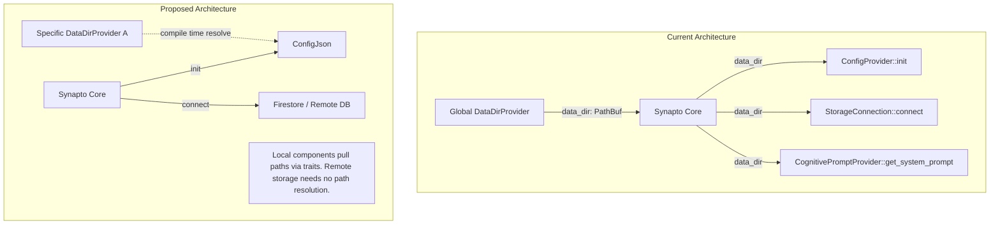

# [DRAFT] Refactor DataDirProvider to Mandatory Trait-Based Strategy

> **Draft Status:** Phase 6 — Drafted (note: Section 5 is combined into Section 4); awaiting Lead Architect review and approval to move to `approved/2026-07-20-data-dir-strategy.md`.
> **Next Step on Resume:** Verify alignment with current `DataDirProvider` in `synapto-interface`, run zero-context subagent review if needed, and seek explicit Phase 6 approval from the Lead Architect.

## 1. User-Centric Motivation & Goal
Developers need explicit control over where components (like configuration, storage, and prompts) read and write their data. Currently, the system uses a single global `DataDirProvider` with a "magic" default behavior. By requiring an explicit, trait-based strategy pattern without any default implementations for every component that touches the filesystem, we eliminate hidden behaviors, making the system predictable, easier to test, and strictly explicit.

## 2. Executive Summary
- **Context:** `Synapto` takes a global `DataDirProvider` generic. This path is implicitly piped into `ConfigProvider::init`, `StorageConnection::connect`, and `CognitivePromptProvider::get_system_prompt`.
- **Motivation:** Implicit global paths create friction, especially in tests or complex environments where different components need distinct paths. A recent workaround added `ConfigPathStrategy` to `ConfigJson`, but with a fallback default.
- **Overarching Goals:** Enforce strict, explicit dependency injection for file system paths. Completely decouple the core from global filesystem assumptions.
- **Purpose:** Standardize path resolution using a mandatory `DataDirProvider` trait (used as a strategy pattern) without default implementations.
- **Problem:** A global `DataDirProvider` tightly couples components to a single base directory. The current `ConfigPathStrategy` introduces mixed explicit/implicit behavior due to its default. Furthermore, the core forces remote providers (like Firestore) to accept a local path parameter they don't need.
- **Solution:** Remove the global `DataDirProvider` from `Synapto` and remove `data_dir` parameters from core interfaces. Keep the `DataDirProvider` trait, but repurpose it as a ubiquitous strategy trait. Components needing path resolution (e.g. local file readers) must explicitly require a provider type parameter. Remote components require nothing.

## 3. Current State Analysis
- `Synapto` accepts `D: DataDirProvider` and uses `D::get_data_dir()` to pass a `PathBuf` to components.
- Interfaces like `ConfigProvider::init(data_dir: PathBuf)`, `StorageConnection::connect(..., data_dir: &Path)`, and `CognitivePromptProvider::get_system_prompt(data_dir: &Path, ...)` currently receive this global path.
- `ConfigJson` recently added `S: ConfigPathStrategy = DataDirStrategy` to override this, but defaults to the global path.
- **Flaws:**
  - **Tight Coupling:** The core assumes a unified "data directory" concept which doesn't fit all use cases.
  - **Irrelevant Context:** Core interfaces (`ConfigProvider`, `StorageConnection`, `CognitivePromptProvider`) force a `data_dir` parameter onto *all* implementations. This is unnecessary for environment variable providers (`Env`), remote config services, remote databases (Postgres, Firestore), or remote/hardcoded prompt providers, none of which use local file paths.
  - **Inverted Control:** Components wait to be told where their data is, rather than explicitly declaring their dependencies via generics.
  - **Implicit Fallbacks:** The use of default generic parameters (`= DataDirStrategy`) hides dependencies and causes accidental usage of the global path.

## 4. Structural Hierarchy
- **Mission:** Explicit File System Dependencies.
- **Goal:** Remove global path assumptions and default generic fallbacks.
- **Atomic Responsibilities:**
  - **Core (`Synapto`):** Orchestrates plugins. Zero knowledge of filesystems.
  - **`DataDirProvider` (Trait):** A generic interface for resolving paths (acting as the strategy).
  - **Components (`ConfigJson`, `FirestoreStorage`, etc.):** Internally define and require an `P: DataDirProvider` if they need file system access, with NO default type.

Imo ## 5. Data Models

### Existing Strategies Migration
Current path resolution implementations like `CurrentDirStrategy` will be renamed to `CurrentDir` and moved to `data_dir.rs`. `EphemeralDir` in `synapto/crates/test/datadir-providers/ephemeral` will remain where it is to avoid pulling `tempfile` dependencies into the production core. Both will implement the refined `DataDirProvider` trait. This allows them to be instantly used as explicit type parameters in any local-storage-dependent component.

### Core Protocol Updates
```rust
// 1. The universal path provider trait (Compile-Time / Static)
pub trait DataDirProvider: Send + Sync + 'static {
    fn get_data_dir() -> std::path::PathBuf;
}

// 2. Core generic parameters (D is removed)
pub struct Synapto<
    C: crate::config::ConfigProvider,
    S: synapto_interface::storage::StorageConnection
        + synapto_interface::storage::KeyValueStore
        + synapto_interface::storage::RecordStore,
    PR: prompt_provider::CognitivePromptProvider = prompt_provider::EmptyPromptProvider,
> { /* ... */ }

// 3. ConfigProvider init interface (no data_dir)
pub trait ConfigProvider: Send + Sync + Sized + 'static {
    fn init() -> Self;
    // ...
}

// 4. StorageConnection connect interface (no data_dir)
pub trait StorageConnection: Send + Sync + Sized + 'static {
    async fn connect(
        config: Self::Config,
        storage_registry: std::sync::Arc<StorageRegistry>,
        plugin_namespace: &str,
    ) -> Result<Self, String>;
}
```

### Static vs. Dynamic Paths
The `DataDirProvider` is explicitly static (`fn get_data_dir()`). This handles compile-time resolution (e.g., standard fallback directories, current directory, or ephemeral temp dirs for testing). For dynamic, user-provided runtime paths (e.g., via CLI or `.env`), components MUST rely on their strongly-typed `Config` struct that is populated during the `init` phase, bypassing the compile-time strategy.

### LLM Payloads & Context
**N/A:** This is an internal dependency injection refactor and does not modify LLM schemas, context inputs, or structured output command payloads.

### Component Implementation Example
```rust
// ConfigJson explicitly requires P without a default
pub struct ConfigJson<P: DataDirProvider> {
    config: serde_json::Value,
    _marker: std::marker::PhantomData<P>,
}

impl<P: DataDirProvider> crate::config::ConfigProvider for ConfigJson<P> {
    fn init() -> Self {
        let base_dir = P::get_data_dir();
        // ... load config.json
    }
}
```

### Shared Bundle Strategy (Type Aliasing)
To prevent verbosity where every component is manually parameterized with the same generic strategy throughout a project, `DataDirProvider` acts as a shared helper. Bundles define their path provider once and use the `type` keyword to create ergonomic, bundle-specific aliases for all local file providers.

```rust
// 1. Define the shared path provider for the bundle
pub struct AppDataDir;
impl DataDirProvider for AppDataDir {
    fn get_data_dir() -> std::path::PathBuf {
        std::path::PathBuf::from("/var/lib/my-app")
    }
}

// 2. Share it across local providers via type aliases
type AppConfig = ConfigJson<AppDataDir>;
type AppPrompts = FilePromptProvider<AppDataDir>;

// 3. Use the clean aliases in the core definition
pub type MyApp = Synapto<AppConfig, FirestoreStorage, AppPrompts>;
```

## 6. Component Architecture
- **Initialization Flow:** When `Synapto::new()` is invoked, it no longer resolves a global `data_dir`. The generic `D: DataDirProvider` is removed from its type signature.
- **Configuration Bootstrapping:** The core iterates over the `PluginTuple` and calls `ConfigProvider::init()` on each provider. Providers that require local file access (like `ConfigJson<P>`) internally invoke `P::get_data_dir()` to locate their specific base directory. Providers that do not require file access (like `Env` or a remote config fetcher) simply initialize themselves without needing any path strategy.
- **Plugin & Storage Instantiation:** During plugin registration and storage connection, the core calls `StorageConnection::connect`. The `data_dir` parameter is removed. Storage implementations that require a local path must either rely on their `Config` (for runtime paths) or be parameterized with an `P: DataDirProvider` (for compile-time paths). Remote providers (e.g., Postgres, Firestore) simply drop the parameter and do not require any strategy trait.
- **Cognitive Prompt Resolution:** Similarly, `CognitivePromptProvider::get_system_prompt` loses its `data_dir` parameter. Implementations that read from the filesystem (e.g., `FilePromptProvider<P>`) will resolve their path via their own generic strategy, while remote or hardcoded prompt providers will not require a path.

## 7. Architectural Diagrams

### Dependency Flow (Before vs. After)



## 8. Robustness & Pragmatic Security Trade-offs
- **Hazard:** Loss of a Single Source of Truth (SSoT) for paths. Because components independently resolve paths, there's a risk they write to disjoint directories.
  - **Accepted Risk (MVP):** We accept this fragmentation. The user is responsible for ensuring that multiple strategies (or configuration overrides) resolve to the same root if they desire unity.
- **Hazard:** Missing directories or permission errors during initialization.
  - **Accepted Risk (MVP):** We will not implement complex protections (e.g., fallback path resolution, robust directory creation permissions, retries on read failures) for this refactoring. It relies on standard unwrap/panics for missing static paths at boot.

## 9. Systemic Consequences
- **Breaking Changes:** This is a major breaking change across the core. `Synapto` instantiation, `ConfigProvider::init`, `StorageConnection::connect`, and `CognitivePromptProvider::get_system_prompt` all change signatures.
- **Dependency Audit:**
  - `synapto/crates/core/src/lib.rs` (Synapto generic signature changes)
  - `synapto/crates/core/src/config/provider.rs` (ConfigProvider trait)
  - `synapto/crates/interface/src/storage.rs` (StorageConnection trait)
  - `synapto/crates/core/src/prompt_provider.rs` (CognitivePromptProvider trait)
  - `synapto/contrib/prompt-providers/file/src/lib.rs`
  - `synapto/contrib/storage-providers/firestore/src/lib.rs`
- **Documentation:** The core `ARCHITECTURE.md` and `provider.md` documentation will need updates to reflect the removal of the global `data_dir` passthrough mechanism.

## 10. Definition of Done (DoD)
- [ ] Keep `DataDirProvider` but update its signature to `fn get_data_dir() -> PathBuf`.
- [ ] Transform `CurrentDirStrategy` in `json.rs` to `CurrentDir` and move it to `synapto/crates/core/src/config/data_dir.rs`. Keep `EphemeralDir` in `datadir-providers/ephemeral` as it is.
- [ ] Remove `D: DataDirProvider` from `Synapto` generic parameters in `lib.rs`.
- [ ] Update `ConfigProvider::init` signature to remove `data_dir`.
- [ ] Update `StorageConnection::connect` signature to remove `data_dir`.
- [ ] Update `CognitivePromptProvider::get_system_prompt` signature to remove `data_dir`.
- [ ] Refactor `ConfigJson` to unconditionally require `P: DataDirProvider` instead of `ConfigPathStrategy`.
- [ ] Refactor `DotEnv` and `Env` providers to match the new `init` signature.
- [ ] Refactor `FilePromptProvider` to accept `P: DataDirProvider`.
- [ ] Refactor `FirestoreStorage` to match the new `connect` signature.
- [ ] Update `provider.md` documentation to remove mentions of global `data_dir` logic.
