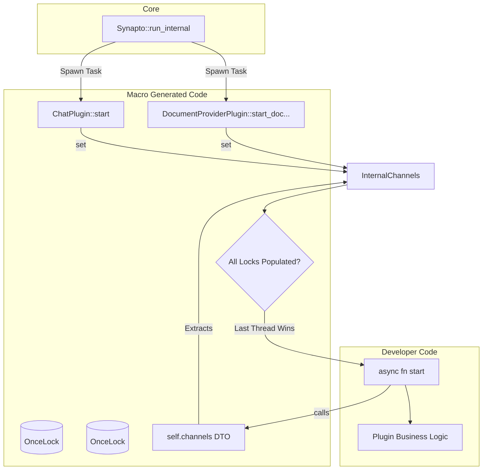

# [DRAFT] RFC: Declarative Plugin Startup Macro

> **Draft Status:** Phase 6 — All 10 sections drafted; awaiting Lead Architect review and approval to move to `approved/2026-07-20-plugin-startup-macro.md`.
> **Next Step on Resume:** Perform Pre-Implementation Recheck against current `PluginRegistry` in `synapto-interface` and seek explicit Phase 6 approval from the Lead Architect.

## 1. User-Centric Motivation & Goal

When developers build complex plugins providing multiple capabilities (e.g., Chat and Document Provisioning), they currently write tedious and error-prone boilerplate to safely collect all necessary communication channels before executing their background tasks. 

The goal of this RFC is to eliminate this boilerplate entirely while preserving the familiar `start` terminology. By providing an attribute macro `#[synapto_plugin]`, developers can declaratively state their capabilities. The macro will automatically generate the required trait implementations, safely gather all channels into a strictly-typed companion struct, and trigger a unified `start` method with zero race conditions.

## 2. Executive Summary

- **Context:** Plugins implementing multiple capabilities receive channels via separate, asynchronous `start` methods from the Core. Because execution order is non-deterministic, plugins currently require a manual `try_start` synchronization barrier with `Arc<Mutex>` logic.
- **Motivation:** Manual synchronization is repetitive, fragile, and pollutes the plugin's business domain with concurrency primitives.
- **Overarching Goals:** Establish a clean, boilerplate-free initialization sequence. Enforce atomic responsibility by hiding the synchronization barrier inside macro-generated code.
- **Purpose:** Introduce a procedural macro that intercepts the Core's asynchronous capability `start` calls, aggregates the channels, and delegates to a unified `start` method written by the developer.
- **Problem:** Writing manual `is_some()` checks across multiple fields and holding a Mutex is a terrible Developer Experience (DX).
- **Solution:** An attribute macro `#[synapto_plugin]` that automatically generates the capability trait implementations, aggregates the channels into a Data Transfer Object (DTO), and safely handles the concurrency barrier.

## 3. Current State Analysis

Presently, developers must manage state manually:
```rust
#[derive(Default)]
struct MyChannels { chat: Option<...>, docs: Option<...> }
pub struct MyPlugin { channels: Arc<Mutex<MyChannels>> }
```
This forces the plugin to act as a concurrency manager, guessing when the Core Orchestrator has finished injecting all channels via `try_start()`. If a new capability is added but the barrier isn't updated, the plugin deadlocks silently.

## 4. Structural Hierarchy

- **Core Orchestrator (`Synapto::run_internal`):**
  - **Constraints:** Unchanged. It continues to concurrently call the asynchronous `start` methods defined by the capability traits.
- **`synapto-derive` (Macro Layer):**
  - **Constraints:** Must encapsulate the concurrency barrier (e.g., an atomic counter or hidden Mutex) to prevent race conditions when multiple `start` methods are called simultaneously.
  - **Atomic Responsibility:** Generating the capability traits, extracting channels into a clean DTO, and invoking the developer's unified `start` method.

## 5. Data Models (Developer Experience)

The developer experience becomes declarative and strictly typed, while preserving total freedom to initialize custom fields explicitly via `#[plugin_custom]`.

```rust
use synapto_derive::synapto_plugin;

#[synapto_plugin(chat, document_provider)]
pub struct GoogleChatPlugin<S: StorageConnection> {
    // Auto-initialized via `context.config()?`
    #[plugin_config]
    config: GoogleChatConfig,
    
    // Auto-initialized via `context.store::<S>().await?`
    #[plugin_store]
    store: Arc<S>,
    
    // Explicitly delegates custom initialization to a user-defined struct.
    #[plugin_custom]
    custom: GoogleChatCustomState<S>,
}

// The developer defines their custom state explicitly.
// If generic types like `S` are needed from the plugin, the custom struct must carry them.
pub struct GoogleChatCustomState<S: StorageConnection> {
    pub custom_client: reqwest::Client,
    _marker: std::marker::PhantomData<S>, // Only needed if S isn't used directly here
}

```rust
// The custom initializer receives a universal, strictly typed proxy context 
// containing the pre-initialized dependencies for this plugin.
// It acts as a wrapper around the original PluginContext to hide low-level internals.
#[async_trait]
pub trait CustomPluginState<C, S: StorageConnection>: Sized {
    async fn init(context: &synapto_interface::plugin::PluginInitContext<'_, C, S>) -> Result<Self, String>;
}

#[async_trait]
impl<S: StorageConnection> CustomPluginState<GoogleChatConfig, S> for GoogleChatCustomState<S> {
    async fn init(
        context: &synapto_interface::plugin::PluginInitContext<'_, GoogleChatConfig, S>
    ) -> Result<Self, String> {
        Ok(Self {
            custom_client: reqwest::Client::new(),
            _marker: std::marker::PhantomData,
        })
    }
}

impl<S: StorageConnection> GoogleChatPlugin<S> {
    // The developer only writes this unified start method!
    async fn start(&self) -> Result<(), String> {
        let channels = self.channels(); 

        tokio::spawn(read_from_chat_task(
            self.config.clone(),
            self.store.clone(), 
            self.custom.custom_client.clone(), // Accessed directly via the defined field
            channels.chat.peer_input_tx.clone(), 
            channels.docs.add_document_tx.clone()
        ));
        
        Ok(())
    }
}
```

### What the Macro Generates

The macro parses the field attributes to generate the hidden state container, the extracted DTO, the trait implementations, and the `Plugin::register` method:

```rust
// The Final Plugin Struct
pub struct GoogleChatPlugin<S: StorageConnection> {
    pub config: GoogleChatConfig,
    pub store: Arc<S>,
    pub custom: GoogleChatCustomState<S>,
    pub(crate) __channels: GoogleChatPluginChannelsInternal,
}

// ... Channels and State structures omitted for brevity ...

// The Auto-Generated Core Plugin Trait (create & register)
#[async_trait]
impl<S: StorageConnection> Plugin for GoogleChatPlugin<S> {
    async fn create(context: PluginContext) -> Result<Self, String> {
        // Auto-generated initializations
        let config: GoogleChatConfig = context.config()?;
        let store = Arc::new(context.store::<S>().await?);
        let llm_executor = context.llm_executor();
        
        // The universal init context struct defined in `synapto_interface`
        // restricts the API surface to prevent exposing low-level internals
        let init_context = synapto_interface::plugin::PluginInitContext {
            config: &config,
            store: &store,
            llm_executor,
        };
        
        // Delegates to the explicitly typed Custom struct initializer
        let custom = GoogleChatCustomState::init(&init_context).await?;
        
        Ok(Self {
            config,
            store,
            custom,
            __channels: GoogleChatPluginChannelsInternal::new(),
        })
    }

    fn register<R: PluginRegistry + ?Sized>(self: std::sync::Arc<Self>, registry: &mut R) {
        registry.register_chat(self.clone());
        registry.register_document_provider(self.clone());
    }
}
```

## 6. Component Architecture

### The Universal `PluginInitContext`
To ensure a uniform developer experience across all plugins and hide low-level internals, `synapto_interface::plugin` will expose a universal generic proxy struct. This satisfies the requirement of having a single specific constructor context for all cases while keeping the API surface minimal:

```rust
pub struct PluginInitContext<'a, C, S: StorageConnection> {
    pub config: &'a C,
    pub store: &'a Arc<S>,
    pub llm_executor: Arc<dyn crate::llm::LlmExecutor>,
}
```

### The Extraction Method & Concurrency Barrier
impl<S: StorageConnection> GoogleChatPlugin<S> {
    pub fn channels(&self) -> GoogleChatPluginChannels {
        GoogleChatPluginChannels {
            chat: self.__channels.chat.get().expect("Chat missing").clone(),
            docs: self.__channels.docs.get().expect("Docs missing").clone(),
        }
    }
    
    // Hidden concurrency barrier
    async fn __generated_try_start_barrier(&self) -> Result<(), String> {
        // N is the number of capabilities declared in the attribute macro
        // For GoogleChatPlugin, N = 2. The threshold is N - 1 (1).
        if self.__channels.barrier.fetch_add(1, std::sync::atomic::Ordering::SeqCst) == 1 {
            self.start().await
        } else {
            Ok(())
        }
    }
}

### The Capability Implementations
```rust
#[async_trait]
impl<S: StorageConnection> ChatPlugin for GoogleChatPlugin<S> {
    async fn start(&self, tx: mpsc::Sender<...>, rx: ...) -> Result<(), String> {
        let _ = self.__channels.chat.set(ChatPluginChannels { tx, rx });
        self.__generated_try_start_barrier().await
    }
}

#[async_trait]
impl<S: StorageConnection> DocumentProviderPlugin for GoogleChatPlugin<S> {
    async fn start_document_provider(&self, tx: mpsc::Sender<...>) -> Result<(), String> {
        let _ = self.__channels.docs.set(DocumentProviderPluginChannels { tx });
        self.__generated_try_start_barrier().await
    }
}
```

### Execution Flow
1. Developer annotates fields with `#[capability(...)]`.
2. Core invokes `ChatPlugin::start` and `DocumentProviderPlugin::start_document_provider` concurrently.
3. The macro-generated trait methods populate their respective `OnceLock`s.
4. Each trait method calls the hidden `__generated_try_start_barrier`.
5. The barrier safely counts the initialized locks. The final arriving thread triggers the developer's unified `start(&self)` method.
6. The developer's `start` method safely extracts all channels via `self.channels()` without any `Option` unwrapping.

## 7. Architectural Diagrams



## 8. Robustness & Pragmatic Security Trade-offs

- **Hazard: Race Conditions on the Barrier.** If `ChatPlugin::start` and `DocumentProvider::start` execute concurrently, a naive `is_some() && is_some()` check could fail if both threads read the other's lock before it is written.
  - **Mitigation:** The macro must generate a thread-safe counting mechanism (e.g., an internal `tokio::sync::Mutex<usize>` or an `AtomicUsize`) to guarantee the user's `start` method is called exactly once. The barrier threshold must be dynamically calculated by the macro based on the number of capabilities declared (i.e. `== N - 1`).
- **Hazard: Core Orchestrator Deadlock.** If the Core Orchestrator fails to execute all of the `start` calls (e.g., due to an upstream channel failure or panic), the plugin's barrier will never reach the threshold. The user's `start` method will never be called, resulting in a silent deadlock for the plugin.
  - **Accepted Risk:** As an MVP, adding complex timeout mechanisms or Drop Guards is deferred. This deadlock scenario is accepted for the initial implementation, with the assumption that the Core is reliable. Future work may introduce a timeout.
- **Hazard: Macro Debugging.** Hidden control flow can be difficult for newcomers to debug.
  - **Accepted Risk:** The DX improvements of strongly-typed channel extraction and zero boilerplate vastly outweigh the abstraction cost.

## 9. Systemic Consequences

- **Breaking Changes:** None. This does not require changes to `Synapto::run_internal`. Existing plugins can continue to manually implement capability traits if they choose to bypass the macro.
- **Ecosystem:** Drastically lowers the barrier to entry for authoring plugins. `self.channels()` becomes the universal standard for accessing system context.

## 10. Definition of Done (DoD)

- [ ] Create `#[synapto_plugin]` procedural attribute macro in `synapto-derive`.
- [ ] Implement struct splitting logic to extract non-tagged fields into a `<PluginName>Custom` struct or delegate them to a `CustomPluginState::init` implementation.
- [ ] Define standard `*PluginChannels` structs in `synapto_interface` (e.g., `ChatPluginChannels`).
- [ ] Generate the `OnceLock` population logic for each supported `#[capability(...)]`.
- [ ] Generate the hidden thread-safe barrier ensuring exact-once execution of `self.start()`.
- [ ] Generate the `*PluginChannels` IoC struct and the `self.channels()` accessor.
- [ ] Refactor `GoogleChatPlugin` to utilize the macro, confirming successful compilation and execution.
- [ ] **Documentation Update (`CREATE_PLUGIN.md`)**: Expand the plugin creation documentation to cover both the declarative macro approach and the manual approach.
  - Document the "Simple (Macro) Way", explicitly detailing how it streamlines plugin creation by automatically generating the necessary boilerplate and synchronization logic.
  - Document the "Hard (Manual) Way" for developers who need complete control (or want to avoid macro abstractions). This must demonstrate the current best practice that powers the macro: using `std::sync::OnceLock` and an atomic counter (`AtomicUsize`) as a safe, lock-free synchronization barrier, replacing any legacy `Arc<Mutex>` logic.