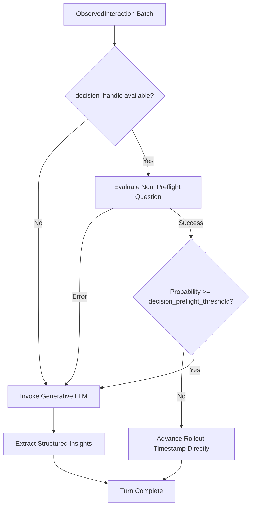
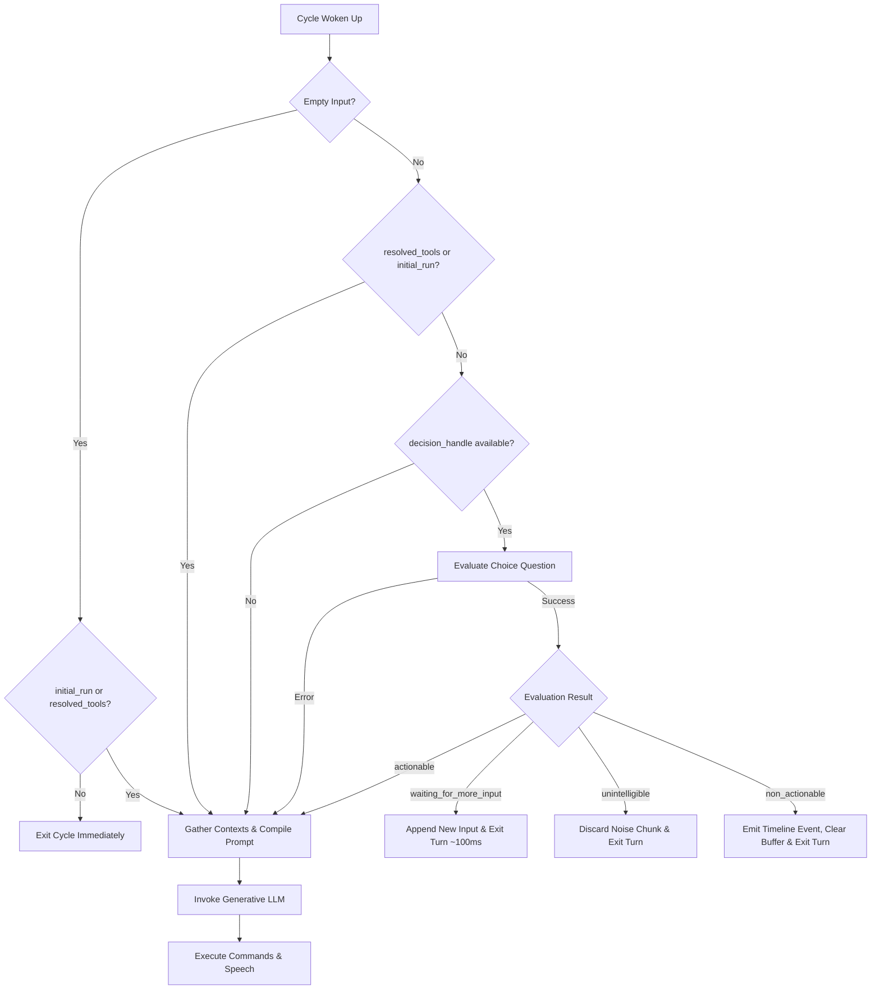

# [MVP] [DRAFT] Integration Roadmap for Decision Executor: Background Preflight Gating and Cognitive Turn Gating

> **Draft Status:** Phase 6 — All 10 sections drafted; awaiting Lead Architect review and approval to move to `approved/2026-09-19-decision-integration-phases.md`.
> **Next Step on Resume:** Perform Pre-Implementation Recheck (note: Phase 2 preflight gating in `behavioral-memory` and `semantic-memory` is partially present) and seek explicit Phase 6 approval for remaining Phase 3 items.

## 1. User-Centric Motivation & Goal
Users and operators want fast, cost-efficient, and responsive conversational assistants. Currently, the system invokes large generative Large Language Models (LLMs) on every background interaction event and every incoming speech chunk. Most background interactions contain no new user habits or factual updates. Similarly, users frequently pause, hesitate, or make noise when speaking.

Executing full multi-second generative LLM calls on empty interactions or incomplete speech wastes tokens and creates sluggish user experiences. By using the low-latency Decision Subsystem (`DecisionHandle`), the assistant can:
1. Check if background interactions contain relevant information before starting heavy extraction prompts.
2. Quickly determine whether the user is still speaking or pausing before compiling expensive generative conversational context.

## 2. Executive Summary
- **Context:** Synapto has implemented the Decision Subsystem (`DecisionHandle`, `RawDecisionExecutor`, `TypeSafeDecision`) and replaced the generative LLM in `task-memory`.
- **Motivation:** Background plugins (`behavioral-memory`, `semantic-memory`) and real-time cognitive loops (`direct.rs`, `side.rs`) still invoke generative LLMs on routine, empty, or incomplete turns.
- **Overarching Goals:** Systematically expand `DecisionHandle` across Synapto in two planned phases: Phase 2 (Preflight Gating in Background Plugins) and Phase 3 (Cognitive Loop Turn Gating).
- **Purpose:** Document the architectural design, evaluation criteria, and execution paths for the two remaining integration areas without introducing unconsidered mechanisms.
- **Problem:**
  - `behavioral-memory` calls a generative LLM on every interaction even though over 85% of turns contain no user habits or preferences.
  - `semantic-memory` serializes large active-insight contexts to a generative LLM on routine conversational turns.
  - `synapto-core::cognitive` compiles complete multi-tier contexts and tool schemas only to discover the user paused mid-sentence (`WaitingForMoreInput`) or made noise (`Unintelligible`).
- **Solution:**
  - **Phase 2 (Preflight Gating):** Add `NoulQuestion` preflight checks to `behavioral-memory` and `semantic-memory`. If probability is below configured `decision_preflight_threshold`, skip generative LLM calls and advance memory rollouts directly.
  - **Phase 3 (Cognitive Turn Gating):** Add a `ChoiceQuestion` gate in `synapto-core::cognitive` before context compilation. Quickly detect `waiting_for_more_input` and `unintelligible` speech, buffering or discarding input in ~100ms without calling generative models. Bypass turn gating when tools have resolved or on initial startup triggers.

## 3. Current State Analysis
- **`behavioral-memory` Execution Flow:**
  - Receives `ObservedInteraction` stream in `behavioral_insight_memory_task`.
  - On every interaction batch, calls `BehavioralInsightLLMPrompt` (generative LLM) with `BehavioralInsightLLMContent`.
  - In most conversational turns, `new_insights` is empty, and the rollout timestamp simply advances.
- **`semantic-memory` Execution Flow:**
  - Receives `ObservedInteraction` stream in `insight_memory_task`.
  - On every interaction batch, sends full `current_active_insights` and `active_activities` to `InsightLLMPrompt`.
  - Generative model evaluates whether to create or obsolete domain insights.
- **`synapto-core::cognitive` Execution Flow:**
  - Receives speech in `cognitive_direct_task` or text in `cognitive_side_task`.
  - Gathers historical, current, and prospective contexts from all registered context plugins.
  - Serializes dynamic tool schemas and dynamic instructions.
  - Invokes generative LLM.
  - Generative output contains `users_messages_evaluation`:
    - `Actionable`: Executes side effects and commands.
    - `WaitingForMoreInput`: Buffers messages and exits cycle without speaking or acting.
    - `Unintelligible`: Drops input and exits cycle without speaking or acting.
    - `NonActionable`: Exits cycle without speaking.
  - Significant compute, latency, and tokens are expended only to determine that no response was needed.

## 4. Structural Hierarchy
- **Mission:** Cost-Efficient, Low-Latency Cognitive Execution via Stepwise Decision Gating.
- **Goal:** Outline the two successive phases of decision executor integration across memory plugins and the core cognitive cycle.
- **Atomic Responsibilities:**
  - **Phase 2 - Background Preflight Gating:**
    - `BehavioralMemoryPlugin` (`integrations/plugins/behavioral-memory`): Evaluates presence of behavioral habits via `NoulQuestion`.
    - `SemanticMemoryPlugin` (`integrations/plugins/semantic-memory`): Evaluates presence of activity updates or factual notes in `insight_memory_task` via `NoulQuestion`.
  - **Phase 3 - Cognitive Loop Turn Gating:**
    - `synapto-core::cognitive::direct` (`crates/core/src/cognitive/direct.rs`): Pre-evaluates speech completeness via `ChoiceQuestion` before context compilation.
    - `synapto-core::cognitive::side` (`crates/core/src/cognitive/side.rs`): Pre-evaluates text actionability via `ChoiceQuestion`.
    - `synapto-core::cognitive::processor` (`crates/core/src/cognitive/processor.rs`): Handles immediate buffering on `waiting_for_more_input`.

## 5. Data Models

### 5.1 Behavioral Preflight Contract (Phase 2)
```rust
use synapto_interface::decision::NoulQuestion;

pub fn generate_behavioral_preflight_question() -> NoulQuestion {
    NoulQuestion {
        instructions: "Does this interaction reveal any user habit, behavioral pattern, personal preference, or constraint?".to_string(),
        criteria: Some(synapto_interface::decision::NoulCriteria {
            r#true: "The user expressed a personal habit, routine, explicit preference, or operational rule.".to_string(),
            r#false: "Routine conversational exchange, question, task command, or general chatter.".to_string(),
        }),
    }
}
```
**State Schema:**
```json
{
  "interactions": [
    {
      "timestamp": 1726740000,
      "interaction": {
        "user_messages": [
          { "Speech": { "speaker": "User", "transcript": "I always drink green tea at 4pm." } }
        ],
        "cognitive_spoken": null,
        "cognitive_reasoning": null
      }
    }
  ]
}
```

### 5.2 Semantic Preflight Contract (Phase 2)
```rust
use synapto_interface::decision::NoulQuestion;

pub fn generate_semantic_preflight_question() -> NoulQuestion {
    NoulQuestion {
        instructions: "Does this interaction reveal any user activity, ongoing project, domain fact, or status change?".to_string(),
        criteria: Some(synapto_interface::decision::NoulCriteria {
            r#true: "Contains factual domain information, project status updates, or new entity data.".to_string(),
            r#false: "No factual knowledge, activity progression, or domain updates present.".to_string(),
        }),
    }
}
```
**State Schema:**
```json
{
  "interactions": [
    {
      "timestamp": 1726740000,
      "interaction": {
        "user_messages": [
          { "Text": { "sender": "User", "text": "Project Apollo is now in testing phase." } }
        ],
        "cognitive_spoken": null,
        "cognitive_reasoning": null
      }
    }
  ]
}
```

### 5.3 Cognitive Turn Evaluation Contract (Phase 3)
```rust
use std::collections::BTreeMap;
use synapto_interface::decision::ChoiceQuestion;

pub fn generate_turn_evaluation_question() -> ChoiceQuestion {
    let mut criteria = BTreeMap::new();
    criteria.insert("actionable".to_string(), "Clear, complete, and actionable command or question requiring an answer.".to_string());
    criteria.insert("waiting_for_more_input".to_string(), "Incomplete thought, mid-sentence pause, trailing sentence, or user is hesitating.".to_string());
    criteria.insert("non_actionable".to_string(), "Ambient speech, background chatter, self-talk, or conversation not addressed to assistant.".to_string());
    criteria.insert("unintelligible".to_string(), "Audio noise, cough, mumbles, audio cut-offs, or unrecognizable language.".to_string());

    ChoiceQuestion {
        instructions: "Evaluate the user input in relation to the current conversational turn:".to_string(),
        criteria,
    }
}
```
**State Schema:**
```json
{
  "active_messages": [
    { "Speech": { "speaker": "User", "transcript": "Can you check if..." } }
  ],
  "recent_interactions": [
    {
      "peer_input": "Hello",
      "cognitive_reasoning": "User greeted",
      "cognitive_output": "Hello! How can I help you today?"
    }
  ]
}
```

## 6. Component Architecture & Execution Flow

### 6.1 Phase 2: Background Memory Preflight Flow
1. Interaction stream arrives at `behavioral_insight_memory_task` or `insight_memory_task`.
2. Plugin checks `decision_handle.is_available()`:
   - **If Available:**
     1. Construct `NoulQuestion` using `generate_behavioral_preflight_question()` or `generate_semantic_preflight_question()`.
     2. Insert question into map under standard key `"preflight"`: `questions.insert("preflight".to_string(), DecisionQuestion::Noul(question))`.
     3. Format `state = serde_json::json!({ "interactions": new_interactions })`.
     4. Call `decision_handle.evaluate(None, state, questions).await`.
     5. On error, conservatively fall back to generative LLM (`prob = 1.0`).
     6. Extract probability:
        ```rust
        let prob = match answers.get("preflight") {
            Some(DecisionAnswer::Noul { noul }) => *noul,
            _ => 1.0,
        };
        ```
     7. If `prob < config.decision_preflight_threshold`:
        - Skip generative LLM invocation.
        - Advance rollout timestamp (`rollout_tx.send(last_interaction_in_batch.timestamp)`).
        - Complete turn immediately.
     8. If `prob >= config.decision_preflight_threshold`:
        - Invoke existing generative LLM prompt.
   - **If Unavailable:**
     - Execute existing generative LLM prompt directly.

### 6.2 Phase 3: Cognitive Loop Turn Gating Flow
1. Engine awakes in `cognitive_direct_task` or `cognitive_side_task`.
2. **Mandatory Gating Bypass Check:**
   - If `current_messages.is_empty()`:
     - If `initial_cognitive_trigger || has_resolved_tools`, proceed to Step 4 (Generative Context Compilation).
     - Otherwise, exit the cycle immediately (no-op wake-up, return/continue loop).
   - If `initial_cognitive_trigger == true` (assistant startup greeting) or `has_resolved_tools == true` (asynchronous tool completion), proceed directly to Step 4.
3. **Turn Gating Evaluation:**
   If `decision_handle.is_available()`:
   - Format `state` with `active_messages` (pending + new) and `recent_interactions`.
   - Call `decision_handle.evaluate(None, state, questions).await`.
   - Map choice string to `UsersMessagesEvaluation`:
     - `WaitingForMoreInput`: Append only `new_speech_messages` to `pending_user_messages` (preventing duplication), log wait, invoke `processor.on_cycle_finished()`, and exit cycle immediately (~100ms).
     - `Unintelligible`: Keep `pending_user_messages` intact (allowing retry), discard only incoming noise, notify `processor.on_unintelligible_input()`, invoke `processor.on_cycle_finished()`, and exit cycle immediately.
     - `NonActionable`: Emit non-actionable interaction to `new_interaction_tx` to preserve ambient timeline, execute `pending_user_messages.clear()`, invoke `processor.on_cycle_finished()`, and exit cycle without speaking.
     - `Actionable`: Proceed to Step 4.
   - On error: Log warning and fall back directly to Step 4.
4. Gather historical, current, and prospective contexts.
5. Evaluate dynamic tools and assemble prompt.
6. Invoke primary generative LLM for response and command execution.

## 7. Architectural Diagrams

### 7.1 Phase 2: Preflight Gating in Memory Plugins


### 7.2 Phase 3: Cognitive Loop Turn Gating


## 8. Robustness & Pragmatic Security Trade-offs

### 8.1 Hazard Analysis
- **Hazard 1: Dropping Resolved Tools:**
  If turn gating ran on tool wake-ups, empty speech input would drop the tool completion.
  - *Mitigation:* Explicit bypass check `if has_resolved_tools { bypass_gating }`.
- **Hazard 2: Suppressing Startup Greetings:**
  On startup, the assistant speaks without prior user input.
  - *Mitigation:* Explicit bypass check `if initial_cognitive_trigger { bypass_gating }`.
- **Hazard 3: Empty Message Wake-ups Calling LLM:**
  False-positive VAD wake-ups with no user input could trigger empty generative LLM calls.
  - *Mitigation:* If `current_messages.is_empty()` and no tool/startup flag is active, cycle exits immediately.
- **Hazard 4: Decision Backend Downtime:**
  If the decision backend fails or times out.
  - *Mitigation:* Automatic fallback to generative LLM execution path on error.

### 8.2 Accepted Risks (MVP Scope)
1. **Static Preflight Thresholds:** Plugin-level explicit config threshold (`decision_preflight_threshold: f64`, default `0.5`) rather than dynamic per-user bayesian adaptation.
2. **Context-Free Background Preflight:** Preflight gating evaluates only the incoming interaction batch without loading historical records from `RecordStore`.
3. **Absence of Dedicated Gate Timeout / Drop Guard:** Gating relies on the underlying client timeout. On error, immediate fallback to generative LLM occurs without retries or exponential backoff.
4. **Cold-Start False Negatives:** If preflight gating misclassifies subtle behavioral cues as routine chatter, the interaction is skipped without background insight extraction.

## 9. Systemic Consequences

### 9.1 Affected Modules
- **Phase 2 Modules:**
  - `synapto-ai/synapto/integrations/plugins/behavioral-memory/src/lib.rs` & `plugin.rs`
  - `synapto-ai/synapto/integrations/plugins/semantic-memory/src/lib.rs` & `plugin.rs`
- **Phase 3 Modules:**
  - `synapto-ai/synapto/crates/core/src/cognitive/mod.rs` & `start` signature
  - `synapto-ai/synapto/crates/core/src/cognitive/direct.rs`
  - `synapto-ai/synapto/crates/core/src/cognitive/side.rs`
  - `synapto-ai/synapto/crates/core/src/cognitive/processor.rs`
  - `synapto-ai/synapto/crates/core/src/lib.rs` (`run_internal`)

### 9.2 Performance Impact
- **Phase 2:** Eliminates 80–90% of background generative LLM requests during normal conversation.
- **Phase 3:** Decreases speech hesitation response time from 2000–4000ms to ~100ms.

## 10. Definition of Done (DoD)

### Phase 2: Memory Preflight Gating
- [x] Add `decision_preflight_threshold: f64` with default `0.5` to `BehavioralMemoryConfig` and `SemanticMemoryConfig`.
- [x] Inject `context.decision_handle()` into `BehavioralMemoryPlugin` and `SemanticMemoryPlugin`.
- [x] Implement `generate_behavioral_preflight_question` and preflight gating in `behavioral_insight_memory_task`.
- [x] Implement `generate_semantic_preflight_question` and preflight gating in `insight_memory_task`.
- [x] Add unit tests verifying preflight bypass when probability < `decision_preflight_threshold`.
- [x] Verify compilation with `cargo check --workspace` and run scenario tests.

### Phase 3: Cognitive Loop Turn Gating
- [x] Forward `self.decision_handle` from `Synapto::run_internal` to `cognitive::start`, `cognitive_direct_task`, and `cognitive_side_task`.
- [x] Add `generate_turn_evaluation_question` in `synapto-core::cognitive`.
- [x] Implement bypass checks (`initial_cognitive_trigger`, `has_resolved_tools`, `current_messages.is_empty()`).
- [x] Integrate turn gating in `cognitive_direct_task` and `cognitive_side_task` with proper buffer hygiene.
- [x] Handle fast exit on `WaitingForMoreInput` and `Unintelligible`.
- [x] Add unit and scenario tests for turn gating decisions.
- [x] Verify compilation with `cargo check --workspace` and test cognitive interactions.
