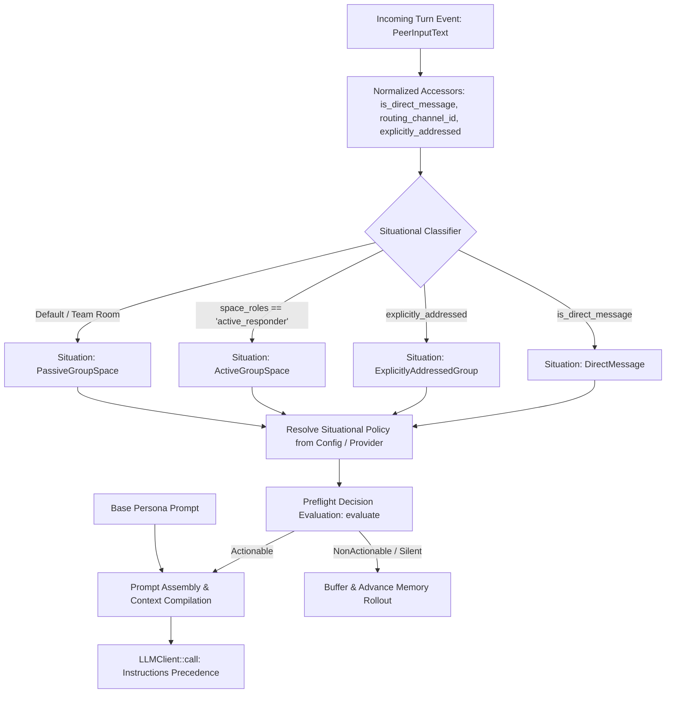
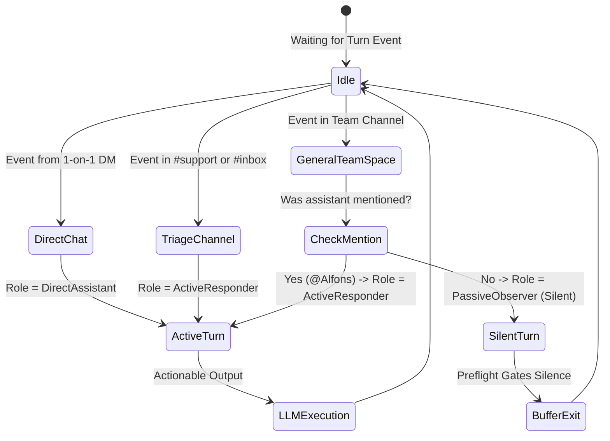

# [MVP] [DRAFT] Contextual Prompt Roles & Situational Prompt Routing for Synapto

> **Draft Status:** Phase 6 — All 10 sections drafted; awaiting Lead Architect review and approval to move to `approved/2026-09-25-contextual-prompt-roles.md`.
> **Next Step on Resume:** Perform Pre-Implementation Recheck and seek explicit Phase 6 approval from the Lead Architect.

## 1. User-Centric Motivation & Goal

Users interact with an organizational assistant across different communication spaces: personal direct messages (1:1 DMs), collaborative team channels, high-volume customer support or lead inboxes, and live voice meetings. 

Currently, the assistant uses a single global system prompt across all interactions. If configured as a quiet observer ("Fly on the Wall"), it ignores incoming messages in dedicated support channels where immediate answers are required. Conversely, if configured as an active conversationalist, it spams busy team rooms with unsolicited chatter. 

Users need the assistant to adapt its behavior automatically to the conversational context:
1. **Immediate Responder:** In designated support, triage, or customer inquiry channels, it acts immediately upon message arrival to answer questions and draft email replies.
2. **Personal Wingman:** In 1:1 direct messages, it converses directly, helpfully, and without requiring users to repeat its name.
3. **Passive Observer ("Fly on the Wall"):** In general team discussion rooms and voice meetings, it stays completely silent until explicitly summoned by name or direct mention (`@mention`).

---

## 2. Executive Summary

- **Context:** Synapto provides a compile-time prompt provider abstraction (`CognitivePromptProvider`) registered via `.prompt::<P>()` on the fluent bundle builder. At boot time, `get_system_prompt` generates a fixed `Vec<Instruction>` provided to `LLMClient::new`. During cognitive turns, `get_dynamic_instructions` injects per-turn instructions. Before calling the generative LLM, `synapto-core::cognitive` evaluates a preflight decision gate (`decision_handle.evaluate`) using the system prompt to determine if input is actionable.
- **Motivation:** `org-assistant` hardcodes a single monolithic `PROMPT.md` enforcing the "Fly on the Wall" silence rule globally. The assistant cannot adopt different operational roles (such as active triage in email forwarding channels versus silent observation in team brainstorming channels).
- **Overarching Goals:** Introduce situational role awareness into the Synapto prompt subsystem and preflight decision gates. Enable bundles and operators to configure distinct behavioral prompts based on deterministic situational metadata (channel type, channel ID, explicit invocation flags, and input modality).
- **Purpose:** Define the data models, situational classifier, decision gate integration, and prompt provider interface extensions for Phase 1 (deterministic situations) without breaking existing bundles.
- **Problem:**
  - `CognitivePromptProvider::get_system_prompt` is static at application boot.
  - The preflight decision engine in `side.rs` and `direct.rs` evaluates input actionability using this static boot prompt. If the boot prompt commands silence, unmentioned messages in active triage spaces are classified as `NonActionable` and dropped before `LLMClient::call` is ever reached.
  - The cognitive loop (`crates/core/src/cognitive/side.rs` and `direct.rs`) passes a static system prompt to the LLM executor, preventing per-turn role modulation.
  - In `google-chat/src/read.rs`, the `is_dm` flag is computed but never serialized into `MessageChannel.context`, preventing deterministic DM detection in core.
  - `synapto-core::config::Config` enforces `#[serde(deny_unknown_fields)]`, so adding role configurations under `"prompt"` conflicts with existing prompt providers such as `EmbeddedPromptConfig`.
- **Solution:**
  - Introduce `CognitiveSituation` enum representing deterministic interaction contexts (`DirectMessage`, `ExplicitlyAddressedGroup`, `ActiveGroupSpace`, `PassiveGroupSpace`, `VoiceMeeting`, `SystemAutonomous`).
  - Adopt **Option A (Layered Composition)**: Combine a constant Base Persona Layer (name, core values, architectural tone, tool safety) with a turn-specific Situational Policy Layer.
  - Strip situational silence rules from the static boot prompt, reserving them exclusively for the Situational Policy Layer.
  - Add top-level `prompt_routing: Option<PromptRoutingConfig>` to `Config` with `#[serde(default)]` in `synapto-core::config`.
  - Update `synapto-plugin-google-chat` to serialize `"is_direct_message": is_dm` into `channel.context`.
  - Integrate situational classification **before** the preflight decision gate in `side.rs` and `direct.rs`, ensuring the decision engine evaluates actionability against the active situational identity.
  - Prepend resolved situational instructions to `instructions` in `LLMClient::call`, keeping `LLMClient` unchanged while giving situational rules precedence under `[CRITICAL RULES]`.

---

## 3. Current State Analysis

### 3.1 Cognitive Prompt Initialization Flow
Currently, in `synapto-core::cognitive` (`crates/core/src/cognitive.rs`):
```rust
fn get_cognitive_system_prompt<P: CognitivePromptProvider>(config: &Config) -> Vec<Instruction> {
    let mut instructions = Vec::new();
    instructions.push(Instruction::Text(format!(
        "Speak in a way that a {} can understand.",
        config.audience
    )));
    let prompt_config: P::Config = serde_json::from_value(config.prompt.clone()).unwrap_or_default();
    let prompt_content = P::get_system_prompt(&prompt_config);
    instructions.extend(prompt_content);
    instructions
}
```
This function executes **once** during `cognitive_task` startup. The resulting `Vec<Instruction>` is passed to `LLMClient::new` and remains immutable for the entire lifetime of the process.

### 3.2 Preflight Decision Gate & Turn Execution Flow
In `crates/core/src/cognitive/side.rs:309-365`:
```rust
let state = serde_json::json!({
    "system_prompt": rendered_system_prompt,
    "contexts": { ... },
    "active_messages": current_messages,
    "recent_interactions": recent_interactions,
});
let eval_result = decision_handle.evaluate(None, state, questions).await;
if eval_result.users_messages_evaluation == UsersMessagesEvaluation::NonActionable {
    pending_user_messages.extend(new_messages);
    new_interaction_tx.send(interaction).await;
    pending_user_messages.clear();
    continue; // HALT: Generative LLM is never called
}
```
Because `rendered_system_prompt` contains the static "Fly on the Wall" silence rule, the decision engine evaluates any unmentioned message as `NonActionable`, terminating the cycle before `llm_client.call` is invoked.

### 3.3 Turn LLM Invocation
In `crates/core/src/cognitive/side.rs:430`:
```rust
let generated_text_result = llm_client
    .call(
        content,
        Some(dynamic_instructions).filter(|v| !v.is_empty()),
        None, // override_reasoning_effort
        resolved_tools.clone(),
        Some(dynamic_tools),
        request,
    )
    .await;
```
`LLMClient::call` passes `&self.system_prompt` to `execute_internal`. `dynamic_instructions` are rendered into the **user prompt body** (`# Instructions: [CRITICAL RULES]`). If `self.system_prompt` still commands silence while dynamic instructions command action, the model receives contradictory instructions.

### 3.4 Flaws Identified
1. **Silent Decision Gate Drop:** Preflight evaluation against static prompts drops inbound triage messages before generative execution.
2. **Instruction Conflict:** Static system prompt and dynamic turn instructions can contradict each other.
3. **Missing DM Metadata in Chat Plugin:** `google-chat/src/read.rs` calculates `is_dm` but omits it from `channel.context`.
4. **Configuration Collision:** Adding structured objects under `config.prompt` breaks existing providers like `EmbeddedPromptConfig` that use `#[serde(flatten)] BTreeMap<String, String>`.

---

## 4. Structural Hierarchy

- **Mission:** Context-Aware Cognitive Roles and Dynamic Prompt Routing.
- **Goal:** Enable Synapto bundles to dynamically modulate cognitive system prompts based on deterministic turn context.
- **Architectural Constraints (per `synapto/docs/src/ARCHITECTURE.md`):**
  - **Rule 6 (Strict LLM I/O Boundaries `!LLMSafe`):** Internal routing state and raw channel contexts must not be passed to the LLM as unstructured strings. Only sanitized instruction models and compiled view models may be serialized.
  - **Rule 7 & 8 (Strict Separation of I/O and Processing & Direct Channel Coupling):** Channel context remains opaque to the core engine; routing classifiers inspect normalized accessors on `PeerInputText` (`is_direct_message`, `routing_channel_id`, `explicitly_addressed`).
  - **Rule 30 (Pluggable Decision Subsystem):** The preflight decision gate must evaluate against the active situational identity to prevent premature turn drops.
  - **Rule 31 (Fluent Bundle Builder):** Prompt providers remain pluggable singletons registered via `.prompt::<P>()`. All trait methods remain associated functions (`fn ...` without `&self`).
  - **Rule 32 (Subsystem Configuration Domain Isolation):** Role configuration belongs strictly within its own configuration domain (`prompt_routing`), never inside `"plugins"` or colliding with flat prompt variables.
- **Atomic Responsibilities:**
  - **`CognitiveSituation` (Classification Layer):** Classifies the incoming turn into a discrete situational context.
  - **`SituationalPromptProvider` (Prompt Layer):** Resolves the appropriate system instructions for the determined situation using Option A (Layered Composition).
  - **`CognitiveSideTask` / `CognitiveDirectTask` (Execution Layer):** Supplies the turn context to the prompt resolver, feeds situational instructions to the decision gate, and renders them into `LLMClient`.

---

## 5. Data Models

### 5.1 Situational Context Enum
In `synapto-interface::cognitive`:
```rust
use serde::{Deserialize, Serialize};

/// Deterministic conversational situation for the active turn.
#[derive(Debug, Clone, Copy, PartialEq, Eq, Hash, Serialize, Deserialize)]
#[serde(rename_all = "snake_case")]
pub enum CognitiveSituation {
    /// 1-on-1 private direct message with a human user.
    DirectMessage,
    /// Group space where the assistant was explicitly mentioned or named.
    ExplicitlyAddressedGroup,
    /// Group space configured for autonomous/immediate response (e.g. triage/inbox).
    ActiveGroupSpace,
    /// Group space configured for passive observation; no explicit summon.
    PassiveGroupSpace,
    /// Live audio/video meeting stream.
    VoiceMeeting,
    /// Background memory, consolidation, or non-user interaction.
    SystemAutonomous,
}
```

### 5.2 Normalized Routing Accessors on `PeerInputText`
In `synapto-interface::peer_input_text`:
```rust
impl PeerInputText {
    /// Returns true if this message originates from a 1:1 direct message channel.
    pub fn is_direct_message(&self) -> bool {
        self.channel.context.get("is_direct_message")
            .and_then(|v| v.as_bool())
            .unwrap_or(false)
            || self.channel.context.get("space_type")
                .and_then(|v| v.as_str())
                .is_some_and(|s| s.eq_ignore_ascii_case("dm") || s.eq_ignore_ascii_case("direct_message"))
    }

    /// Returns a normalized string identifier for the channel (e.g. space_id or room_name).
    pub fn routing_channel_id(&self) -> Option<&str> {
        self.channel.context.get("space_id")
            .or_else(|| self.channel.context.get("channel_id"))
            .or_else(|| self.channel.context.get("room_id"))
            .and_then(|v| v.as_str())
    }
}
```

### 5.3 Extended Prompt Provider Interface (Associated Functions, Option A)
In `synapto::prompt_provider`:
```rust
use synapto_llm::Instruction;

pub trait CognitivePromptProvider: Send + Sync + 'static {
    type Config: serde::de::DeserializeOwned + Default + Send + Sync;

    /// Generates the static baseline identity (name, core values, safety rules).
    fn get_system_prompt(_config: &Self::Config) -> Vec<Instruction> {
        Vec::new()
    }

    /// Generates turn-specific situational policy instructions.
    /// Default implementation returns empty, maintaining 100% backward compatibility.
    fn get_situational_policy(
        _config: &Self::Config,
        _situation: CognitiveSituation,
    ) -> Vec<Instruction> {
        Vec::new()
    }

    /// Generates dynamic instructions for the current turn based on compiled context.
    fn get_dynamic_instructions(
        _prompt_config: &Self::Config,
        _compiled_context: &crate::cognitive::CognitiveLLMContent,
        _is_initial_run: bool,
        _target: crate::prompt_provider::CognitiveTarget,
    ) -> Vec<Instruction> {
        Vec::new()
    }
}
```

### 5.4 Configuration Domain Model (`config.prompt_routing`)
In `synapto-core::config`:
```rust
#[derive(Debug, Clone, Default, Serialize, Deserialize)]
pub struct PromptRoutingConfig {
    #[serde(default)]
    pub default_role: Option<String>,
    #[serde(default)]
    pub space_roles: std::collections::HashMap<String, String>,
    #[serde(default)]
    pub roles: std::collections::HashMap<String, RoleDefinition>,
}

#[derive(Debug, Clone, Default, Serialize, Deserialize)]
pub struct RoleDefinition {
    pub instructions: String,
}
```

#### Configuration Example (`config.json`):
```json
{
  "prompt_routing": {
    "default_role": "passive_observer",
    "space_roles": {
      "spaces/AAAA_INBOX": "active_responder",
      "spaces/AAAA_SUPPORT": "active_responder",
      "spaces/AAAA_DEV_TEAM": "passive_observer"
    },
    "roles": {
      "active_responder": {
        "instructions": "You are the primary first responder in this space. Immediately analyze inbound inquiries, summarize key points, and draft solutions without waiting to be named."
      },
      "passive_observer": {
        "instructions": "You are a quiet, non-intervening observer. Remain completely silent unless your name is explicitly mentioned or you are directly addressed."
      },
      "direct_assistant": {
        "instructions": "You are in a confidential 1-on-1 direct message conversation with a team member. Assist them directly, pragmatically, and concisely."
      }
    }
  }
}
```

---

## 6. Component Architecture

### 6.1 Situational Classifier (`synapto-core::cognitive::situation`)
The classifier maps normalized input metadata and configuration to a `CognitiveSituation`:

1. **Direct Message Check:**
   - If `msg.is_direct_message()` ➔ `CognitiveSituation::DirectMessage`.
2. **Explicit Mention Check:**
   - If `msg.explicitly_addressed` ➔ `CognitiveSituation::ExplicitlyAddressedGroup`.
3. **Space Role Configuration Match:**
   - If `msg.routing_channel_id()` matches a key in `config.prompt_routing.space_roles`:
     - `"active_responder"` ➔ `CognitiveSituation::ActiveGroupSpace`.
     - `"passive_observer"` ➔ `CognitiveSituation::PassiveGroupSpace`.
4. **Modality Check:**
   - If `CognitiveTarget::Direct` (Voice/Audio) ➔ `CognitiveSituation::VoiceMeeting`.
5. **Tool Resumption & State Retention:**
   - If turn is woken by tool completion (`msg == None`), retains the turn situation from the active cycle or defaults to `CognitiveSituation::SystemAutonomous`.
6. **Default Fallback:**
   - Defaults to `CognitiveSituation::PassiveGroupSpace` (preserving the safe "Fly on the Wall" baseline).

### 6.2 Preflight Decision Gate Alignment
In both `cognitive_side_task` and `cognitive_direct_task`:
1. Classify active `CognitiveSituation` for the incoming batch.
2. Resolve situational policy:
   - Check if `P::get_situational_policy` returns non-empty instructions.
   - If empty, resolve from `config.prompt_routing.roles` matching the mapped role name for the situation.
3. Build combined state for the decision gate:
   ```rust
   let rendered_state_prompt = format!("{}\n{}", base_prompt_rendered, situational_policy_rendered);
   state["system_prompt"] = serde_json::Value::String(rendered_state_prompt);
   ```
4. Run `decision_handle.evaluate(...)`. The decision gate evaluates messages in `ActiveGroupSpace` as `Actionable` even without `@mention`.

### 6.3 Prompt Assembly Pipeline
1. Combine `situational_policy` instructions with `dynamic_instructions`.
2. Pass combined instructions into `llm_client.call(..., Some(instructions), ...)`.
3. `LLMClient` renders situational instructions under `# Instructions: [CRITICAL RULES]`, guaranteeing precedence over the base persona without modifying `LLMClient` internals.

---

## 7. Architectural Diagrams

### 7.1 Flowchart: Situational Classification & Preflight Alignment


### 7.2 State Diagram: Operational Role Transitions


---

## 8. Robustness & Pragmatic Security Trade-offs

### 8.1 Hazards & Edge Cases
1. **Conflicting Configuration:** A space ID is marked as both an active responder space and a quiet space.
   - *Mitigation:* Explicit precedence ordering: Direct Message > Explicit Mention > Specific Space ID Match > Default Role.
2. **Prompt Injection via Space Role Spoofing:** A malicious user sends forged metadata claiming `is_direct_message = true` inside a public channel.
   - *Mitigation:* The `is_direct_message` flag is set exclusively by the verified edge channel plugin (`synapto-plugin-google-chat` from verified Google API metadata), not by user message text.
3. **Context Window Bloat:** Adding long role instructions to every turn could consume tokens.
   - *Mitigation:* Option A keeps role policies concise (~50-100 tokens), modifying only engagement criteria and output format expectations.

### 8.2 Accepted Risks (MVP Scope)
- **Multi-Channel Buffer Precedence:** If `pending_user_messages` contains inputs from multiple spaces, the situation of the most recent message (`new_messages.last()`) will govern the turn. Complex multi-channel consensus is deferred.
- **Tool Resumption Context:** For turns where `msg` is `None` (tool resolution), the situation defaults to `CognitiveSituation::SystemAutonomous` unless an active channel context is preserved in the in-flight tool state.
- **Runtime Role Reconfiguration:** Space role mappings remain static in configuration files. Dynamic mutability via chat commands or API calls is deferred.
- **Voice Meeting Granular Roles:** `CognitiveTarget::Direct` maps deterministically to `CognitiveSituation::VoiceMeeting`. Dynamic speaker diarization or multi-party conversation roles in voice are deferred.
- **Gating Fallback:** If `decision_handle.evaluate` times out or fails, the turn falls back directly to the generative LLM without preflight gating.

---

## 9. Systemic Consequences

### 9.1 Mandatory Codebase Audit
The following files across `synapto-ai` and `allusio-ai` directly touch `CognitivePromptProvider`, `get_system_prompt`, configuration, or channel context:

- `synapto-ai/synapto/crates/core/src/prompt_provider.rs`: Defines trait `CognitivePromptProvider`.
- `synapto-ai/synapto/crates/core/src/config.rs`: Add `prompt_routing` domain.
- `synapto-ai/synapto/crates/core/src/cognitive.rs`: Initializes prompt at boot.
- `synapto-ai/synapto/crates/core/src/cognitive/side.rs`: Turn execution loop calling `decision_handle.evaluate` and `get_dynamic_instructions`.
- `synapto-ai/synapto/crates/core/src/cognitive/direct.rs`: Voice turn execution loop.
- `synapto-ai/synapto/crates/core/src/lib.rs`: Builder method `.prompt::<PR>()`.
- `synapto-ai/synapto/crates/interface/src/peer_input_text.rs`: Normalized routing accessors.
- `synapto-ai/synapto/integrations/prompt-providers/file/src/lib.rs`: Implements `CognitivePromptProvider` from files.
- `allusio-ai/synapto-plugins/google-chat/src/read.rs`: Populates `is_direct_message` in `channel.context`.
- `allusio-ai/synapto-plugins/prompt-embedded/src/lib.rs`: Implements `CognitivePromptProvider` via static macro string.
- `allusio-ai/org-assistant/src/main.rs`: Registers `EmbeddedPromptProvider`.

### 9.2 Backward Compatibility
- Maintaining associated functions on `CognitivePromptProvider` with default empty implementations guarantees that existing providers (`EmbeddedPromptProvider`, `FilePromptProvider`, `EmptyPromptProvider`) compile and function with zero modifications.
- Existing bundles not specifying situational roles continue to operate under `get_system_prompt` defaults.

---

## 10. Definition of Done (DoD)

- [ ] **Data Model Implementation:** Add `CognitiveSituation` to `synapto-interface`.
- [ ] **Channel Context Population:** Update `synapto-plugin-google-chat/src/read.rs` to serialize `"is_direct_message": is_dm` into `channel.context`.
- [ ] **Normalized Accessors:** Add `is_direct_message()` and `routing_channel_id()` to `PeerInputText` in `synapto-interface`.
- [ ] **Trait Extension:** Add `get_situational_policy` as an associated function to `CognitivePromptProvider` with default implementation returning `Vec::new()`.
- [ ] **Configuration Model:** Add `PromptRoutingConfig` to `synapto-core::config::Config` under the `prompt_routing` namespace with `#[serde(default)]`.
- [ ] **Preflight Alignment:** Update `cognitive_side_task` and `cognitive_direct_task` to evaluate `CognitiveSituation` before `decision_handle.evaluate` and inject active situational instructions into the decision evaluation state.
- [ ] **Turn Execution Wiring:** Prepend situational policy instructions to `instructions` in `llm_client.call`.
- [ ] **Consumer Verification:** Update `allusio-ai/org-assistant` to demonstrate situational role switching between `#support-inbox` (Active Responder) and general spaces (Passive Observer).
- [ ] **Verification Tests:** Unit and scenario tests validating that incoming turns in configured spaces receive their corresponding situational role instructions and pass the preflight gate.
- [ ] **Documentation Update:** Update `synapto/docs/src/ARCHITECTURE.md` Section 7 to document Situational Prompt Roles.
