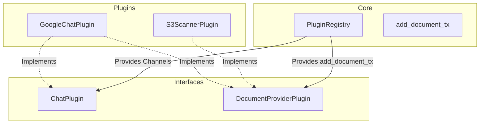

# [MVP] RFC: Split Document Provider Functionality from ChatPlugin

## 1. User-Centric Motivation & Goal

Currently, the ability to inject new documents into the system is bundled directly into the `ChatPlugin` interface. If a developer wants to create a plugin that *only* provides documents (for example, a plugin that scans a Google Drive or a local directory) without acting as a chat interface, they are forced to implement the entire `ChatPlugin` trait and deal with text input/output channels unnecessarily.

The goal of this RFC is to decouple the document provisioning capability from the `ChatPlugin`. By creating a dedicated trait (e.g., `DocumentProviderPlugin`), we allow specialized plugins to supply documents to the system independently, improving modularity and adhering to the Single Responsibility Principle.

## 2. Executive Summary

- **Context:** `ChatPlugin::start()` currently accepts an `Option<mpsc::Sender<AddDocumentRequest>>`. This assumes that only chat plugins are capable of providing documents to the system.
- **Motivation:** We need to decouple document ingestion sources from chat interfaces to allow non-chat plugins to provide documents.
- **Overarching Goals:** Enforce atomic responsibility in plugin interfaces. Interfaces should represent distinct capabilities.
- **Purpose:** Refactor `synapto_interface` and core registry to split the `add_document_tx` out of `ChatPlugin` into a new `DocumentProviderPlugin` trait.
- **Problem:** Tight coupling between chat functionality and document provision prevents standalone document source plugins.
- **Solution:** 
  1. Remove `add_document_tx` from `ChatPlugin::start`.
  2. Create a new trait `DocumentProviderPlugin` in `synapto_interface::document`.
  3. Update `PluginRegistry` to support `register_document_provider`.
  4. Update `Synapto::run` core to pass `add_document_tx` to registered document providers.
  5. Update existing chat plugins (like `GoogleChatPlugin`, `MumblePlugin`) to implement `DocumentProviderPlugin` if they provide documents.

## 3. Current State Analysis

Presently, `synapto_interface::chat::ChatPlugin` looks like this:
```rust
pub trait ChatPlugin: Plugin + Send + Sync {
    async fn start(
        &self,
        peer_input_text_tx: mpsc::Sender<PeerInputText>,
        cognitive_output_text_rx: mpsc::Receiver<CognitiveOutputText>,
        cognitive_state_rx: broadcast::Receiver<CognitiveStateUpdate>,
        add_document_tx: Option<mpsc::Sender<AddDocumentRequest>>, // <-- Tightly coupled
    ) -> Result<(), String>;
}
```

**Flaws & Tight Coupling:**
- **Inverted Responsibility:** A chat plugin's primary job is exchanging text messages with a user. Supplying documents to the internal retrieval system is a distinct capability.
- **Limitation:** A background service that periodically pulls PDFs from an S3 bucket cannot easily inject them without implementing `ChatPlugin` or manually wiring into the core.

## 4. Structural Hierarchy

- **`DocumentProviderPlugin` (Trait):**
  - **Constraints:** Must be implemented by any plugin that wants to supply documents to the system.
  - **Atomic Responsibility:** Receives the `add_document_tx` channel and sends `AddDocumentRequest`s into the system.
- **`ChatPlugin` (Trait):**
  - **Constraints:** Must no longer receive `add_document_tx`.
  - **Atomic Responsibility:** Strictly handles `PeerInputText` and `CognitiveOutputText`.

## 5. Data Models

The fundamental data models (`AddDocumentRequest`, `DocumentRegistrationRequest`) remain unchanged.

### Semantic Schemas

```rust
// New Trait in synapto_interface::document
#[async_trait]
pub trait DocumentProviderPlugin: Plugin + Send + Sync {
    async fn start_document_provider(
        &self,
        add_document_tx: mpsc::Sender<crate::document::AddDocumentRequest>,
    ) -> Result<(), String>;
}
```

```rust
// Updated ChatPlugin in synapto_interface::chat
#[async_trait]
pub trait ChatPlugin: Plugin + Send + Sync {
    async fn start(
        &self,
        peer_input_text_tx: mpsc::Sender<crate::peer_input_text::PeerInputText>,
        cognitive_output_text_rx: mpsc::Receiver<crate::cognitive_output_text::CognitiveOutputText>,
        cognitive_state_rx: broadcast::Receiver<crate::cognitive::CognitiveStateUpdate>,
    ) -> Result<(), String>;
}
```

## 6. Component Architecture

### Execution Flow
1. Core initializes channels, including `(add_document_tx, add_document_rx)`.
2. The core registers plugins.
3. For plugins implementing `DocumentProviderPlugin`, core invokes `register_document_provider` and spawns a task executing `start_document_provider(add_document_tx.clone())`.
4. For plugins implementing `ChatPlugin`, core invokes `register_chat` and spawns a task executing `start(...)` without the document channel.
5. `GoogleChatPlugin` will implement both `ChatPlugin` and `DocumentProviderPlugin`.

## 7. Architectural Diagrams



## 8. Robustness & Pragmatic Security Trade-offs

- **Hazard: Increased task spawning.** A plugin implementing both traits will now spawn two separate tokio tasks (one for chat, one for documents).
  - **Accepted Risk (MVP):** This is standard for plugins implementing multiple capabilities (e.g., `AudioInputPlugin` and `AudioOutputPlugin`). It enforces strict separation of concerns.

## 9. Systemic Consequences

- **Breaking Changes:** This is a breaking change to the `synapto_interface::chat::ChatPlugin` trait. All existing implementations of `ChatPlugin` (e.g., `MumblePlugin`, `GoogleChatPlugin`, `MockChatPlugin`) must be updated to remove `add_document_tx` from their `start` method.
- **Updates required:**
  - `synapto_interface::chat::ChatPlugin`
  - `synapto_interface::plugin::PluginRegistry`
  - `synapto::crates::core::src::lib.rs` (Synapto run loop)
  - `synapto::crates::test::src::plugins::chat::MockChatPlugin`
  - `synapto-plugins::google-chat::GoogleChatPlugin`
  - `synapto::contrib::plugins::mumble::MumblePlugin`

## 10. Definition of Done (DoD)

- [ ] Create `DocumentProviderPlugin` trait in `synapto_interface::document`.
- [ ] Add `register_document_provider` to `synapto_interface::plugin::PluginRegistry`.
- [ ] Update `ChatPlugin` trait to remove `add_document_tx`.
- [ ] Update `synapto/crates/core/src/lib.rs` to implement the new registry method and update `register_chat`.
- [ ] Implement `DocumentProviderPlugin` for `MockChatPlugin`, update `ChatPlugin` implementation.
- [ ] Implement `DocumentProviderPlugin` for `GoogleChatPlugin` (if applicable), update `ChatPlugin` implementation.
- [ ] Update `MumblePlugin` to remove `add_document_tx` from `ChatPlugin::start`.
- [ ] Ensure all tests and examples compile and run successfully.
