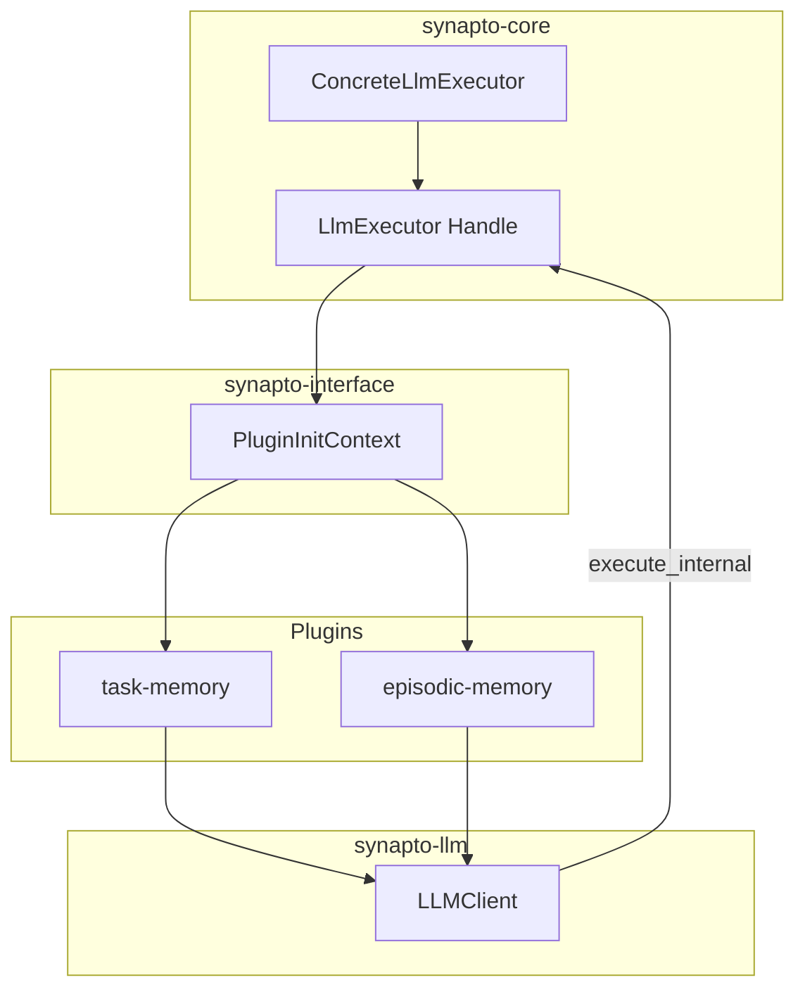

# [MVP] RFC: Encapsulate LLM Execution via Opaque LlmExecutor Handle

## 1. Motivation and Goal

The current architecture exposes the low-level `execute_raw` method on `pub trait LlmExecutor` in `synapto-interface`. This design allows plugins and external crates to bypass the structured `synapto_llm::LLMClient` API, construct raw string prompts, and skip schema enforcement and telemetry.

The goal of this RFC is to convert `LlmExecutor` into an opaque struct handle in `synapto-interface`. This change removes all public prompt-execution methods from the executor handle and forces all LLM interactions through the typed `synapto_llm::LLMClient` interface.

## 2. Executive Summary

- **Context:** Plugins currently receive `std::sync::Arc<dyn synapto_interface::llm::LlmExecutor>`.
- **Problem:** `LlmExecutor` is a public trait with a public `execute_raw` method. This allows plugins to execute unstructured, untyped prompts directly. The signature `Arc<dyn LlmExecutor>` also adds boilerplate across plugin types.
- **Solution:**
  1. Define a private/internal backend trait `RawLlmExecutor` in `synapto-interface`.
  2. Redefine `LlmExecutor` as an opaque `pub struct LlmExecutor` wrapping `Arc<dyn RawLlmExecutor>`.
  3. Keep `LlmExecutor` free of public prompt-execution methods.
  4. Provide crate-gated execution access exclusively to `synapto_llm::LLMClient`.
  5. Update plugin and core signatures from `Arc<dyn LlmExecutor>` to the lightweight `LlmExecutor` struct.

## 3. Current State Analysis

Currently, `synapto_interface::llm::LlmExecutor` is defined as:

```rust
pub trait LlmExecutor: Send + Sync + 'static {
    async fn execute_raw(
        &self,
        model: &str,
        system_prompt: &str,
        prompt: &str,
        options: RawLlmOptions,
    ) -> Result<genai::chat::ChatResponse, String>;
}
```

### Architectural Deficiencies

1. **Leakage of Implementation Details:** External crates can call `execute_raw` directly and bypass the `Instruction` and `LLMClient` architecture.
2. **Type Complexity:** Every consumer must pass `Arc<dyn LlmExecutor>`.
3. **No Centralized Governance:** Schema caching, telemetry injection, and prompt formatting cannot be enforced at compile time.

## 4. Structural Hierarchy

- **`RawLlmExecutor` (Trait):**
  - **Location:** `synapto-interface::llm` (Internal / `#[doc(hidden)]`).
  - **Responsibility:** Defines the low-level execution contract with the LLM provider backend (`genai`).
- **`LlmExecutor` (Opaque Struct):**
  - **Location:** `synapto-interface::llm`.
  - **Responsibility:** Serves as a capability token passed across plugin boundaries. It exposes only lifecycle constructors and cloning.
- **`LLMClient` (Struct):**
  - **Location:** `synapto-llm`.
  - **Responsibility:** The single public entry point for prompt execution. Manages schema caching, structured instructions, and telemetry.

## 5. Data Models and API Changes

### `synapto-interface::llm`

```rust
/// Internal raw backend interface.
#[doc(hidden)]
#[async_trait::async_trait]
pub trait RawLlmExecutor: Send + Sync + 'static {
    async fn execute_raw(
        &self,
        model: &str,
        system_prompt: &str,
        prompt: &str,
        options: RawLlmOptions,
    ) -> Result<genai::chat::ChatResponse, String>;
}

/// Opaque executor handle.
///
/// This struct wraps the internal execution backend. It exposes no public
/// methods for prompt execution. Pass this handle to `LLM::create_client`.
#[derive(Clone)]
pub struct LlmExecutor {
    backend: std::sync::Arc<dyn RawLlmExecutor>,
}

impl LlmExecutor {
    pub fn new(backend: impl RawLlmExecutor + 'static) -> Self {
        Self {
            backend: std::sync::Arc::new(backend),
        }
    }

    pub fn from_arc(backend: std::sync::Arc<dyn RawLlmExecutor>) -> Self {
        Self { backend }
    }

    #[doc(hidden)]
    pub async fn execute_internal(
        &self,
        model: &str,
        system_prompt: &str,
        prompt: &str,
        options: RawLlmOptions,
    ) -> Result<genai::chat::ChatResponse, String> {
        self.backend
            .execute_raw(model, system_prompt, prompt, options)
            .await
    }
}
```

### `synapto-interface::plugin::PluginInitContext`

```rust
impl<'a> PluginInitContext<'a> {
    pub fn llm_executor(&self) -> LlmExecutor {
        self.llm_executor.clone()
    }
}
```

### `synapto-llm`

```rust
pub trait LLM {
    type Content: schemars::JsonSchema + Serialize + LLMSafe;
    type Output: schemars::JsonSchema + DeserializeOwned + Clone + LLMSafe;

    fn create_client(
        executor: LlmExecutor,
        config: ModelConfig,
        system_prompt: Vec<Instruction>,
    ) -> LLMClient<Self::Content, Self::Output, WithoutTools>;
}
```

## 6. Component Architecture



## 7. Migration and Implementation Plan

1. **Phase 1: Update `synapto-interface`**:
   - Introduce `RawLlmExecutor` and `LlmExecutor` struct.
   - Update `PluginInitContext` to hold and return `LlmExecutor`.
2. **Phase 2: Update `synapto-llm`**:
   - Implement `RawLlmExecutor` for `ConcreteLlmExecutor`.
   - Update `LLM::create_client`, `LLM::create_client_with_tools`, and `LLMClient` to consume `LlmExecutor`.
   - Update `LLMClient::call_inner` to call `self.executor.execute_internal(...)`.
3. **Phase 3: Update Plugins and Core**:
   - Replace `Arc<dyn LlmExecutor>` with `LlmExecutor` across all plugin constructors, tasks, and test harnesses.
