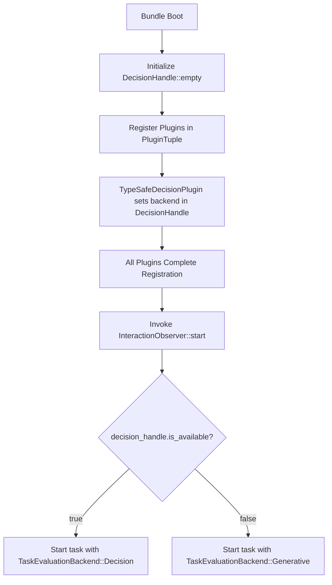
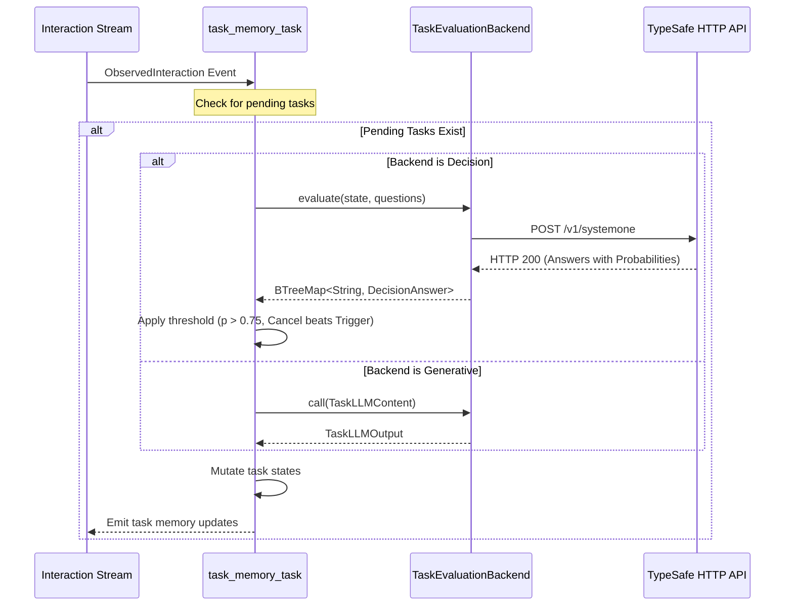

# [MVP] Optional Decision Subsystem and First-Class Decision Plugin Architecture

## 1. User-Centric Motivation & Goal
Users and operators want fast, responsive, and cost-effective AI assistants. Currently, the system invokes large generative Large Language Models (LLMs) for all cognitive tasks. These LLM invocations introduce noticeable latency (often multiple seconds) and high token costs. Many tasks do not generate text, conversational answers, or explanations. Instead, they make simple binary or discrete choices, such as checking whether an active task should start or stop.

By adding an optional Decision Subsystem based on specialized System One models (such as TypeSafe Jev), the system can execute these decisions in milliseconds at low cost. If an operator provides a decision plugin in the bundle, the system uses fast typed judgments. If an operator does not provide a decision plugin, the system continues to work using the standard generative LLM without code changes.

## 2. Executive Summary
- **Context:** The Synapto cognitive architecture uses generative LLMs (`synapto-llm` via `genai`) for all processing steps, including background task evaluation, insight extraction, and conversational cognitive loops.
- **Motivation:** Calling full generative LLMs for pure decision problems causes unnecessary latency, high operational cost, and nondeterministic string parsing.
- **Overarching Goals:** Introduce a first-class, pluggable Decision Subsystem into the Synapto ecosystem. Keep the core framework modular and decoupled. Enable complete LLM replacement in decision-only plugins (`task-memory`), preflight gating in background memory plugins (`behavioral-memory`), and turn evaluation gating in the core cognitive loop.
- **Purpose:** Define standard, vendor-neutral decision abstractions in `synapto-interface`. Enable plugins to discover and use an optional `DecisionHandle` at setup time. Provide an initial TypeSafe System One implementation plugin and migrate `task-memory` to support complete LLM replacement when the decision plugin is present.
- **Problem:**
  - `synapto-llm` is hardcoded inside `synapto-core` and exposed unconditionally via `PluginInitContext::llm_executor()`.
  - Plugins that only evaluate conditions (such as `task-memory` activating or cancelling pending tasks) must compile complex prompts and serialize generative schemas.
  - There is no vendor-neutral abstraction for structured, typed judgments (`Choice`, `Noul`, `Score`).
  - No mechanism exists for plugins to know whether a fast decision engine is available or if they must use the generative LLM.
- **Solution:**
  - Define domain-level judgment primitives (`DecisionQuestion`, `DecisionAnswer`, `Noul`, `Choice`, `Score`) in `synapto-interface::decision`.
  - Define `RawDecisionExecutor` and an opaque, cheap-to-clone handle `DecisionHandle` per Rule 26 of `ARCHITECTURE.md`.
  - Define `DecisionProviderPlugin` as a first-class plugin registered via `PluginRegistry`.
  - Expose `PluginInitContext::decision_handle(&self) -> DecisionHandle` where `DecisionHandle::is_available(&self) -> bool` allows deterministic strategy selection before background task execution.
  - Implement `synapto-decision-typesafe` in `integrations/plugins/` to connect to TypeSafe's System One HTTP API.
  - Update `task-memory` (`src/tasks.rs`) to use `DecisionHandle` for task activation and cancellation when present, with complete fallback to `TaskLLMPrompt` when absent.

## 3. Current State Analysis
- **Universal LLM Dependency:**
  All plugins receive `llm_executor: synapto_interface::llm::LlmExecutor` inside `PluginInitContext`. Every semantic judgment requires a generative chat completion request.
- **Tightly Coupled Task Evaluation in `task-memory`:**
  In `synapto/integrations/plugins/task-memory/src/tasks.rs`, the background task `task_memory_task` listens for `ObservedInteraction` events.
  On every interaction, it serializes all pending tasks and recent interactions into `TaskLLMContent`.
  It sends this payload to the generative LLM using `TaskLLMPrompt::create_client`.
  The generative model returns `TaskLLMOutput`:
  ```rust
  struct TaskLLMOutput {
      pub activated_task_ids: Vec<TaskId>,
      pub cancelled_task_ids: Vec<TaskId>,
  }
  ```
- **Flaws in Current Architecture:**
  - **Inverted Responsibility and Resource Waste:** A full generative reasoning model is used as a basic boolean evaluator.
  - **Latency and Throughput Bottleneck:** Generative chat completions take 1000ms to 4000ms. Background task evaluations queue up and consume API quotas.
  - **No Pluggable Capability for Decisions:** Unlike STT, TTS, storage, and credentials, the engine does not treat decision services as pluggable capability archetypes.
  - **Zero Optionality:** A plugin cannot choose between a fast decision evaluator and a generative model based on bundle composition.

## 4. Structural Hierarchy
- **Mission:** Pluggable, Type-Safe, Low-Latency Decision Subsystem with Zero Hard Core Coupling.
- **Goal:** Provide setup-time optionality for decision execution, enabling consumer plugins to bypass generative LLMs completely for discrete judgments.
- **Atomic Responsibilities:**
  - **`DecisionQuestion` & `DecisionAnswer` (`synapto-interface::decision`):** Vendor-neutral domain primitives for typed judgments (`Noul`, `Choice`, `Score`). Complies with Rule 15 (Strong Typing).
  - **`RawDecisionExecutor` (`synapto-interface::decision`):** Asynchronous transport trait executing raw judgment requests.
  - **`DecisionHandle` (`synapto-interface::decision`):** Encapsulated, cheap-to-clone opaque handle wrapping `Arc<parking_lot::RwLock<Option<Arc<dyn RawDecisionExecutor>>>>`. Complies with Rule 26 (Encapsulated Handles).
  - **`DecisionProviderPlugin` (`synapto-interface::plugin`):** Capability plugin trait implemented by decision backends. Conforms to `ARCHITECTURE.md` Section 6 (Provider Plugins vs Actor Plugins).
  - **`PluginRegistry` Extension (`synapto-interface::plugin`):** Extends engine registry with `register_decision_provider`. Complies with Rule 24 (Strict Domain Registries).
  - **`PluginInitContext` Exposure (`synapto-interface::plugin`):** Supplies `DecisionHandle` to plugins during initialization.
  - **`TypeSafeDecisionPlugin` (`integrations/plugins/typesafe-decision`):** Concrete integration plugin implementing `RawDecisionExecutor` over the TypeSafe HTTP API.
  - **`TypeSafeCredentialTarget` (`integrations/plugins/typesafe-decision`):** Typed credential target resolving API keys via `context.credentials()`. Complies with Rule 27.
  - **`TaskMemoryPlugin` Migration (`integrations/plugins/task-memory`):** Concrete consumer plugin implementing strategy selection between `DecisionHandle` and `TaskLLMPrompt`.

## 5. Data Models

### 5.1 Judgment Primitives (`synapto-interface::decision`)
Complies with `ARCHITECTURE.md` Rule 6 (`!LLMSafe` for internal structures) and Rule 15 (Strong Typing).

```rust
use serde::{Deserialize, Serialize};
use std::collections::BTreeMap;
use synapto_interface::llm::LLMSafe;

/// Binary condition evaluation question.
#[derive(Debug, Clone, Serialize, Deserialize, PartialEq)]
pub struct NoulQuestion {
    pub instructions: String,
    #[serde(skip_serializing_if = "Option::is_none")]
    pub criteria: Option<NoulCriteria>,
}

#[derive(Debug, Clone, Serialize, Deserialize, PartialEq)]
pub struct NoulCriteria {
    pub r#true: String,
    pub r#false: String,
}

/// Categorical selection question from a defined rubric.
#[derive(Debug, Clone, Serialize, Deserialize, PartialEq)]
pub struct ChoiceQuestion {
    pub instructions: String,
    pub criteria: BTreeMap<String, String>,
}

/// Graded continuous or multi-level scoring question.
#[derive(Debug, Clone, Serialize, Deserialize, PartialEq)]
pub struct ScoreQuestion {
    pub instructions: String,
    pub criteria: Vec<String>,
}

/// Typed question variants supported by the Decision Subsystem.
#[derive(Debug, Clone, Serialize, Deserialize, PartialEq)]
#[serde(tag = "type", rename_all = "snake_case")]
pub enum DecisionQuestion {
    Noul(NoulQuestion),
    Choice(ChoiceQuestion),
    Score(ScoreQuestion),
}

/// Answers returned by the decision backend.
#[derive(Debug, Clone, Serialize, Deserialize, PartialEq)]
#[serde(tag = "type", rename_all = "snake_case")]
pub enum DecisionAnswer {
    Noul {
        noul: f64,
    },
    Choice {
        choice: String,
        probabilities: BTreeMap<String, f64>,
        confidence: f64,
    },
    Score {
        score: f64,
        probabilities: BTreeMap<String, f64>,
        confidence: f64,
    },
}
```

### 5.2 Opaque Handle and Raw Trait (`synapto-interface::decision`)
Complies with `ARCHITECTURE.md` Rule 26 (Encapsulated Handles and Shared Ownership) and Section 6 (Provider Plugin on-demand execution).

```rust
use async_trait::async_trait;
use parking_lot::RwLock;
use std::collections::BTreeMap;
use std::sync::Arc;

#[async_trait]
pub trait RawDecisionExecutor: Send + Sync + 'static {
    async fn evaluate_raw(
        &self,
        model: Option<&str>,
        state: serde_json::Value,
        questions: BTreeMap<String, DecisionQuestion>,
    ) -> Result<BTreeMap<String, DecisionAnswer>, String>;
}

/// Opaque, thread-safe handle to the decision backend.
/// Uses internal shared cell resolution to eliminate bundle ordering dependencies.
#[derive(Clone, Default)]
pub struct DecisionHandle {
    backend: Arc<RwLock<Option<Arc<dyn RawDecisionExecutor>>>>,
}

impl DecisionHandle {
    pub fn empty() -> Self {
        Self {
            backend: Arc::new(RwLock::new(None)),
        }
    }

    pub fn set_backend<B: RawDecisionExecutor>(&self, backend: B) {
        let mut lock = self.backend.write();
        *lock = Some(Arc::new(backend));
    }

    pub fn set_arc_backend(&self, backend: Arc<dyn RawDecisionExecutor>) {
        let mut lock = self.backend.write();
        *lock = Some(backend);
    }

    pub fn is_available(&self) -> bool {
        self.backend.read().is_some()
    }

    pub async fn evaluate(
        &self,
        model: Option<&str>,
        state: serde_json::Value,
        questions: BTreeMap<String, DecisionQuestion>,
    ) -> Result<BTreeMap<String, DecisionAnswer>, String> {
        let backend = {
            let lock = self.backend.read();
            lock.clone()
        };
        match backend {
            Some(executor) => executor.evaluate_raw(model, state, questions).await,
            None => Err("No decision provider registered".to_string()),
        }
    }
}
```

### 5.3 First-Class Plugin Extension (`synapto-interface::plugin`)
Complies with `ARCHITECTURE.md` Rule 24 (Strict Domain Registries).

```rust
pub trait DecisionProviderPlugin: Send + Sync + 'static {
    fn raw_decision_executor(&self) -> std::sync::Arc<dyn crate::decision::RawDecisionExecutor>;
}

pub trait PluginRegistry {
    // Existing registrations...
    fn register_decision_provider<P: DecisionProviderPlugin>(&mut self, provider: std::sync::Arc<P>);
}

impl<'a> PluginInitContext<'a> {
    pub fn decision_handle(&self) -> crate::decision::DecisionHandle {
        self.decision_handle.clone()
    }
}
```

### 5.4 Provider Configuration and Credential Target (`typesafe-decision`)
Complies with `ARCHITECTURE.md` Rule 27 (Unified Credentials Provider Mandate) and Rule 28/29 (Explicit Configuration).

```rust
use serde::{Deserialize, Serialize};
use synapto_interface::credentials::CredentialTarget;

/// Explicit configuration struct for TypeSafe decision plugin.
#[derive(Debug, Clone, Serialize, Deserialize)]
pub struct TypeSafeDecisionConfig {
    pub model: String,
    pub api_endpoint: String,
}

/// Typed target descriptor for resolving TypeSafe API keys via CredentialsHandle.
pub struct TypeSafeCredentialTarget;

impl CredentialTarget for TypeSafeCredentialTarget {}
```

### 5.5 Task Evaluation Data Structures (`task-memory`)
Complies with `ARCHITECTURE.md` Rule 15 (Strong Typing & Newtype Pattern Mandate).

```rust
use serde::{Deserialize, Serialize};
use synapto_interface::decision::NoulQuestion;
use crate::types::{Task, TaskId};

#[derive(Debug, Clone, PartialEq, Eq, PartialOrd, Ord, Serialize, Deserialize)]
pub enum TaskEvaluationKind {
    Trigger,
    Cancel,
}

#[derive(Debug, Clone, PartialEq, Eq, PartialOrd, Ord, Serialize, Deserialize)]
pub struct TaskQuestionKey {
    pub task_id: TaskId,
    pub kind: TaskEvaluationKind,
}

impl TaskQuestionKey {
    pub fn to_string_key(&self) -> String {
        format!("{}:{:?}", self.task_id.0, self.kind)
    }

    /// Parses string key safely from the right to avoid collisions with colons inside TaskId.
    pub fn parse_string_key(key: &str) -> Option<(TaskId, TaskEvaluationKind)> {
        let (id, kind_str) = key.rsplit_once(':')?;
        let kind = match kind_str {
            "Trigger" => TaskEvaluationKind::Trigger,
            "Cancel" => TaskEvaluationKind::Cancel,
            _ => return None,
        };
        Some((TaskId(id.to_string()), kind))
    }
}

/// Maps a pending task into binary decision questions.
/// If a task has no trigger condition, the trigger question is safely omitted.
pub fn generate_task_questions(task: &Task) -> (Option<NoulQuestion>, NoulQuestion) {
    let trigger_question = task.trigger.as_ref().map(|t| NoulQuestion {
        instructions: format!(
            "Did the user trigger condition occur in the interaction for task '{}'?",
            task.title
        ),
        criteria: Some(synapto_interface::decision::NoulCriteria {
            r#true: format!("The condition '{}' was satisfied in the conversation.", t.description),
            r#false: format!("The condition '{}' did not occur.", t.description),
        }),
    });

    let cancel_question = NoulQuestion {
        instructions: format!(
            "Did the user explicitly cancel, reject, or discard the task '{}'?",
            task.title
        ),
        criteria: Some(synapto_interface::decision::NoulCriteria {
            r#true: "The user commanded to stop, delete, or cancel this specific task.".to_string(),
            r#false: "The user did not state an intention to cancel this task.".to_string(),
        }),
    };

    (trigger_question, cancel_question)
}
```

### 5.6 JSON Contract Examples

#### Decision Evaluation Request Payload (Sent to Decision Provider)
```json
{
  "state": {
    "pending_tasks": [
      {
        "id": "task-01J8Y",
        "title": "Turn off hallway light",
        "trigger": "when user leaves home"
      }
    ],
    "recent_interactions": [
      {
        "speaker": "User",
        "text": "I am leaving the house now. See you later."
      }
    ]
  },
  "model": "jev-latest",
  "questions": {
    "task-01J8Y:Trigger": {
      "type": "noul",
      "instructions": "Did the user trigger condition occur in the interaction for task 'Turn off hallway light'?",
      "criteria": {
        "true": "The condition 'when user leaves home' was satisfied in the conversation.",
        "false": "The condition 'when user leaves home' did not occur."
      }
    },
    "task-01J8Y:Cancel": {
      "type": "noul",
      "instructions": "Did the user explicitly cancel, reject, or discard the task 'Turn off hallway light'?",
      "criteria": {
        "true": "The user commanded to stop, delete, or cancel this specific task.",
        "false": "The user did not state an intention to cancel this task."
      }
    }
  }
}
```

#### Decision Evaluation Response Payload (Received from Decision Provider)
```json
{
  "model": "jev-latest",
  "answers": {
    "task-01J8Y:Trigger": {
      "type": "noul",
      "noul": 0.94
    },
    "task-01J8Y:Cancel": {
      "type": "noul",
      "noul": 0.02
    }
  }
}
```

## 6. Component Architecture & Execution Flow

### 6.1 Shared Cell Strategy Resolution
To eliminate ordering race conditions in `PluginTuple`, `synapto-core` instantiates a shared `DecisionHandle` during engine construction:
1. `synapto-core` creates `decision_handle = DecisionHandle::empty()`.
2. Each plugin receives this cloned `decision_handle` via `PluginInitContext`.
3. When `TypeSafeDecisionPlugin` registers via `registry.register_decision_provider(plugin)`, `synapto-core` calls `decision_handle.set_arc_backend(plugin.raw_decision_executor())`.
4. In `Synapto::run`, all plugins complete registration before the engine invokes any `InteractionObserver::start` method.
5. In `TaskMemoryPlugin::start`, `decision_handle.is_available()` is checked:
   - If `true`, the task starts with `TaskEvaluationBackend::Decision(decision_handle)`.
   - If `false`, the task starts with `TaskEvaluationBackend::Generative(client)`.
   This guarantees 100% deterministic strategy selection regardless of bundle tuple order.

### 6.2 Model Parameter Resolution Precedence
When `evaluate` executes:
- If `model` is passed as `Some(name)`, the provider plugin sends `name` to the API.
- If `model` is passed as `None`, the provider plugin defaults to `TypeSafeDecisionConfig.model`.

### 6.3 Event-Driven Execution Flow in Background Loop
1. `task_memory_task` receives an `ObservedInteraction` event.
2. When pending tasks exist, the task evaluates them using its configured `TaskEvaluationBackend`.
3. If `Decision`:
   - It iterates through pending tasks and builds batch `Noul` questions using `generate_task_questions`.
   - Tasks without a trigger condition generate only a cancellation question.
   - It executes a single asynchronous `evaluate` call via `DecisionHandle`.
   - **Answer Validation Policy:** If a requested question key is missing from `answers` or its variant is not `DecisionAnswer::Noul`, the evaluator logs a warning via `tracing::warn!` and treats the probability as `0.0`.
   - For each task, it compares valid `cancel` and `trigger` probabilities against the `0.75` threshold.
   - **Precedence Rule:** If both `cancel` and `trigger` probabilities exceed `0.75`, **cancellation takes precedence over activation** to prevent invalid task execution.
4. The task updates state and emits dirty notifications without any generative LLM invocation.

## 7. Architectural Diagrams

### 7.1 Setup-Time Strategy Resolution


### 7.2 Event-Driven Task Evaluation Flow


## 8. Robustness & Pragmatic Security Trade-offs

### 8.1 Hazard Analysis
- **Hazard 1: Network Failure or API Downtime:**
  The decision backend connects via HTTP. If the remote service fails or times out, the background evaluation must not crash the task.
  - *Mitigation:* The `evaluate` method returns a `Result`. On error, `task_memory_task` logs an error via `tracing::error!` and leaves tasks pending until the next turn.
- **Hazard 2: Ambiguous Probabilities (Near 0.50):**
  A `Noul` value near 0.50 indicates uncertainty, not medium confidence.
  - *Mitigation:* A strict threshold (`0.75`) is enforced before activating or cancelling tasks. Tasks below the threshold remain pending.
- **Hazard 3: Conflicting Simultaneous Trigger and Cancel:**
  Model probabilities for both trigger and cancel could exceed the threshold simultaneously on noisy input.
  - *Mitigation:* Explicit state transition precedence: cancellation overrides activation.
- **Hazard 4: API Key Leakage:**
  Decision providers require API credentials.
  - *Mitigation:* In accordance with `ARCHITECTURE.md` Rule 27 (Unified Credentials Provider Mandate), the provider plugin resolves its API key through `context.credentials()` using `TypeSafeCredentialTarget`.

### 8.2 Accepted Risks (MVP Scope)
1. **HTTP Request Timeouts:** Default client timeouts are used. Advanced configurable request timeouts are deferred to future work.
2. **Transient Error Retries and Backoff:** On HTTP 429 or 5xx, the provider does not execute an immediate backoff loop. Re-evaluation occurs naturally on the next observed interaction event.
3. **Task Pagination and Payload Limits:** Batching occurs across all pending tasks in a single turn. Pagination for very large task lists is deferred to future work.
4. **Provider Health Gating / Circuit Breaking:** Repeated backend failures do not trip a circuit breaker. Failures are logged via `tracing::error!`.
5. **No In-Flight Dynamic Fallback:** If the decision provider fails during a request, the system does not execute a dynamic fallback to the generative LLM on that same turn. It logs an error and retries on the next turn.
6. **Graceful Cancellation / Drop Guards:** The evaluator does not implement custom drop guards for in-flight HTTP calls during engine shutdown. Tokio aborts spawned child futures on runtime teardown.

## 9. Systemic Consequences

### 9.1 Codebase Audit & Import Web
The following files interact with `PluginInitContext`, `PluginRegistry`, or `task-memory`:
- `synapto-ai/synapto/crates/interface/src/plugin.rs`: Extends `PluginRegistry` and `PluginInitContext`.
- `synapto-ai/synapto/crates/core/src/lib.rs`: Implements `register_decision_provider` on `Synapto` and provides `DecisionHandle` to `PluginInitContext`.
- `synapto-ai/synapto/integrations/plugins/task-memory/src/lib.rs`: Passes `DecisionHandle` to `task_memory_task`.
- `synapto-ai/synapto/integrations/plugins/task-memory/src/tasks.rs`: Adds `TaskEvaluationBackend`.
- `synapto-ai/synapto/crates/test/src/lib.rs`: Implements mock registry methods.

### 9.2 API Surface & Compatibility
- **Backward Compatibility:**
  Fully preserved. `decision_handle.is_available()` returns `false` by default when no provider is registered. Existing plugins compile without modifications.
- **Breaking Changes:**
  None. The extension to `PluginRegistry` is additive. Any mock registries in `synapto-test` must implement the new method.

### 9.3 Documentation
- Update `synapto-ai/synapto/docs/src/ARCHITECTURE.md` to document the Decision Subsystem capability.
- Document the new plugin in `synapto-ai/synapto/integrations/plugins/typesafe-decision/README.md`.

## 10. Definition of Done (DoD)
- [ ] Define `synapto_interface::decision` with `NoulQuestion`, `ChoiceQuestion`, `ScoreQuestion`, `DecisionQuestion`, `DecisionAnswer`, `RawDecisionExecutor`, and `DecisionHandle`.
- [ ] Add `DecisionProviderPlugin` trait and `register_decision_provider<P: DecisionProviderPlugin>` method to `PluginRegistry` in `synapto-interface`.
- [ ] Add `decision_handle: DecisionHandle` to `PluginInitContext` in `synapto-interface`.
- [ ] Implement `register_decision_provider` in `synapto-core/src/lib.rs` and store provider in engine `DecisionHandle`.
- [ ] Create `synapto-decision-typesafe` crate in `integrations/plugins/typesafe-decision` with `TypeSafeDecisionConfig`, `TypeSafeCredentialTarget`, and `RawDecisionExecutor` implementation over HTTP.
- [ ] Update `task-memory` (`tasks.rs`) with `TaskEvaluationBackend` (Decision vs Generative), `TaskQuestionKey`, and conflict precedence.
- [ ] Add unit tests verifying `Noul` task activation, cancellation, and precedence logic in `task-memory`.
- [ ] Update mock implementations in `synapto-test`.
- [ ] Validate compilation with `cargo check --workspace`.
