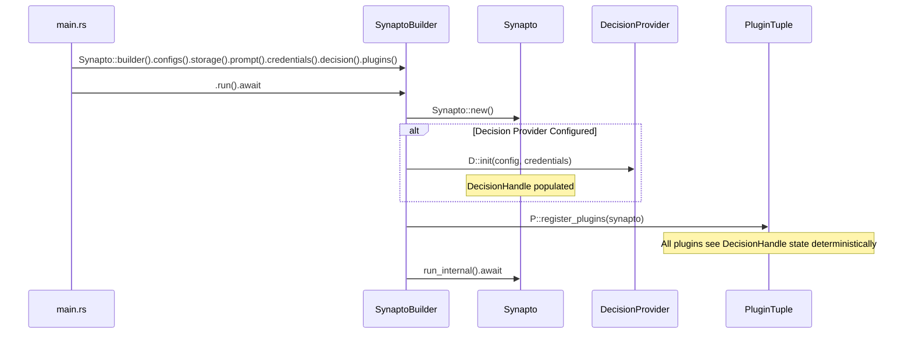

# [MVP] Fluent Builder Pattern for Bundle Composition and Dedicated Singleton Decision Provider

## 1. User-Centric Motivation & Goal
Developers building AI assistants currently configure bundles using rigid, complex nested generic type parameters on `Synapto`:
```rust
Synapto::<
    (ConfigJson<DataDir>, DotEnv, Env),
    Storage,
    FilePromptProvider<DataDir>,
    (GoogleCredentials, TypeSafeCredentials),
>::run::<(
    TypeSafeDecisionPlugin,
    ClockPlugin,
    TaskMemoryPlugin<Storage>,
)>()
.await
```
This syntax causes difficult-to-read error messages when a single type in the tuple is mismatched or misconfigured. Furthermore, treating a decision provider as a `Plugin` is architecturally incorrect: a decision engine does not have actor loops, channels, or plugins capabilities. It is a singular infrastructure provider, analogous to storage or credentials.

A fluent Builder interface (`Synapto::builder()`) provides clear, self-documenting syntax. It separates storage, configurations, credentials, prompts, the singular decision provider, and general actor plugins into distinct, typed builder steps:
```rust
Synapto::builder()
    .configs::<(ConfigJson<DataDir>, DotEnv, Env)>()
    .storage::<Storage>()
    .prompt::<FilePromptProvider<DataDir>>()
    .credentials::<(GoogleCredentials, TypeSafeCredentials)>()
    .decision::<TypeSafeDecision>()
    .plugins::<(
        ClockPlugin,
        McpPlugin,
        HostAudioInputPlugin,
        HostAudioOutputPlugin,
        SttGooglePlugin,
        TtsGooglePlugin,
        SemanticMemoryPlugin<Storage>,
        BehavioralMemoryPlugin<Storage>,
        EpisodicMemoryPlugin<Storage>,
        TaskMemoryPlugin<Storage>,
    )>()
    .run()
    .await
```
Method names strictly obey a cardinality convention:
- **Plural (trailing `s`):** Methods accepting multiple types (tuples): `.configs(...)`, `.credentials(...)`, `.plugins(...)`.
- **Singular (no trailing `s`):** Methods accepting a single type: `.storage(...)`, `.prompt(...)`, `.decision(...)`.

## 2. Executive Summary
- **Context:** Synapto bundles (`personal-assistant`, `kid-assistant`, `bundles/*`, `org-assistant`, `synapto-bundles/*`) bootstrap the system via `Synapto::<C, S, PR, CR>::run::<Plugins>()`.
- **Motivation:** The current nested generic type parameter structure is inflexible and unreadable. Decision providers were previously modeled as `Plugin`, giving them unrelated capabilities and allowing them to be incorrectly mixed into the general plugins list.
- **Overarching Goals:** Modernize bundle construction with a type-safe fluent Builder pattern. Decouple bundle configuration into explicit stages: `.configs(...)`, `.storage(...)`, `.credentials(...)`, `.prompt(...)`, `.decision(...)`, and `.plugins(...)`. Enforce at-most-one constraints on decision providers at the API boundary.
- **Purpose:** Define `SynaptoBuilder` in `synapto-core`. Define `DecisionProvider` in `synapto-interface::decision`. Remove `DecisionProviderPlugin` and `register_decision_provider` from `PluginRegistry`. Completely remove the legacy `Synapto::run` generic entrypoint. Migrate all existing bundles, scenario tests, and documentation across `synapto-ai` and `allusio-ai` to the new fluent builder API.
- **Problem:**
  - High cognitive friction when composing bundles with 4+ type parameter groups in `main.rs`.
  - Decision providers are not plugins: they do not manage actor loops, observe interactions, or emit audio/text streams. Modeling them as `Plugin` violates the Single Responsibility Principle and Interface Segregation.
  - Allowing decision providers inside the `Plugins` tuple permits duplicate conflicting decision engines without compile-time prevention.
- **Solution:**
  - Define `DecisionProvider` trait in `synapto-interface::decision`:
    ```rust
    pub trait DecisionProvider: Send + Sync + 'static {
        type Config: serde::de::DeserializeOwned;
        fn init(config: Self::Config, credentials: CredentialsHandle) -> Result<Self, String>
        where
            Self: Sized;
        fn raw_decision_executor(&self) -> Arc<dyn RawDecisionExecutor>;
    }
    ```
  - Remove `DecisionProviderPlugin` from `PluginRegistry`.
  - Introduce `SynaptoBuilder<C, S, PR, CR, D, P>` with zero-cost phantom typestate transitions.
  - Apply method cardinality naming convention:
    - `.configs<C>()`: Plural, accepts tuple of configuration providers.
    - `.storage<S>()`: Singular, accepts single storage backend.
    - `.prompt<PR>()`: Singular, accepts single cognitive prompt provider.
    - `.credentials<CR>()`: Plural, accepts tuple of credentials providers.
    - `.decision<D>()`: Singular, accepts single decision provider.
    - `.plugins<P>()`: Plural, accepts tuple of actor plugins.
  - Implement `.decision::<D: DecisionProvider>()` exclusively on `NoDecision`. Because `D` does not implement `Plugin`, passing it to `.plugins()` is a compile error.
  - Enforce mandatory `.configs::<C>()` and `.storage::<S>()` before `.run()` becomes available.
  - Remove legacy `Synapto::run` completely with no backward compatibility wrappers.

## 3. Current State Analysis
- **Monolithic Type Signature:**
  In `crates/core/src/lib.rs`:
  ```rust
  pub struct Synapto<
      C: config::ConfigProvider,
      S: synapto_interface::storage::StorageConnection
          + synapto_interface::storage::KeyValueStore
          + synapto_interface::storage::RecordStore,
      PR: prompt_provider::CognitivePromptProvider,
      CR: credentials::CredentialsTuple = (),
  > { ... }
  ```
  Bootstrapping requires calling:
  ```rust
  Synapto::<C, S, PR, CR>::run::<Plugins>()
  ```
  where `Plugins` must satisfy `PluginTuple<C, S, PR, CR>`.
- **Misclassified Decision Provider Capability:**
  `DecisionProviderPlugin` extended `Plugin`. This forced decision providers to inherit dummy plugin implementations (`create`, `register`) and pollutes `PluginRegistry`.
- **Flaws in Current Architecture:**
  - **Interface Segregation Violation:** A pure judgment provider does not need `PluginRegistry` access or actor life cycles.
  - **Violation of Principle of Explicit Configuration (Rule 28):** Singleton providers are masquerading as general plugins.
  - **Poor Ergonomics & High Error Surface:** Missing a comma or mismatching a tuple element generates extensive compiler output spanning hundreds of lines.

## 4. Structural Hierarchy
- **Mission:** Intuitive, Type-Safe, Stepwise Fluent Bundle Construction with Pure Decision Providers.
- **Goal:** Provide a fluent builder pattern for bundle entrypoints, isolating storage, configuration, credentials, prompts, decision engines, and plugins into clean, atomic builder methods.
- **Method Cardinality Convention:**
  - **Plural (Multiple Items):** `.configs::<C>()`, `.credentials::<CR>()`, `.plugins::<P>()`
  - **Singular (Single Item):** `.storage::<S>()`, `.prompt::<PR>()`, `.decision::<D>()`
- **Atomic Responsibilities:**
  - **`DecisionProvider` (`synapto-interface::decision`):** Pure provider trait for decision execution. Has zero plugin capabilities.
  - **`SynaptoBuilder<C, S, PR, CR, D, P>` (`synapto-core`):** Typestate builder orchestrating bundle initialization. Complies with Rule 15 (Strong Typing).
  - **`decision::<D: DecisionProvider>()` (`synapto-core`):** Singular builder method establishing the unique decision engine. Complies with Rule 24 and Rule 30.
  - **`prompt::<PR: CognitivePromptProvider>()` (`synapto-core`):** Singular builder method establishing the cognitive prompt provider.
  - **`plugins::<P>()` (`synapto-core`):** Plural builder method registering actor and observer plugins into the engine.
  - **`run()` (`synapto-core`):** Terminal method available only when mandatory core infrastructure (`C: ConfigProvider`, `S: StorageConnection`) is configured.

## 5. Data Models

### 5.1 Dedicated Decision Provider Trait (`synapto-interface::decision`)
Complies with `ARCHITECTURE.md` Rule 15 (Strong Typing) and Rule 24 (Strict Domain Registries).

```rust
use std::sync::Arc;
use synapto_interface::credentials::CredentialsHandle;

/// Pure capability trait for decision providers.
/// Decision providers do NOT implement Plugin and have no actor or channel capabilities.
pub trait DecisionProvider: Send + Sync + 'static {
    type Config: serde::de::DeserializeOwned;

    fn init(
        config: Self::Config,
        credentials: CredentialsHandle,
    ) -> Result<Self, String>
    where
        Self: Sized;

    fn raw_decision_executor(&self) -> Arc<dyn RawDecisionExecutor>;
}
```

### 5.2 Typestate Marker Types & Builder Struct (`synapto-core`)
Complies with `ARCHITECTURE.md` Rule 15 (Strong Typing) and Rule 26 (Encapsulated Handles).

```rust
use std::marker::PhantomData;
use std::process::ExitCode;
use synapto_interface::decision::DecisionProvider;
use crate::prompt_provider::{CognitivePromptProvider, EmptyPromptProvider};
use crate::config::ConfigProvider;
use crate::credentials::CredentialsTuple;

/// Marker for unconfigured mandatory configuration provider.
pub struct NoConfig;

/// Marker for unconfigured mandatory storage backend.
pub struct NoStorage;

/// Marker for absent decision provider.
pub struct NoDecision;

/// Marker for configured singleton decision provider.
pub struct WithDecision<D>(pub(crate) PhantomData<D>);

/// Public trait defining decision provider setup into Synapto core.
pub trait DecisionSetup<
    C: ConfigProvider,
    S: synapto_interface::storage::StorageConnection
        + synapto_interface::storage::KeyValueStore
        + synapto_interface::storage::RecordStore,
    PR: CognitivePromptProvider,
    CR: CredentialsTuple,
> {
    fn setup(synapto: &mut Synapto<C, S, PR, CR>) -> Result<(), String>;
}

impl<
    C: ConfigProvider,
    S: synapto_interface::storage::StorageConnection
        + synapto_interface::storage::KeyValueStore
        + synapto_interface::storage::RecordStore,
    PR: CognitivePromptProvider,
    CR: CredentialsTuple,
> DecisionSetup<C, S, PR, CR> for NoDecision {
    fn setup(_synapto: &mut Synapto<C, S, PR, CR>) -> Result<(), String> {
        Ok(())
    }
}

impl<
    C: ConfigProvider,
    S: synapto_interface::storage::StorageConnection
        + synapto_interface::storage::KeyValueStore
        + synapto_interface::storage::RecordStore,
    PR: CognitivePromptProvider,
    CR: CredentialsTuple,
    D,
> DecisionSetup<C, S, PR, CR> for WithDecision<D>
where
    D: DecisionProvider,
{
    fn setup(synapto: &mut Synapto<C, S, PR, CR>) -> Result<(), String> {
        let full_path = core::any::type_name::<D>();
        let crate_name = full_path
            .split("::")
            .next()
            .unwrap_or("")
            .to_string()
            .replace('-', "_");
        let base_path = full_path.split('<').next().unwrap_or(full_path);
        let provider_type_name = base_path.split("::").last().unwrap_or("").to_string();

        let raw_config = synapto
            .config_provider
            .get_plugin_config_value(&crate_name, &provider_type_name);

        let config: D::Config = serde_json::from_value(raw_config)
            .map_err(|e| format!("Failed to parse config for decision provider '{}': {}", provider_type_name, e))?;

        let provider = D::init(config, synapto.credentials.clone())?;
        synapto.decision_handle.set_arc_backend(provider.raw_decision_executor());
        tracing::info!("  Decision capability registered: {}", provider_type_name);
        Ok(())
    }
}

/// Zero-cost typestate builder for Synapto bundles.
pub struct SynaptoBuilder<C, S, PR, CR, D, P> {
    _marker: PhantomData<(C, S, PR, CR, D, P)>,
}
```

### 5.3 Progressive Typestate Transitions
```rust
// Remove struct-level trait bounds on Synapto to permit NoConfig and NoStorage typestate markers:
pub struct Synapto<
    C = NoConfig,
    S = NoStorage,
    PR = EmptyPromptProvider,
    CR = (),
> { /* ... fields ... */ }

impl Synapto<NoConfig, NoStorage, EmptyPromptProvider, ()> {
    /// Entry point for fluent bundle composition.
    pub fn builder() -> SynaptoBuilder<NoConfig, NoStorage, EmptyPromptProvider, (), NoDecision, ()> {
        SynaptoBuilder {
            _marker: PhantomData,
        }
    }
}

impl<C, S, PR, CR, D, P> SynaptoBuilder<C, S, PR, CR, D, P> {
    /// Sets the configuration provider sources (plural: accepts tuple).
    pub fn configs<NewC: ConfigProvider>(
        self,
    ) -> SynaptoBuilder<NewC, S, PR, CR, D, P> {
        SynaptoBuilder { _marker: PhantomData }
    }

    /// Sets the shared storage backend (singular: accepts single storage type).
    pub fn storage<NewS>(
        self,
    ) -> SynaptoBuilder<C, NewS, PR, CR, D, P>
    where
        NewS: synapto_interface::storage::StorageConnection
            + synapto_interface::storage::KeyValueStore
            + synapto_interface::storage::RecordStore,
    {
        SynaptoBuilder { _marker: PhantomData }
    }

    /// Overrides the cognitive prompt provider (singular: accepts single prompt provider, defaults to EmptyPromptProvider).
    pub fn prompt<NewPR: CognitivePromptProvider>(
        self,
    ) -> SynaptoBuilder<C, S, NewPR, CR, D, P> {
        SynaptoBuilder { _marker: PhantomData }
    }

    /// Overrides credentials providers (plural: accepts tuple, defaults to ()).
    pub fn credentials<NewCR: CredentialsTuple>(
        self,
    ) -> SynaptoBuilder<C, S, PR, NewCR, D, P> {
        SynaptoBuilder { _marker: PhantomData }
    }

    /// Registers the plugin tuple (plural: accepts tuple).
    pub fn plugins<NewP>(
        self,
    ) -> SynaptoBuilder<C, S, PR, CR, D, NewP> {
        SynaptoBuilder { _marker: PhantomData }
    }
}

/// Singleton decision provider registration is available only when NoDecision is present.
impl<C, S, PR, CR, P> SynaptoBuilder<C, S, PR, CR, NoDecision, P> {
    /// Registers the singular decision provider (singular: accepts single decision provider).
    /// Calling this method a second time is prevented at compile time.
    /// Cannot be called with standard plugins (must implement DecisionProvider).
    pub fn decision<D: DecisionProvider>(
        self,
    ) -> SynaptoBuilder<C, S, PR, CR, WithDecision<D>, P> {
        SynaptoBuilder { _marker: PhantomData }
    }
}

/// Terminal execution method: available only when mandatory infrastructure is provided.
impl<C, S, PR, CR, D, P> SynaptoBuilder<C, S, PR, CR, D, P>
where
    C: ConfigProvider,
    S: synapto_interface::storage::StorageConnection
        + synapto_interface::storage::KeyValueStore
        + synapto_interface::storage::RecordStore,
    PR: CognitivePromptProvider,
    CR: CredentialsTuple,
    D: DecisionSetup<C, S, PR, CR>,
    P: PluginTuple<C, S, PR, CR>,
{
    pub async fn run(self) -> ExitCode {
        let mut synapto = Synapto::<C, S, PR, CR>::new();
        if let Err(e) = D::setup(&mut synapto) {
            panic!("Failed to initialize decision provider: {}", e);
        }
        let synapto = P::register_plugins(synapto);
        synapto.run_internal().await
    }
}
```

## 6. Component Architecture & Execution Flow
- **Stage 1 (Definition):** The bundle `main.rs` chains builder calls:
  `Synapto::builder().configs(...).storage(...).prompt(...).credentials(...).decision(...).plugins(...)`.
- **Stage 2 (Compile-Time Validation):**
  - If `.configs()` or `.storage()` is omitted, `C` or `S` remains `NoConfig` or `NoStorage`, which does not satisfy trait bounds on `run()`. The compiler prints: `method 'run' not found in SynaptoBuilder<NoConfig, ...>`.
  - If `.decision()` is called with a type that does not implement `DecisionProvider` (e.g. `ClockPlugin`), compilation fails immediately.
  - If `.plugins()` is called with a tuple containing a `DecisionProvider`, compilation succeeds at the call site (because `.plugins<NewP>()` is unconstrained to allow commutative chaining) but fails at `.run()`, where the bound `P: PluginTuple<C, S, PR, CR>` requires each type to implement `Plugin`.
  - If `.decision()` is called more than once, compilation fails because `.decision()` is implemented only on `NoDecision`.
- **Stage 3 (Execution):** When `.run().await` executes:
  1. `Synapto::<C, S, PR, CR>::new()` initializes core engine state and default handles.
  2. `D::setup(&mut synapto)` initializes the decision provider using `D::init(config, credentials)` and sets the backend in `decision_handle`.
  3. `P::register_plugins(synapto)` initializes and registers all plugins in `P`. All plugins see `decision_handle.is_available()` deterministically.
  4. `synapto.run_internal().await` launches cognitive loops and background observer tasks.

## 7. Architectural Diagrams

### 7.1 Canonical Chaining Flow (Builder Typestate)
```mermaid
stateDiagram-v2
    [*] --> Initial: Synapto::builder()
    Initial --> WithConfig: .configs<C>()
    WithConfig --> Ready: .storage<S>()
    Ready --> Ready: .prompt<PR>() [optional]
    Ready --> Ready: .credentials<CR>() [optional]
    Ready --> WithDec: .decision<D: DecisionProvider>() [at most once]
    WithDec --> WithDec: .plugins<P>()
    Ready --> Ready: .plugins<P>()
    Ready --> Running: .run().await
    WithDec --> Running: .run().await
    Running --> [*]
```

### 7.2 Execution Sequence


## 8. Robustness & Pragmatic Security Trade-offs

### 8.1 Hazard Analysis
- **Hazard 1: Missing Mandatory Infrastructure (e.g. Storage or Configs):**
  If a developer forgets `.storage::<Storage>()`, a runtime panic would occur.
  - *Mitigation:* Compile-time typestate guarantees `.run()` is not available when `C = NoConfig` or `S = NoStorage`.
- **Hazard 2: Conflicting Duplicate Decision Providers:**
  A bundle could attempt to register multiple competing decision backends.
  - *Mitigation:* The `.decision::<D>()` method is implemented only for `NoDecision`. Calling it again produces a compile error.
- **Hazard 3: Misplacing Decision Providers in Plugins List:**
  A developer might try to pass a decision provider into `.plugins::<(D, ...)>()`.
  - *Mitigation:* `DecisionProvider` does NOT implement `Plugin`. Rust compiler rejects passing `D` to `plugins()` at `.run()` compile time.

### 8.2 Accepted Risks (MVP Scope)
1. **Configuration Namespace Reuse:**
   - *Risk:* `DecisionProvider` reuses `get_plugin_config_value` rather than a dedicated `load_decision_config` method.
   - *Mitigation (MVP):* Accepted to prevent breaking workspace-wide `ConfigProvider` trait implementations. A dedicated method will be evaluated post-MVP.
2. **Tuple Macro Arity Ceiling Retention:**
   - *Risk:* `.plugins::<P: PluginTuple<...>>()` retains the 16-arity ceiling.
   - *Mitigation (MVP):* Accepted as sufficient for all current bundles (maximum active plugins in any bundle is currently 10).
3. **Synchronous Unbounded Boot Initialization:**
   - *Risk:* `D::init` and `Plugin::create` run during startup without timeout guards.
   - *Mitigation (MVP):* Accepted fail-fast process termination on boot failure.

## 9. Systemic Consequences

### 9.1 Codebase Audit & Affected Targets
The following files across both repositories will be migrated:

#### Core Engine & Interface
- `synapto-ai/synapto/crates/interface/src/decision.rs`: Adds `DecisionProvider` trait.
- `synapto-ai/synapto/crates/interface/src/plugin.rs`: Removes `DecisionProviderPlugin` and registry method.
- `synapto-ai/synapto/crates/core/src/lib.rs`: Implements `SynaptoBuilder` and removes legacy `Synapto::run`.
- `synapto-ai/synapto/integrations/decision-providers/typesafe/`: Provides `TypeSafeDecision` implementing `DecisionProvider`.
- `synapto-ai/synapto/integrations/credentials-providers/typesafe/`: Provides `TypeSafeCredentials` resolving `TypeSafeCredentialTarget`.

#### Production Bundles (`synapto-ai` - 5 bundles)
- `synapto-ai/personal-assistant/src/main.rs`
- `synapto-ai/kid-assistant/src/main.rs`
- `synapto-ai/bundles/home-assistant/src/main.rs`
- `synapto-ai/bundles/rpg/src/main.rs`
- `synapto-ai/bundles/teacher/src/main.rs`

#### Production Bundles (`allusio-ai` - 2 bundles)
- `allusio-ai/org-assistant/src/main.rs`
- `allusio-ai/synapto-bundles/research/src/main.rs`

#### Integration Test Suites (`synapto-ai` - 18 suites)
- `synapto-ai/synapto/crates/test/tests/scenario_tests.rs`
- `synapto-ai/synapto/integrations/datadir-providers/local/tests/scenario_tests.rs`
- `synapto-ai/synapto/integrations/plugins/behavioral-memory/tests/scenario_tests.rs`
- `synapto-ai/synapto/integrations/plugins/clock/tests/scenario_tests.rs`
- `synapto-ai/synapto/integrations/plugins/episodic-memory/tests/scenario_tests.rs`
- `synapto-ai/synapto/integrations/plugins/linux-host-audio/tests/scenario_tests.rs`
- `synapto-ai/synapto/integrations/plugins/mcp/tests/scenario_tests.rs`
- `synapto-ai/synapto/integrations/plugins/mumble/tests/scenario_tests.rs`
- `synapto-ai/synapto/integrations/plugins/semantic-memory/tests/scenario_tests.rs`
- `synapto-ai/synapto/integrations/plugins/stt-elevenlabs/tests/scenario_tests.rs`
- `synapto-ai/synapto/integrations/plugins/stt-google/tests/scenario_tests.rs`
- `synapto-ai/synapto/integrations/plugins/stt-speechmatics/tests/scenario_tests.rs`
- `synapto-ai/synapto/integrations/plugins/task-memory/tests/scenario_tests.rs`
- `synapto-ai/synapto/integrations/plugins/tts-elevenlabs/tests/scenario_tests.rs`
- `synapto-ai/synapto/integrations/plugins/tts-google/tests/scenario_tests.rs`
- `synapto-ai/synapto/integrations/prompt-providers/file/tests/scenario_tests.rs`
- `synapto-ai/synapto/integrations/storage-providers/firestore/tests/scenario_tests.rs`
- `synapto-ai/synapto/integrations/storage-providers/surrealdb/tests/scenario_tests.rs`

#### Integration Test Suites (`allusio-ai` - 5 suites)
- `allusio-ai/synapto-plugins/call-recorder/tests/scenario_tests.rs`
- `allusio-ai/synapto-plugins/documents/tests/scenario_tests.rs`
- `allusio-ai/synapto-plugins/google-chat/tests/scenario_tests.rs`
- `allusio-ai/synapto-plugins/google-meet/tests/scenario_tests.rs`
- `allusio-ai/synapto-plugins/speaker-recognizer/tests/scenario_tests.rs`

#### Documentation Files
- `synapto-ai/synapto/docs/src/ARCHITECTURE.md`
- `synapto-ai/synapto/docs/src/DOCUMENTATION.md`
- `synapto-ai/synapto/docs/src/TESTING.md`
- `synapto-ai/synapto/README.md`
- `synapto-ai/bundles/README.md`
- `synapto-ai/synapto/crates/core/src/config/provider.md`

### 9.2 API Surface & Compatibility
- **Backward Compatibility:** Zero backward compatibility per user directive. The legacy `Synapto::<C, S, PR, CR>::run::<Plugins>()` method is completely deleted.
- **Breaking Changes:** Every bundle and scenario test is updated to `Synapto::builder()` in a single atomic migration.

### 9.3 Documentation
- Update `synapto-ai/synapto/docs/src/ARCHITECTURE.md` to document the fluent builder bundle entrypoint.

## 10. Definition of Done (DoD)
- [x] Add `DecisionProvider` trait in `synapto_interface::decision`.
- [x] Remove `DecisionProviderPlugin` and `register_decision_provider` from `synapto-interface::plugin`.
- [x] Convert `synapto-decision-typesafe` to provide `TypeSafeDecision` implementing `DecisionProvider` (not `Plugin`).
- [x] Strip trait bounds from `pub struct Synapto` declaration and define `NoConfig`, `NoStorage`, `NoDecision`, `WithDecision<D>`, and `pub trait DecisionSetup` in `synapto-core/src/lib.rs`.
- [x] Define `SynaptoBuilder<C, S, PR, CR, D, P>` with typestate methods adhering to the cardinality naming convention: `.configs()`, `.storage()`, `.prompt()`, `.credentials()`, `.decision()`, `.plugins()`, and terminal `.run()`.
- [x] Remove legacy `Synapto::run` method from `synapto-core`.
- [x] Migrate all 5 bundles in `synapto-ai`.
- [x] Migrate all 2 bundles in `allusio-ai`.
- [x] Migrate all 18 scenario tests in `synapto-ai` and 5 in `allusio-ai`.
- [x] Update documentation files (`ARCHITECTURE.md`, `DOCUMENTATION.md`, `TESTING.md`, `README.md`, `bundles/README.md`, `provider.md`).
- [x] Validate compilation with `cargo check --workspace` across both repositories and run all tests.
