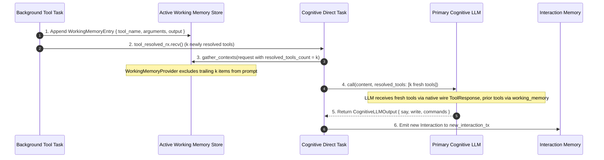
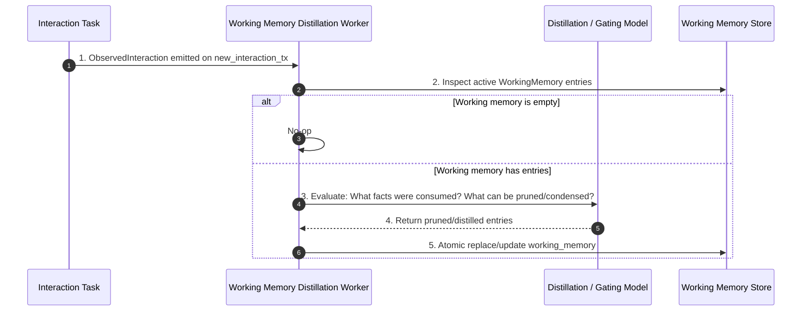

# [MVP] RFC: Active Working Memory for Tool Outputs and Multi-Turn Reasoning

## 1. Motivation and Goal

In the current Synapto architecture, tool execution outputs are treated as single-turn ephemeral events. When a tool finishes executing:
1. Its output (`ToolOutput`) is injected only into `RawLlmOptions` for the immediate turn.
2. The output payload is never stored in `InteractionMemory` (which tracks only `{ id, name, arguments }` in `InFlightTool`).
3. If multiple tools are triggered simultaneously, the first tool to resolve triggers an isolated cognitive cycle with its single result, while remaining tools remain in flight.
4. If a tool completes during a turn evaluated as `WaitingForMoreInput`, `NonActionable`, or ambient speech, the output is discarded without ever being used.
5. In subsequent turns, the LLM cannot inspect, recall, or reason about past tool outputs.

The goal of this RFC is to introduce **Active Working Memory** as a first-class `TemporalScope::Current` context provider, decoupling tool output persistence from conversational speech turns and providing asynchronous, interaction-driven background distillation.

---

## 2. Executive Summary

- **Context:** Synapto coordinates real-time audio and text interactions while executing background tools asynchronously.
- **Problem:**
  - Tool outputs vanish from the prompt after one turn.
  - The LLM cannot perform multi-turn reasoning on tool outputs.
  - Dependent tool calling and parallel tool execution fail because the first tool's return value is lost before the second tool finishes.
  - Turns with ambient speech or user hesitation forfeit resolved tool results permanently.
- **Solution:**
  1. **Immediate Ingestion on Arrival:** When a tool resolves, its output is appended immediately to an append-only `ActiveWorkingMemory` log. This ensures absolute safety against barge-in interrupts or aborted turns.
  2. **Zero-Duplication Context Compilation (Tail Slicing):**
     - When $k$ newly resolved tools arrive, they are passed as native wire `ChatMessage::ToolResponse` messages via `RawLlmOptions.resolved_tools`.
     - During prompt compilation, `WorkingMemoryProvider` slices the log to exclude the trailing $k$ items (`0..len - k`).
     - The $k$ newly arrived tools are delivered strictly through the native wire protocol, while all prior tools are delivered through `working_memory` in the prompt. Zero duplication occurs.
  3. **Automatic Promotion on Subsequent Turns:** On turn $t+1$, $k = 0$. The newly resolved tools automatically become visible in the prompt's `working_memory` view with zero state-machine mutations.
  4. **Interaction-Driven Distillation:** A background worker implements `InteractionObserver`. It wakes up strictly upon `Interaction` creation to compress raw payloads into salient facts and prune consumed/irrelevant records.

---

## 3. Structural Hierarchy

```
synapto-interface
└── context
    ├── TemporalScope::Current
    └── ContextRequest (with resolved_tools_count: usize)

synapto-core
├── working_memory (NEW: sibling to interactions)
│   ├── mod.rs (starts working memory subsystem and wires background distillation)
│   ├── store.rs (ActiveWorkingMemory, WorkingMemoryStore, and WorkingMemoryProvider)
│   └── distillation.rs (background distillation worker hooked to observers_tx)
├── interactions (conversational speech and interaction memory)
├── cognitive
│   ├── direct.rs (appends to working_memory_store on tool resolution)
│   └── side.rs (appends to working_memory_store on tool resolution)
└── lib.rs (wires working_memory alongside interactions in run_internal)
```

---

## 4. Data Models and Contracts

### 4.1 Working Memory Models (`synapto-core::working_memory`)

```rust
use serde::{Deserialize, Serialize};
use schemars::JsonSchema;
use synapto_interface::llm::LLMSafe;

#[derive(Serialize, Deserialize, JsonSchema, Clone, Copy, Debug, PartialEq, Eq, LLMSafe)]
pub(crate) enum WorkingMemoryState {
    /// The raw, uncompressed output directly from tool execution.
    Original,
    /// A distilled summary of the tool output produced by background consolidation.
    Condensed,
}

#[derive(Serialize, Deserialize, JsonSchema, Clone, Debug, PartialEq, Eq, LLMSafe)]
pub(crate) struct WorkingMemoryEntry {
    /// Name of the tool that generated this output.
    pub tool_name: String,
    /// Arguments passed to the tool invocation.
    pub arguments: serde_json::Value,
    /// Tool execution output: raw upon initial resolution, or distilled after background worker processing.
    pub output: serde_json::Value,
    /// Whether this is the verbatim raw tool output (Original) or a condensed summary (Condensed).
    pub state: WorkingMemoryState,
}

#[derive(
    Serialize,
    Deserialize,
    JsonSchema,
    Clone,
    Debug,
    Default,
    PartialEq,
    Eq,
    LLMSafe,
    derive_more::Deref,
    derive_more::DerefMut,
    derive_more::IntoIterator,
)]
pub(crate) struct ActiveWorkingMemory(pub Vec<WorkingMemoryEntry>);
```

### 4.2 Context Provider Contract (`TemporalScope::Current`)

```rust
use synapto_interface::context::{ContextProvider, ContextRequest, TemporalScope};

pub struct ContextRequest {
    pub recent_interactions: Vec<ContextInteraction>,
    pub initial_run: bool,
    pub resolved_tools_count: usize,
}

#[async_trait::async_trait]
impl ContextProvider for WorkingMemoryProvider {
    type Context = ActiveWorkingMemory;
    const NAME: &'static str = "working_memory";
    const SCOPE: TemporalScope = TemporalScope::Current;

    async fn context(&self, request: &ContextRequest) -> Result<Self::Context, String> {
        let memory = self.memory.read().await;
        let visible_len = memory.len().saturating_sub(request.resolved_tools_count);
        Ok(ActiveWorkingMemory(memory[..visible_len].to_vec()))
    }

    fn subscribe(&self) -> Option<tokio::sync::watch::Receiver<()>> {
        Some(self.change_rx.clone())
    }
}
```

### 4.3 Distillation Worker Replacement Contract

The primary cognitive loop does not manage memory eviction or cleanup. The background distillation worker evaluates `ActiveWorkingMemory` alongside the full current context and committed `ObservedInteraction`, and atomically replaces `ActiveWorkingMemory` with the pruned/distilled result:

```rust
#[async_trait::async_trait]
pub trait WorkingMemoryStore: Send + Sync + 'static {
    async fn append(&self, entry: WorkingMemoryEntry);
    async fn replace(&self, memory: ActiveWorkingMemory);
    async fn get(&self) -> ActiveWorkingMemory;
}
```

---

## 5. Execution Flow

### 5.1 Real-Time Tool Resolution & Cognitive Loop



### 5.2 Background Distillation Flow (`InteractionObserver`)



---

## 6. Detailed Component Analysis

### 6.1 Immediate Ingestion and Zero-Duplication Tail Slicing

To achieve both **native wire protocol compliance** (`ChatMessage::ToolResponse`) and **durable multi-turn memory** without duplicating payloads in the same request:

1. **Immediate Append on Arrival:**
   The moment a tool completes, its result is appended to `ActiveWorkingMemory`. The output is crash-safe and cannot be lost if the user barges in or interrupts the turn.
2. **Context Tail Slicing during Turn Execution ($k$ newly resolved tools):**
   - When the cognitive loop wakes up with $k$ freshly resolved tools, these $k$ items are passed to `RawLlmOptions.resolved_tools` to satisfy the provider's native wire `ChatMessage::ToolResponse` requirement.
   - When compiling `CognitiveLLMContent`, `WorkingMemoryProvider` excludes the last $k$ entries:
     $$\text{Prompt Entries} = \text{working\_memory}[0 \dots (\text{len} - k)]$$
   - Result: Fresh tools are delivered strictly through the native wire protocol. Previously resolved tools are delivered through `working_memory` in the user prompt. No payload is sent twice.
3. **Automatic Promotion on Subsequent Turns:**
   - In subsequent turns (where $k = 0$), the slice encompasses the full log (`0..len`).
   - The previously completed tools naturally appear in the prompt's `working_memory` with zero state-machine transitions or manual flags.

### 6.2 Tool Resolution Handling in `direct.rs` and `side.rs`

Modified Architecture:
```rust
.. if let res = tool_resolved_rx.recv() => {
    if let Some((doc_text, tool_call)) = res {
        // 1. Immediate Ingestion: Append directly to Working Memory store
        working_memory_store.append(WorkingMemoryEntry {
            tool_name: tool_call.fn_name.clone(),
            arguments: tool_call.fn_arguments.clone(),
            output: doc_text.into(),
        }).await;

        // 2. Execution Plane: Retire in-flight tracking marker
        resolve_in_flight_tool_tx.send(ToolCallId(tool_call.call_id.clone())).await.ok();

        // 3. Stage for native wire protocol delivery in this turn
        resolved_tools = Some(vec![(tool_call.clone(), doc_text)]);
        run_after_unpaused = true;
    }
}
```

When constructing `ContextRequest` during context compilation:
```rust
let request = synapto_interface::context::ContextRequest {
    recent_interactions,
    initial_run: initial_cognitive_trigger,
    resolved_tools_count: resolved_tools.as_ref().map(|v| v.len()).unwrap_or(0),
};
let current_contexts = registries.context.current.gather_contexts(&request).await;
```

### 6.3 Eliminating Artificial Debounce
- Tools execute and resolve at their own pace.
- If Tool A finishes first, it writes to Working Memory and executes turn 1 with Tool A on the wire and Tool B in flight.
- When Tool B finishes 2 seconds later, it writes to Working Memory and executes turn 2 with Tool B on the wire and Tool A visible in `working_memory`.
- The LLM makes decisions using both tool results with complete causal consistency and zero debounce timers.

### 6.4 Hybrid, Per-Record State Machine Distillation Worker
- **Trigger:** Listens on `mpsc::Receiver<ObservedInteraction>`.
- **Timing:** Runs strictly *after* the primary turn has completed, ensuring zero latency penalty for the active user response and zero write contention during prompt compilation.
- **Isolated Passes:** Evaluates each `WorkingMemoryEntry` in its own independent evaluation pass rather than batching all entries together, preventing cross-contamination.
- **Hybrid Evaluation (System 1 First):**
  - **`WorkingMemoryState::Condensed` Records:**
    - Re-condensing is strictly prohibited by construction.
    - Evaluated as a binary choice (`"keep"` vs. `"remove"`).
    - When `DecisionHandle` is available, this takes **0 generative LLM tokens** (~50–80ms).
  - **`WorkingMemoryState::Original` Records:**
    - Evaluated as a 3-way choice (`"keep"`, `"condense"`, `"remove"`).
    - If `keep` or `remove`: Executed directly via `DecisionHandle` (**0 generative LLM tokens**).
    - If `condense`: Only then invokes `synapto-llm` to summarize the raw payload into key facts and transitions the record to `WorkingMemoryState::Condensed`.
- **Fallback:** If `decision_handle` is not registered, cleanly falls back to `synapto-llm` with the same per-record state machine.

---

## 7. Migration and Implementation Plan

1. **Phase 1: Interface Contracts**
   - Define `WorkingMemoryEntry` and `ActiveWorkingMemory` in `synapto-interface::context`.
   - Update `ContextRequest` in `synapto-interface::context` to include `pub resolved_tools_count: usize`.

2. **Phase 2: Core Working Memory Subsystem (`synapto-core::working_memory`)**
   - Implement `WorkingMemoryStore` and `WorkingMemoryProvider` with tail-slicing logic (`memory[..len - k]`).
   - Register `WorkingMemoryProvider` automatically into `registries.context.current` in `synapto-core/src/lib.rs`.
   - Wire the distillation worker directly into `observers_tx` in `synapto-core/src/lib.rs`.

3. **Phase 3: Core Loop Ingestion Integration**
   - Update `cognitive_direct_task` and `cognitive_side_task` to append completed tools to `WorkingMemoryStore` immediately upon arrival.
   - Pass `resolved_tools_count: resolved_tools.as_ref().map(|v| v.len()).unwrap_or(0)` when building `ContextRequest`.

4. **Phase 4: Scenario and Multi-Tool Validation**
   - Add scenario tests for:
     - Parallel tools resolving with staggered delays.
     - Dependent tool calls across consecutive turns.
     - Interrupted and ambient speech turns preserving tool outputs.

---

## 8. Definition of Done (DoD)

- [ ] `WorkingMemoryProvider` registered under `registries.context.current`.
- [ ] Tool resolution writes directly to Working Memory before waking the cognitive loop.
- [ ] Multiple tool resolutions preserve prior tool results across turns.
- [ ] Distillation worker triggers exclusively on `Interaction` creation without adding turn latency.
- [ ] Scenario tests passing for multi-tool staggered resolution and consequent turn reasoning.
