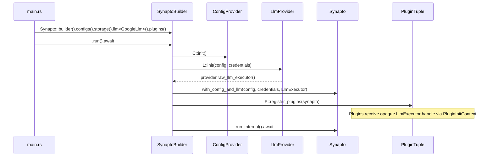

# [MVP] Pluggable Singleton LLM Provider and Core Decoupling

## 1. User-Centric Motivation & Goal
Developers and operators want the flexibility to run AI assistants across diverse LLM backends (such as OpenAI, Anthropic, Google Gemini/Vertex AI, Ollama, AWS Bedrock, or custom local inference engines) without modifying core framework code or bundling unwanted cloud vendor dependencies into the core engine.

Currently, the Google Gemini and Vertex AI implementation (`synapto-llm` via `ConcreteLlmExecutor`) is hardcoded directly inside `synapto-core`. Every bundle inevitably inherits Google-specific dependencies, configurations, and authentication paths. Operators who want to run a completely local assistant or target a different cloud provider cannot cleanly swap out the LLM engine.

By establishing a dedicated, pluggable singleton LLM Provider architecture (mirroring the clean builder pattern used for storage and decision providers), operators explicitly select exactly one LLM provider during bundle configuration:
```rust
Synapto::builder()
    .configs::<(ConfigJson<DataDir>, DotEnv, Env)>()
    .storage::<Storage>()
    .llm::<GoogleLlm>() // Exactly one required LLM provider
    .run()
    .await
```
This guarantees compile-time enforcement of the single-provider constraint, eliminates vendor lock-in and vendor fields in `Config`, and keeps the core engine lightweight and vendor-neutral.

## 2. Executive Summary
- **Context:** `synapto-core` initializes `synapto_interface::llm::LlmExecutor` by instantiating `synapto_llm::ConcreteLlmExecutor` inside `Synapto::with_config_provider`. The LLM client setup relies on fields embedded directly in `Config` (`google_vertex_ai_location`, `google_project_id`, `google_service_account_credentials`, `gemini_api_key`).
- **Motivation:** Hardcoding the LLM executor inside `synapto-core` violates the Principle of Locality (Rule 21), Principle of Explicit Configuration (Rule 28), and Subsystem Configuration Domain Isolation (Rule 32). Core cannot be built without `synapto-llm` and its Google Cloud dependencies, preventing modular multi-provider support.
- **Overarching Goals:** Completely decouple LLM backend instantiation from `synapto-core`. Establish a dedicated `LlmProvider` capability trait in `synapto-interface`. Enforce that every bundle configures exactly one LLM provider at compile time using the typestate builder pattern (`SynaptoBuilder`). Separate vendor-neutral prompt DSL (`synapto-llm`) from concrete vendor executors, moving Google-specific backend execution into an external integration provider (`integrations/llm-providers/google`).
- **Purpose:** Define `LlmProvider` in `synapto-interface::llm`. Add `.llm::<L>()` to `SynaptoBuilder` with compile-time zero-or-multiple provider rejection. Remove `ConcreteLlmExecutor` and Google Cloud dependencies from `synapto-core` and `synapto-llm`. Clean vendor-specific fields out of `Config`. Retain `synapto-llm` in `synapto-core` strictly as a vendor-neutral prompt DSL and tool-execution client crate.
- **Problem:**
  - `synapto-core` directly instantiates `synapto_llm::ConcreteLlmExecutor` backed by GCP dependencies.
  - `Config` is polluted with Google/Gemini specific fields marked with `// FIXME`.
  - Bundles have no way to choose or substitute the underlying `RawLlmExecutor` backend.
  - Unlike `Storage` (singular, mandatory) or `Decision` (singular, optional), there is no compile-time mechanism to bind a singular, mandatory LLM provider to the bundle.
- **Solution:**
  - Define `LlmProvider` in `synapto-interface::llm`:
    ```rust
    pub trait LlmProvider: Send + Sync + 'static {
        type Config: serde::de::DeserializeOwned;

        fn init(
            config: Self::Config,
            credentials: CredentialsHandle,
        ) -> Result<Self, String>
        where
            Self: Sized;

        fn raw_llm_executor(&self) -> Arc<dyn RawLlmExecutor>;
    }
    ```
  - Extend `ConfigProvider` with `load_llm_config`, `get_llm_config_value`, and `get_llm_config<T>`, mapping to the `"llm"` configuration namespace per Rule 32 across `env.rs`, `dotenv.rs`, `json.rs`, and config tuple macros.
  - Introduce typestate markers `NoLlm` and `WithLlm<L>` on `SynaptoBuilder`.
  - Expose `.llm::<L: LlmProvider>()` exclusively on `NoLlm`. Calling `.llm()` a second time or omitting `.llm()` results in a compile-time failure when calling `.run()`.
  - Partition `synapto-llm`: retain the vendor-neutral prompt DSL (`LLMClient`, `Instruction`, `ToolExecutor`) in `crates/llm`, while creating `synapto-llm-google` in `integrations/llm-providers/google` as `GoogleLlm` resolving tokens via `CredentialsHandle` per Rule 27. Delete deprecated `google_credentials.rs` from `synapto-core`.

## 3. Current State Analysis
- **Hardcoded Instantiation in Core:**
  In `synapto/crates/core/src/lib.rs` (`Synapto::with_config_provider`):
  ```rust
  let config = config_provider.get_core_config();
  let executor_config = synapto_llm::LLMClientConfig {
      google_vertex_ai_location: config.google_vertex_ai_location.clone(),
      google_project_id: config.google_project_id.clone(),
      google_service_account_credentials: config
          .google_service_account_credentials
          .clone()
          .map(|secret| secret.into_secret()),
      gemini_api_key: config.gemini_api_key.clone(),
  };
  let llm_executor = synapto_interface::llm::LlmExecutor::new(
      synapto_llm::ConcreteLlmExecutor::new(executor_config),
  );
  ```
- **Polluted Core Configuration (`crates/core/src/config.rs`):**
  `Config` directly contains:
  ```rust
  // FIXME
  pub google_vertex_ai_location: Option<String>,
  // FIXME
  pub google_project_id: String,
  // FIXME
  pub gemini_api_key: Option<Secret<String>>,
  // FIXME
  pub google_service_account_credentials: Option<Secret<GoogleServiceAccountCredentials>>,
  ```
- **Flaws in Current Architecture:**
  - **Violation of Subsystem Configuration Domain Isolation (Rule 32):** Provider-specific LLM parameters are merged into core config rather than residing under `"llm"`.
  - **Violation of Principle of Locality (Rule 21):** Google credentials and project parameters live in core rather than in an integration provider crate.
  - **Lack of Pluggability:** Any alternative LLM backend (e.g. Ollama, OpenAI, Anthropic, Mock/Test LLM) requires modifying core source code.
  - **Absence of Compile-Time Invariants:** Core assumes a single hardcoded provider exists, but lacks typestate safety if made pluggable.

## 4. Structural Hierarchy
- **Mission:** Pluggable, Type-Safe, Singleton LLM Provider Architecture with Strict Core Decoupling.
- **Goal:** Enable bundles to configure any LLM provider via `SynaptoBuilder`, enforcing exactly one LLM provider at compile time while isolating configuration into dedicated namespaces.
- **Method Cardinality Convention (Rule 31):**
  - **Singular (Single Item):** `.llm::<L>()` registers the single required LLM provider.
- **Atomic Responsibilities:**
  - **`LlmProvider` (`synapto-interface::llm`):** Pure provider trait defining provider lifecycle, configuration deserialization, and raw executor extraction.
  - **`RawLlmExecutor` (`synapto-interface::llm`):** Transport-level trait for low-level chat completion calls (existing).
  - **`LlmExecutor` (`synapto-interface::llm`):** Opaque handle wrapping `Arc<dyn RawLlmExecutor>` passed to plugins and cognitive tasks (existing, compliant with Rule 26).
  - **`ConfigProvider` (`synapto-core` / `synapto-interface`):** Extended with `load_llm_config` and `get_llm_config_value` to support the `"llm"` configuration namespace per Rule 32.
  - **`SynaptoBuilder<C, S, PR, CR, D, L, P>` (`synapto-core`):** Typestate builder tracking the configuration state of all subsystems.
  - **`NoLlm` & `WithLlm<L>` (`synapto-core`):** Zero-cost typestate markers enforcing that `.run()` is only callable when `L != NoLlm` and `.llm()` can only be called once.
  - **`GoogleLlm` (`integrations/llm-providers/google`):** Concrete LLM provider implementing `LlmProvider` backed by `ConcreteLlmExecutor`.

## 5. Data Models

### 5.1 Dedicated LLM Provider Trait (`synapto-interface::llm`)
Complies with `ARCHITECTURE.md` Rule 15 (Strong Typing), Rule 24 (Strict Domain Registries), and Rule 26 (Encapsulated Handles).

```rust
use std::sync::Arc;
use synapto_interface::credentials::CredentialsHandle;

/// Pure capability trait for LLM providers.
/// LLM providers do NOT implement Plugin and have no actor or channel capabilities.
pub trait LlmProvider: Send + Sync + 'static {
    type Config: serde::de::DeserializeOwned;

    fn init(
        config: Self::Config,
        credentials: CredentialsHandle,
    ) -> Result<Self, String>
    where
        Self: Sized;

    fn raw_llm_executor(&self) -> Arc<dyn RawLlmExecutor>;
}
```

### 5.2 Typestate Marker Types & Builder Transition (`synapto-core`)
Complies with `ARCHITECTURE.md` Rule 15 (Strong Typing) and Rule 31 (Fluent Bundle Builder Pattern).

```rust
use std::marker::PhantomData;
use std::sync::Arc;
use synapto_interface::credentials::CredentialsHandle;
use synapto_interface::llm::{LlmProvider, RawLlmExecutor};
use synapto_telemetry::tracing::Tracing;

/// Marker for unconfigured mandatory LLM provider.
pub struct NoLlm;

/// Marker for configured singular LLM provider.
pub struct WithLlm<L>(PhantomData<L>);

/// Internal setup helper trait for applying the LLM provider to Synapto.
/// Executes before Synapto is instantiated to avoid Chicken-and-Egg Lifecycle Paradox.
pub trait LlmSetup<C> {
    type Provider: LlmProvider;
    fn setup(config_provider: &C, credentials: &CredentialsHandle) -> Result<Arc<dyn RawLlmExecutor>, String>;
}

impl<C, L> LlmSetup<C> for WithLlm<L>
where
    C: config::ConfigProvider,
    L: LlmProvider,
{
    type Provider = L;

    fn setup(config_provider: &C, credentials: &CredentialsHandle) -> Result<Arc<dyn RawLlmExecutor>, String> {
        let full_path = core::any::type_name::<L>();
        let crate_name = full_path
            .split("::")
            .next()
            .unwrap_or("")
            .to_string()
            .replace('-', "_");
        let base_path = full_path.split('<').next().unwrap_or(full_path);
        let provider_type_name = base_path.split("::").last().unwrap_or("").to_string();

        let raw_config = config_provider
            .get_llm_config_value(&crate_name, &provider_type_name);

        let config: L::Config = serde_json::from_value(raw_config).map_err(|e| {
            format!(
                "Failed to parse config for LLM provider '{}': {}",
                provider_type_name, e
            )
        })?;

        let provider = L::init(config, credentials.clone())?;
        Tracing::add_plugin_to_log(&provider_type_name);
        tracing::info!("  LLM capability registered: {}", provider_type_name);
        Ok(provider.raw_llm_executor())
    }
}
```

### 5.3 Synapto Engine Constructor with Injected LLM (`synapto-core`)

```rust
impl<C, S, PR, CR> Synapto<C, S, PR, CR>
where
    C: config::ConfigProvider,
    S: synapto_interface::storage::StorageConnection
        + synapto_interface::storage::KeyValueStore
        + synapto_interface::storage::RecordStore,
    PR: prompt_provider::CognitivePromptProvider,
    CR: credentials::CredentialsTuple,
{
    pub(crate) fn with_config_and_llm(
        config_provider: C,
        credentials: synapto_interface::credentials::CredentialsHandle,
        llm_executor: synapto_interface::llm::LlmExecutor,
        error_rx: std::sync::mpsc::Receiver<String>,
        tracing: Tracing,
    ) -> Self {
        // Retains all existing internal spawner vectors and channel allocations from
        // the original Synapto::with_config_provider, replacing only the hardcoded
        // ConcreteLlmExecutor instantiation with the injected llm_executor.
        let config_provider = Arc::new(config_provider);
        let config = config_provider.get_core_config();

        let (current_context_tx, _current_context_rx) =
            synapto_interface::sync::watch::channel(serde_json::Value::Null);

        let registries = synapto_interface::context::EngineRegistries::default();
        let storage_resolver = Arc::new(CoreStorageConfigResolver {
            provider: config_provider.clone(),
        });
        let storage = synapto_interface::storage::StorageHandle::new(storage_resolver);

        Self {
            config,
            config_provider,
            decision_handle: synapto_interface::decision::DecisionHandle::empty(),
            llm_executor,
            registries,
            credentials,
            storage,
            current_context_tx,
            gui_spawner: None,
            _tracing: tracing,
            error_rx: Some(error_rx),
            chat_spawners: Vec::new(),
            audio_input_spawners: Vec::new(),
            audio_output_spawners: Vec::new(),
            stt_spawners: Vec::new(),
            tts_spawners: Vec::new(),
            diarization_spawners: Vec::new(),
            audio_recorder_spawners: Vec::new(),
            camera_spawners: Vec::new(),
            call_spawners: Vec::new(),
            context_providers: Vec::new(),
            plugins: Vec::new(),
            _prompt_provider: PhantomData,
            _storage_provider: PhantomData,
            _credentials_provider: PhantomData,
        }
    }
}
```

### 5.4 Typestate Transitions on `SynaptoBuilder` (`synapto-core`)

```rust
/// Zero-cost typestate builder for Synapto bundles tracking 7 subsystems.
pub struct SynaptoBuilder<C, S, PR, CR, D, L, P> {
    _marker: PhantomData<(C, S, PR, CR, D, L, P)>,
}

/// Entry point for fluent bundle composition with 7 typestate parameters.
impl Synapto<NoConfig, NoStorage, prompt_provider::EmptyPromptProvider, ()> {
    pub fn builder() -> SynaptoBuilder<
        NoConfig,
        NoStorage,
        prompt_provider::EmptyPromptProvider,
        (),
        NoDecision,
        NoLlm,
        (),
    > {
        SynaptoBuilder {
            _marker: PhantomData,
        }
    }
}

impl<C, S, PR, CR, D, L, P> SynaptoBuilder<C, S, PR, CR, D, L, P> {
    pub fn configs<NewC: config::ConfigProvider>(self) -> SynaptoBuilder<NewC, S, PR, CR, D, L, P> {
        SynaptoBuilder { _marker: PhantomData }
    }

    pub fn storage<NewS>(self) -> SynaptoBuilder<C, NewS, PR, CR, D, L, P>
    where
        NewS: synapto_interface::storage::StorageConnection
            + synapto_interface::storage::KeyValueStore
            + synapto_interface::storage::RecordStore,
    {
        SynaptoBuilder { _marker: PhantomData }
    }

    pub fn prompt<NewPR: prompt_provider::CognitivePromptProvider>(
        self,
    ) -> SynaptoBuilder<C, S, NewPR, CR, D, L, P> {
        SynaptoBuilder { _marker: PhantomData }
    }

    pub fn credentials<NewCR: credentials::CredentialsTuple>(
        self,
    ) -> SynaptoBuilder<C, S, PR, NewCR, D, L, P> {
        SynaptoBuilder { _marker: PhantomData }
    }

    pub fn plugins<NewP>(self) -> SynaptoBuilder<C, S, PR, CR, D, L, NewP> {
        SynaptoBuilder { _marker: PhantomData }
    }
}

/// Singleton decision provider registration is available only when NoDecision is present,
/// preserving arbitrary chaining order with .llm().
impl<C, S, PR, CR, L, P> SynaptoBuilder<C, S, PR, CR, NoDecision, L, P> {
    pub fn decision<D: synapto_interface::decision::DecisionProvider>(
        self,
    ) -> SynaptoBuilder<C, S, PR, CR, WithDecision<D>, L, P> {
        SynaptoBuilder { _marker: PhantomData }
    }
}

/// Singleton LLM provider registration is available only when NoLlm is present.
impl<C, S, PR, CR, D, P> SynaptoBuilder<C, S, PR, CR, D, NoLlm, P> {
    pub fn llm<L: LlmProvider>(
        self,
    ) -> SynaptoBuilder<C, S, PR, CR, D, WithLlm<L>, P> {
        SynaptoBuilder {
            _marker: PhantomData,
        }
    }
}

/// Terminal execution method: requires mandatory C (Config), S (Storage), and L (WithLlm).
impl<C, S, PR, CR, D, L, P> SynaptoBuilder<C, S, PR, CR, D, WithLlm<L>, P>
where
    C: config::ConfigProvider,
    S: synapto_interface::storage::StorageConnection
        + synapto_interface::storage::KeyValueStore
        + synapto_interface::storage::RecordStore,
    PR: prompt_provider::CognitivePromptProvider,
    CR: credentials::CredentialsTuple,
    D: DecisionSetup<C, S, PR, CR>,
    L: LlmProvider,
    WithLlm<L>: LlmSetup<C>,
    P: PluginTuple<C, S, PR, CR>,
{
    pub async fn run(self) -> ExitCode {
        rustls::crypto::ring::default_provider().install_default().ok();
        let (gui_layer, error_rx) = synapto_telemetry::tracing::GuiErrorLayer::new();
        let tracing = Tracing::setup(gui_layer);

        let config_provider = C::init();
        let credentials = match CR::build_handle(&config_provider) {
            Ok(creds) => creds,
            Err(e) => panic!("Failed to build credentials handle: {}", e),
        };

        let raw_executor = match <WithLlm<L> as LlmSetup<C>>::setup(&config_provider, &credentials) {
            Ok(exec) => exec,
            Err(e) => panic!("Failed to initialize LLM provider: {}", e),
        };
        let llm_executor = synapto_interface::llm::LlmExecutor::from_arc(raw_executor);

        let mut synapto = Synapto::<C, S, PR, CR>::with_config_and_llm(
            config_provider,
            credentials,
            llm_executor,
            error_rx,
            tracing,
        );

        if let Err(e) = D::setup(&mut synapto) {
            panic!("Failed to initialize decision provider: {}", e);
        }
        let synapto = P::register_plugins(synapto).await;
        synapto.run_internal().await
    }
}
```

### 5.5 Concrete Google LLM Provider Configuration (`synapto-llm-google`)
Complies with `ARCHITECTURE.md` Rule 27 (Unified Credentials Provider) and Rule 28 (Explicit Configuration).
`GoogleLlm` relies exclusively on ambient `CredentialsHandle` to acquire bearer tokens for `GoogleCloudTarget`. It does not embed custom authentication, API keys, or `gcp_auth`.

```rust
use serde::{Deserialize, Serialize};

/// Explicit configuration struct for Google Gemini / Vertex AI provider.
#[derive(Debug, Clone, Serialize, Deserialize)]
#[serde(deny_unknown_fields)]
pub struct GoogleLlmConfig {
    pub google_project_id: String,
    pub google_vertex_ai_location: String,
}
```

### 5.6 JSON Configuration Schema Example
Complies with `ARCHITECTURE.md` Rule 28 (Explicit Configuration) and Rule 32 (Subsystem Configuration Domain Isolation).

```json
{
  "llm": {
    "synapto_llm_google": {
      "GoogleLlm": {
        "google_project_id": "my-gcp-project",
        "google_vertex_ai_location": "us-central1"
      }
    }
  }
}
```

### 5.7 LLM Tooling and Prompt Payloads Example
Complies with Section 5 of the RFC protocol. Context compiled for LLM calls and resulting output command structures:

Compiled input prompt context under `context_plugins`:
```json
{
  "role": "user",
  "content": "{\"memories\":[{\"type\":\"semantic\",\"content\":\"User prefers concise replies\"}],\"state\":{\"interaction_state\":\"active\"},\"message\":\"Turn off the lights\"}"
}
```

Structured output command generated by LLM:
```json
{
  "reasoning": "The user explicitly asked to turn off the lights. Dispatching home assistant tool call.",
  "commands": {
    "say": "Turning off the living room lights now.",
    "write": null,
    "state_changes": []
  }
}
```

### 5.8 Scenario Testing Provider (`synapto-test`)
Complies with Section 1 of Implementation & Testing Protocols.
To prevent regressions across existing scenarios without requiring dummy cloud keys, `synapto-test` provides `MockLlm`:

```rust
use std::sync::Arc;
use synapto_interface::credentials::CredentialsHandle;
use synapto_interface::llm::{LlmProvider, RawLlmExecutor, RawLlmOptions};

#[derive(Debug, Clone, Default, serde::Deserialize)]
pub struct MockLlmConfig {}

pub struct MockLlmExecutor;

#[async_trait::async_trait]
impl RawLlmExecutor for MockLlmExecutor {
    async fn execute_raw(
        &self,
        _model: &str,
        _system_prompt: &str,
        _prompt: &str,
        _options: RawLlmOptions,
    ) -> Result<genai::chat::ChatResponse, String> {
        Ok(genai::chat::ChatResponse {
            content: genai::chat::MessageContent::from(""),
            reasoning_content: None,
            model_iden: genai::ModelIden::new(genai::adapter::AdapterKind::OpenAI, "mock"),
            provider_model_iden: genai::ModelIden::new(genai::adapter::AdapterKind::OpenAI, "mock"),
            stop_reason: Some(genai::chat::StopReason::Completed("stop".to_string())),
            usage: genai::chat::Usage::default(),
            captured_raw_body: None,
            response_id: None,
        })
    }
}

pub struct MockLlm {
    executor: Arc<MockLlmExecutor>,
}

impl LlmProvider for MockLlm {
    type Config = MockLlmConfig; // Safely deserializes from empty map `{}` in scenario tests

    fn init(_config: Self::Config, _credentials: CredentialsHandle) -> Result<Self, String> {
        Ok(Self {
            executor: Arc::new(MockLlmExecutor),
        })
    }

    fn raw_llm_executor(&self) -> Arc<dyn RawLlmExecutor> {
        self.executor.clone()
    }
}
```

## 6. Component Architecture & Execution Flow
- **Decoupled Engine Bootstrap:**
  `SynaptoBuilder` manages bundle initialization across distinct stages. `SynaptoBuilder` holds typestate `(C, S, PR, CR, D, L, P)`.
  1. `.configs<C>()`: Registers configuration providers. Transitions `NoConfig -> C`.
  2. `.storage<S>()`: Registers storage backend. Transitions `NoStorage -> S`.
  3. `.prompt<PR>()`: Registers prompt provider (optional, defaults to `EmptyPromptProvider`).
  4. `.credentials<CR>()`: Registers credentials providers (optional, defaults to `()`).
  5. `.decision<D>()`: Registers singular decision provider (optional, transitions `NoDecision -> WithDecision<D>`).
  6. `.llm<L>()`: Registers singular mandatory LLM provider (mandatory, transitions `NoLlm -> WithLlm<L>`). Calling `.llm()` again produces a compile error because `.llm()` is implemented only for `NoLlm`.
  7. `.plugins<P>()`: Registers actor and observer plugins tuple.
  8. `.run().await`: Terminal method. Enforced via trait bounds to be present only when `C != NoConfig`, `S != NoStorage`, and `L != NoLlm`.
- **Execution Flow at Boot:**
  1. `C::init()` and `CR::build_handle(&config_provider)` instantiate configuration and ambient credentials.
  2. `LlmSetup::setup(&config_provider, &credentials)` initializes `L: LlmProvider` by loading `"llm"` configuration via `ConfigProvider::get_llm_config_value`. It extracts the `Arc<dyn RawLlmExecutor>` and wraps it inside the opaque `LlmExecutor` handle.
  3. `Synapto::<C, S, PR, CR>::with_config_and_llm(config_provider, credentials, llm_executor)` constructs the core engine with the verified, non-empty `LlmExecutor`.
  4. `DecisionSetup::setup(&mut synapto)` initializes the decision engine (if configured).
  5. `P::register_plugins(synapto)` initializes all plugins, injecting `PluginInitContext` containing the configured `LlmExecutor` and `DecisionHandle`.
  6. `synapto.run_internal().await` starts cognitive loops (`cognitive_direct_task`, `cognitive_side_task`, `distillation_task`). All tasks consume the identical singleton `LlmExecutor`.

## 7. Architectural Diagrams

### 7.1 Canonical Chaining Flow (Builder Typestate)
```mermaid
stateDiagram-v2
    [*] --> Initial: Synapto::builder()
    Initial --> WithConfig: .configs<C>()
    WithConfig --> BaseReady: .storage<S>()
    BaseReady --> BaseReady: .prompt<PR>() [optional]
    BaseReady --> BaseReady: .credentials<CR>() [optional]
    BaseReady --> WithDec: .decision<D>() [optional]
    BaseReady --> WithLlmOnly: .llm<L>() [strictly once]
    WithDec --> Ready: .llm<L>() [strictly once]
    WithLlmOnly --> Ready: .decision<D>() [optional]
    WithLlmOnly --> Ready: .plugins<P>()
    Ready --> Ready: .plugins<P>()
    Ready --> Running: .run().await
    Running --> [*]
```

### 7.2 Execution Sequence


## 8. Robustness & Pragmatic Security Trade-offs

### 8.1 Hazard Analysis
- **Hazard 1: Zero Configured LLM Providers:**
  If a developer omits `.llm::<L>()`, the cognitive core would lack a language reasoning engine, leading to runtime panics during boot.
  - *Mitigation:* The `.run()` method is not implemented for `SynaptoBuilder<..., NoLlm, ...>`. Omitting `.llm()` fails at compile time.
- **Hazard 2: Multiple Conflicting LLM Providers:**
  A developer might call `.llm::<GoogleLlm>()` and subsequently `.llm::<OpenAiLlm>()`.
  - *Mitigation:* `.llm()` is implemented exclusively for `NoLlm` and transitions the builder to `WithLlm<L>`. A second call is rejected by the Rust compiler.
- **Hazard 3: Misplaced LLM Provider in `.plugins()`:**
  A developer might attempt to place `GoogleLlm` inside the `.plugins::<(GoogleLlm, ...)>()` tuple.
  - *Mitigation:* `LlmProvider` does not implement `Plugin`. Passing an `LlmProvider` to `.plugins()` violates `P: PluginTuple` and triggers a compile error.
- **Hazard 4: Leaking Credentials across Cloud Providers:**
  An LLM provider might attempt to read ambient credentials belonging to another vendor.
  - *Mitigation:* `CredentialsHandle` uses strongly-typed target descriptors (`CredentialTarget`). `GoogleLlm` resolves only `GoogleCloudTarget` through `credentials.resolve_bearer_token()`.

### 8.2 Accepted Risks (MVP Scope)
1. **Synchronous Boot Initialization:**
   - *Risk:* `L::init` performs synchronous or quick async setup without drop guards or retries.
   - *Mitigation (MVP):* Fail-fast process termination on invalid LLM configuration at startup is preferred over complex background retry loops.
2. **Single Shared Model Options:**
   - *Risk:* `RawLlmOptions` applies to all calls through `RawLlmExecutor` without fine-grained per-plugin rate limiting.
   - *Mitigation (MVP):* Accepted for the initial singleton architecture; model and rate-limit governance are handled upstream by `LLMClient`.
3. **Unbounded Boot Timeout in `LlmProvider::init`:**
   - *Risk:* `L::init` credential or network check runs without bounding by an initialization timeout.
   - *Mitigation (MVP):* Accepted for MVP; operator cancellation or container timeout handles non-responsive infrastructure.
4. **Lack of In-Flight Token Refresh Retries:**
   - *Risk:* Bearer tokens expired mid-flight return HTTP 401 without provider-level retry loops.
   - *Mitigation (MVP):* Handled upstream via `GoogleCredentials` token caching; complex per-request credential retry loops inside the provider are deferred.
5. **Absence of Multi-Provider Fallbacks:**
   - *Risk:* Outages in the configured LLM backend stall the cognitive loop without automated provider failover.
   - *Mitigation (MVP):* Singleton provider model is strictly enforced; fallback orchestration belongs in higher-order proxy providers.
6. **Dynamic Model Reconfiguration at Runtime:**
   - *Risk:* Changing LLM model parameters or switching endpoints without restarting the process is unsupported.
   - *Mitigation (MVP):* Model selection is immutable for the process lifetime; configuration changes require process restarts.
7. **Mid-Flight Stream Cancellation Cleanup:**
   - *Risk:* Dropping a cognitive execution future mid-stream does not explicitly signal upstream cancellation to cloud endpoints.
   - *Mitigation (MVP):* Rely on client connection drop; advanced HTTP/2 abort signaling is deferred.

## 9. Systemic Consequences

### 9.1 Codebase Audit & Affected Targets
A mechanical grep audit confirms all files requiring migration:

#### Core Engine, Interface & LLM DSL
- `synapto-ai/synapto/crates/interface/src/llm.rs`: Adds `LlmProvider` trait.
- `synapto-ai/synapto/crates/core/src/lib.rs`: Removes direct `ConcreteLlmExecutor` instantiation; implements 7-parameter `SynaptoBuilder`, `NoLlm`, `WithLlm<L>`, `LlmSetup`, and `.llm::<L>()`.
- `synapto-ai/synapto/crates/core/src/config/provider.rs`: Adds `load_llm_config`, `get_llm_config_value`, and `get_llm_config<T>` to `ConfigProvider`, `()` impl, and tuple macros.
- `synapto-ai/synapto/crates/core/src/config/env.rs`: Updates `load_core_config()` to strip `"LLM"` via `obj.remove("LLM")` and implements `load_llm_config` using `SYNAPTO__LLM__{crate}__{provider}__`.
- `synapto-ai/synapto/crates/core/src/config/dotenv.rs`: Updates `load_core_config()` to strip `"LLM"` via `obj.remove("LLM")` and implements `load_llm_config`.
- `synapto-ai/synapto/crates/core/src/config/json.rs`: Updates `load_core_config()` to strip `"llm"` via `obj.remove("llm")` and implements `load_llm_config` by querying `self.config.get("llm")`.
- `synapto-ai/synapto/crates/core/src/config.rs`: Removes `google_vertex_ai_location`, `google_project_id`, `gemini_api_key`, and `google_service_account_credentials` fields from `Config`.
- `synapto-ai/synapto/crates/core/src/google_credentials.rs`: Deletes dead code file.
- `synapto-ai/synapto/crates/llm/src/lib.rs`: Retains prompt DSL and client abstractions (`LLMClient`, `Instruction`, `ToolExecutor`), while removing `ConcreteLlmExecutor`, `gcp_auth`, and `LLMClientConfig`.
- `synapto-ai/synapto/Cargo.toml`: Adds `synapto-llm-google` to `members` and `[workspace.dependencies]`.
- `synapto-ai/synapto/integrations/llm-providers/google/`: New crate `synapto-llm-google` providing `GoogleLlm` implementing `LlmProvider`.
- `synapto-ai/synapto/crates/test/src/`: Provides `MockLlm` with `type Config = ()` for zero-config scenario testing.

#### Production Bundles (`synapto-ai` - 5 bundles, `allusio-ai` - 3 bundles, Total: 8 bundles)
- `synapto-ai/personal-assistant/`: Adds `synapto-llm-google` to `Cargo.toml` and `.llm::<GoogleLlm>()` in `src/main.rs`.
- `synapto-ai/kid-assistant/`: Adds `synapto-llm-google` to `Cargo.toml` and `.llm::<GoogleLlm>()` in `src/main.rs`.
- `synapto-ai/bundles/home-assistant/`: Adds `synapto-llm-google` to `Cargo.toml` and `.llm::<GoogleLlm>()` in `src/main.rs`.
- `synapto-ai/bundles/rpg/`: Adds `synapto-llm-google` to `Cargo.toml` and `.llm::<GoogleLlm>()` in `src/main.rs`.
- `synapto-ai/bundles/teacher/`: Adds `synapto-llm-google` to `Cargo.toml` and `.llm::<GoogleLlm>()` in `src/main.rs`.
- `allusio-ai/alfons/`: Adds `synapto-llm-google` to `Cargo.toml` and `.llm::<GoogleLlm>()` in `src/main.rs`.
- `allusio-ai/org-assistant/`: Adds `synapto-llm-google` to `Cargo.toml` and `.llm::<GoogleLlm>()` in `src/main.rs`.
- `allusio-ai/synapto-bundles/research/`: Adds `synapto-llm-google` to `Cargo.toml` and `.llm::<GoogleLlm>()` in `src/main.rs`.

#### Integration Scenario Test Suites (23 total suites)
- `synapto-ai/synapto/crates/test/tests/scenario_tests.rs`: Adds `.llm::<MockLlm>()`.
- All 17 plugin and provider scenario test files in `synapto-ai/synapto/integrations/**/scenario_tests.rs`: Add `.llm::<MockLlm>()`.
- All 5 plugin scenario test files in `allusio-ai/synapto-plugins/**/tests/scenario_tests.rs`: Add `.llm::<MockLlm>()`.

### 9.2 Documentation Updates
- `synapto/docs/src/ARCHITECTURE.md`: Document Rule 33 (Pluggable Singleton LLM Provider) and update Rule 31 (Fluent Bundle Builder Pattern) diagram and specification to include `.llm::<L>()`.

## 10. Definition of Done (DoD)
- [x] Add `pub trait LlmProvider` to `synapto-interface::llm`.
- [x] Add `load_llm_config`, `get_llm_config_value`, and `get_llm_config<T>` to `ConfigProvider` in `synapto-core`, updating `env.rs`, `dotenv.rs`, `json.rs` (including `obj.remove("llm")`), and config provider tuple macros.
- [x] Strip vendor-specific fields (`google_vertex_ai_location`, `google_project_id`, `gemini_api_key`, `google_service_account_credentials`) from `Config` in `synapto-core/src/config.rs`.
- [x] Delete `synapto/crates/core/src/google_credentials.rs`.
- [x] Strip `gcp_auth` and `ConcreteLlmExecutor` from `synapto-llm`, preserving prompt DSL and `LLMClient`.
- [x] Update `SynaptoBuilder` to 7 typestate parameters, implementing `NoLlm`, `WithLlm<L>`, `LlmSetup`, and `Synapto::with_config_and_llm`.
- [x] Implement `.llm::<L: LlmProvider>()` on `SynaptoBuilder<C, S, PR, CR, D, NoLlm, P>` and constrain `.run()` to `WithLlm<L>`.
- [x] Create `synapto-llm-google` in `synapto/integrations/llm-providers/google` implementing `LlmProvider` with `GoogleLlm` (resolving bearer tokens exclusively via `CredentialsHandle`).
- [x] Register `synapto-llm-google` in root workspace `Cargo.toml`.
- [x] Implement `MockLlm` with `type Config = MockLlmConfig` in `synapto-test` for scenario testing.
- [x] Update all 8 production bundles across `synapto-ai` and `allusio-ai` (`Cargo.toml` and `main.rs`) to configure `.llm::<GoogleLlm>()`.
- [x] Update all 23 scenario test suites across `synapto-ai` and `allusio-ai` to configure `.llm::<MockLlm>()`.
- [x] Update `ARCHITECTURE.md` with Rule 33 and updated Rule 31 builder steps.
