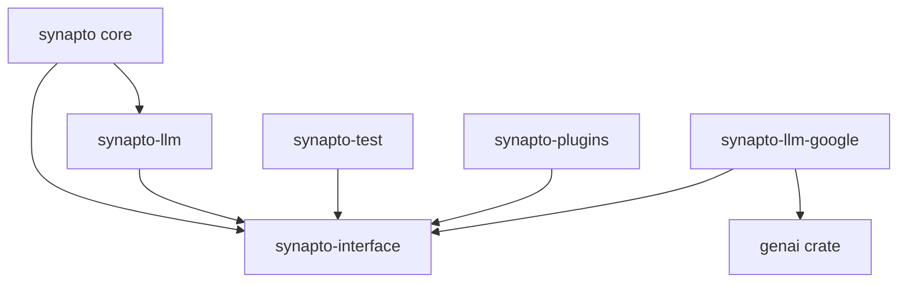
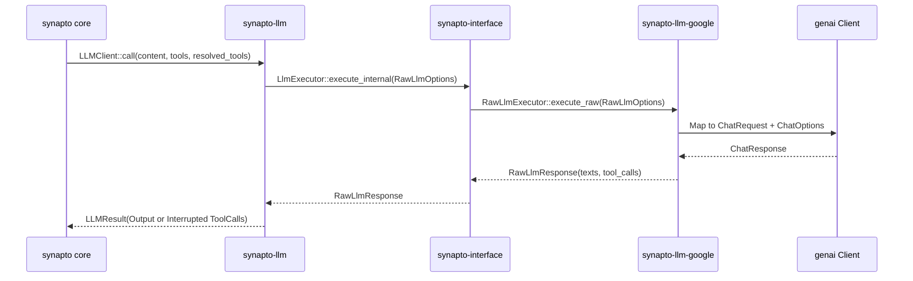

# [MVP] RFC: Decouple `genai` and `futures` from `synapto-interface`

> **Classification:** `Guideline` (Interface Boundary Purity & Zero Third-Party Leakage)

## 1. User-Centric Motivation & Goal

`synapto-interface` is the shared contract crate for every plugin, provider, and core crate in the Synapto ecosystem. Its specification (`synapto/crates/interface/README.md:5`) requires that `synapto-interface` stay free of unnecessary third-party dependencies so plugin crates remain fast to compile and isolated from breaking changes in external client libraries.

Currently, `synapto/crates/interface/Cargo.toml:23-24` depends on `genai = { version = "0.6" }` and `futures = "0.3.32"`, and `synapto/crates/interface/src/llm.rs:1` publicly re-exports `pub use genai;`. `RawLlmOptions` (`synapto/crates/interface/src/llm.rs:46-52`), `RawLlmExecutor` (`synapto/crates/interface/src/llm.rs:57-65`), and `LlmExecutor::execute_internal` (`synapto/crates/interface/src/llm.rs:125-135`) expose `genai::chat` types directly across the crate boundary, contradicting the doc comment on `RawLlmExecutor` (`synapto/crates/interface/src/llm.rs:54`: `"completely decoupled from any specific client library"`). In addition, `synapto/crates/llm/Cargo.toml:28` depends directly on `genai`, which prevents upgrading `genai` inside `synapto/integrations/llm-providers/google` (`synapto-llm-google`) independently of the core framework.

This RFC removes `genai` and `futures` from `synapto-interface`, removes `genai` from `synapto-llm`, replaces `genai::chat::*` types on the interface boundary with native `synapto_interface::llm` DTOs (Option A: Minimal YAGNI Contract), replaces `futures::future::join_all` in `synapto/crates/interface/src/context.rs:115` with `tokio::task::JoinSet`, and confines all `genai` usage to `synapto-llm-google`.

---

## 2. Executive Summary

- **Context:** `synapto/crates/interface/{Cargo.toml, src/llm.rs, src/context.rs, src/plugin.rs}`, `synapto/crates/llm/{Cargo.toml, src/lib.rs}`, `synapto/crates/core/src/cognitive/{types.rs, direct.rs, side.rs}`, `synapto/crates/test/src/lib.rs`, `synapto/integrations/plugins/tts-google/tests/tts_google_integration_test.rs`, and `synapto/integrations/llm-providers/google/src/lib.rs`.
- **Motivation:** Eliminate third-party LLM client library (`genai`) and `futures` leakage across `synapto-interface` and `synapto-llm` so provider upgrades (such as `genai` 0.7.5) remain isolated inside concrete LLM provider crates.
- **Overarching Goals:** Make `synapto-interface` and `synapto-llm` 100% vendor-neutral and client-library-agnostic.
- **Purpose:** Remove `genai` and `futures` from `synapto/crates/interface/Cargo.toml`, remove `genai` from `synapto/crates/llm/Cargo.toml`, define native `ToolDefinition`, `ToolCall`, `RawLlmResponse`, and `RawLlmOptions` types in `synapto_interface::llm`, update `ContextRegistryBuilder::gather_contexts` to use `tokio::task::JoinSet`, and perform `synapto_interface::llm` <-> `genai::chat` translation strictly inside `synapto-llm-google`.
- **Problem:**
  1. **Direct `genai` Dependency & Re-Export (`synapto/crates/interface/Cargo.toml:23`, `src/llm.rs:1, 46-65, 84-96, 125-135`):** `pub use genai;` exposes the entire `genai` crate through `synapto_interface::llm::genai`, and `RawLlmOptions`/`RawLlmExecutor`/`LlmExecutor` bind the public trait contract to `genai::chat::{ReasoningEffort, Tool, ToolCall, ChatMessage, ChatResponse}`.
  2. **Direct `genai` Dependency in Core LLM Layer (`synapto/crates/llm/Cargo.toml:28`, `src/lib.rs:4, 139-160, 212-218, 222-232, 241-274`):** `synapto-llm` is documented as provider-agnostic (`synapto/docs/src/ARCHITECTURE.md:198`), yet imports `genai::chat::{Tool, ToolCall, ReasoningEffort}` directly.
  3. **Direct `futures` Dependency (`synapto/crates/interface/Cargo.toml:24`, `src/context.rs:115`):** `RawLlmExecutor` and `RawDecisionExecutor` already use `#[async_trait]`. The only remaining `futures` usage in `synapto-interface` is `futures::future::join_all(futures).await` in `ContextRegistryBuilder::gather_contexts`, while `tokio` (with `rt` enabled) is already a dependency of `synapto-interface`.
- **Solution:**
  1. Define native `ToolDefinition`, `ToolCall` (using `crate::tool::ToolCallId` and opaque `provider_metadata: Option<serde_json::Value>`), and `RawLlmResponse` types in `synapto_interface::llm`, reuse `synapto_interface::llm::ReasoningEffort` in `RawLlmOptions`, drop the unused `messages` field from `RawLlmOptions`, and remove `pub use genai;` and the `genai` dependency from `synapto-interface` and `synapto-llm`.
  2. Replace `futures::future::join_all` in `synapto/crates/interface/src/context.rs:115` with `tokio::task::JoinSet` and remove `futures` from `synapto/crates/interface/Cargo.toml`.
  3. Update `synapto-core`, `synapto-test`, and test mocks to use the native `synapto_interface::llm` types.
  4. Translate between `synapto_interface::llm::*` and `genai::chat::*` (including removing `options.messages` handling) exclusively inside `synapto/integrations/llm-providers/google/src/lib.rs`.

---

## 3. Current State Analysis (Exact File & Line Inventory)

1. **`synapto/crates/interface/Cargo.toml:15, 23-24`**:
   ```toml
   tokio = { workspace=true, features = ["sync", "rt", "macros"] }
   ...
   genai = { version = "0.6" }
   futures = "0.3.32"
   ```
2. **`synapto/crates/interface/src/llm.rs:1, 27-34, 46-65, 84-96, 125-135`**:
   ```rust
   pub use genai;
   ...
   pub enum ReasoningEffort {
       #[default]
       None,
       Minimal,
       Low,
       Medium,
       High,
   }
   ...
   #[derive(Debug, Default, Clone)]
   pub struct RawLlmOptions {
       pub reasoning_effort: Option<genai::chat::ReasoningEffort>,
       pub tools: Option<Vec<genai::chat::Tool>>,
       pub resolved_tools: Option<Vec<(genai::chat::ToolCall, String)>>,
       pub output_schema: Option<schemars::Schema>,
       pub messages: Option<Vec<genai::chat::ChatMessage>>,
   }

   #[doc(hidden)]
   #[async_trait::async_trait]
   pub trait RawLlmExecutor: Send + Sync + 'static {
       async fn execute_raw(
           &self,
           model: &str,
           system_prompt: &str,
           prompt: &str,
           options: RawLlmOptions,
       ) -> Result<genai::chat::ChatResponse, String>;
   }
   ```
   `impl RawLlmExecutor for std::sync::Arc<T>` (`llm.rs:84-96`) and `LlmExecutor::execute_internal` (`llm.rs:125-135`) propagate `Result<genai::chat::ChatResponse, String>`.
3. **`synapto/crates/interface/src/context.rs:106-123`**:
   The only usage of `futures` in `synapto-interface` is:
   ```rust
   let results = futures::future::join_all(futures).await;
   ```
   Errors returned by `provider.erased_context(&request).await` are silently skipped (`if let Ok(val) = res`). (`RawDecisionExecutor` in `synapto/crates/interface/src/decision.rs:75-83` and `RawLlmExecutor` in `llm.rs:56-65` already use `#[async_trait]`.)
4. **`synapto/crates/interface/src/plugin.rs:186-198`**:
   Test helper `DummyLlmExecutor` implements `RawLlmExecutor` returning `Result<crate::llm::genai::chat::ChatResponse, String>`.
5. **`synapto/crates/llm/Cargo.toml:28` and `synapto/crates/llm/src/lib.rs:4, 107, 130, 139-160, 181-190, 212-239, 241-274, 301, 364`**:
   - Depends directly on `genai = { version = "0.6" }`.
   - Imports `use genai::chat::{Tool, ToolCall};`.
   - Maps `synapto_interface::llm::ReasoningEffort` to `genai::chat::ReasoningEffort` (`lib.rs:212-218`).
   - Builds `RawLlmOptions` with `messages: None` (`lib.rs:222-232`).
   - Serializes `current_tools` via `serde_json::to_string_pretty` behind `#[cfg(feature = "rerun")]` (`lib.rs:181-190`).
   - Consumes only `response_obj.tool_calls()` and `response_obj.texts().join("")` from `ChatResponse` (`lib.rs:241-274`).
   - Uses `ToolCall` fields `call_id`, `fn_name`, `fn_arguments`, and `thought_signatures` in `ToolCallFmt` (`lib.rs:139-160`).
6. **`synapto/crates/core/src/cognitive/types.rs:16, 25, 45, 68-169, 459-483`, `direct.rs:352-385, 697-710`, and `side.rs:211-235, 489-502`**:
   - `types.rs:16` imports `synapto_interface::llm::{LLMSafe, genai::chat::ToolCall}`.
   - `types.rs:459-483` constructs `Vec<synapto_interface::llm::genai::chat::Tool>` via `Tool::new(tool.name()).with_description(tool.description()).with_schema(schema)`.
   - `types.rs:69, 98, 140, 158` pass `call.call_id.clone()` into `CognitiveDirectState::{ToolExecuting, ToolResolved}` (`call_id: String`).
   - `direct.rs:370` and `side.rs:227` wrap `tool_call.call_id.clone()` in `synapto_interface::tool::ToolCallId(...)`, and `direct.rs:702` / `side.rs:494` copy `call.call_id.clone()` into `InFlightTool.id: String`.
7. **`synapto/crates/test/src/lib.rs:25-43` and `synapto/integrations/plugins/tts-google/tests/tts_google_integration_test.rs:47-55`**:
   - `MockLlmExecutor` (`test/src/lib.rs`) and `DummyLlmExecutor` (`tts-google`) implement `RawLlmExecutor` returning `genai::chat::ChatResponse`.
8. **`synapto/integrations/llm-providers/google/src/lib.rs:104-205`**:
   - `GoogleLlmExecutor::execute_raw` takes `RawLlmOptions` and returns `Result<genai::chat::ChatResponse, String>`.
   - Uses `options.reasoning_effort`, `options.output_schema`, `options.tools`, `options.resolved_tools`, and `options.messages` (`lib.rs:122-126`, currently unused by all callers).
   - Reads `call.thought_signatures` and `call.call_id` when building `ChatMessage::assistant_tool_calls_with_thoughts` and `ToolResponse::new`.
9. **External Consumers (`synapto-plugins` and `org-assistant`)**:
   - `synapto-plugins/documents/src/service.rs:815-818` uses only `synapto_interface::llm::{ModelConfig, ReasoningEffort}` and does not reference `genai`.
   - `org-assistant` does not reference `genai` in Rust source files.

---

## 4. Structural Hierarchy

- **Mission:** Pure, Zero-Third-Party Interface Contract (`synapto-interface`) and Provider-Agnostic LLM Client Layer (`synapto-llm`).
- **Goal:** Confine `genai` strictly to concrete LLM provider implementations (`synapto-llm-google`).
- **Atomic Responsibilities:**
  - **`synapto_interface::llm` (`crates/interface/src/llm.rs`):** Defines pure `serde`/`schemars` DTOs (`ReasoningEffort`, `ToolDefinition`, `ToolCall`, `RawLlmOptions`, `RawLlmResponse`) and `RawLlmExecutor`.
  - **`synapto_interface::context` (`crates/interface/src/context.rs`):** Executes `ContextProvider` futures concurrently using `tokio::task::JoinSet` without depending on `futures`.
  - **`synapto-llm` (`crates/llm/src/lib.rs`):** Provides typed `LLMClient` orchestration over `synapto_interface::llm` types without importing `genai`.
  - **`synapto-llm-google` (`integrations/llm-providers/google/src/lib.rs`):** Translates between `synapto_interface::llm::*` and `genai::chat::*`.

---

## 5. Data Models

### 5.1 Governing Architectural Rules
- **`synapto/crates/interface/README.md` Line 5:** `synapto-interface` must stay free of unnecessary third-party dependencies.
- **Rule 15 (`synapto/docs/src/ARCHITECTURE.md:42-46`):** Strong Typing & Newtype Pattern Mandate requires reusing domain newtypes such as `crate::tool::ToolCallId` instead of raw `String`.
- **Rule 26 (`synapto/docs/src/ARCHITECTURE.md:93-96`):** Encapsulated Handles and Shared Ownership via opaque `LlmExecutor` wrapping `Arc<dyn RawLlmExecutor>`.
- **Rule 33 (`synapto/docs/src/ARCHITECTURE.md:120-121`):** Pluggable Singleton LLM Provider decouples the concrete generative LLM backend from the core framework behind `LlmProvider`, `RawLlmExecutor`, and `LlmExecutor`.
- **Rule 34 & Section 6 (`synapto/docs/src/ARCHITECTURE.md:123-127, 169`):** Strict Interface Integrity & Platform-Agnostic Capabilities prohibit provider-specific fields (such as Gemini's `thought_signatures`) in `synapto-interface`; opaque provider state travels as `provider_metadata: Option<serde_json::Value>`.
- **Source Code Map (`synapto/docs/src/ARCHITECTURE.md:198`):** `crates/llm/` is the provider-agnostic LLM interface layer.

### 5.2 Native `synapto_interface::llm` Contract (Option A Selected)

Selected architectural option: **Option A (Minimal YAGNI Contract)**. Unused `RawLlmOptions.messages` is removed, `RawLlmResponse` exposes only `texts` and `tool_calls`, `ToolCall.call_id` uses the existing `crate::tool::ToolCallId` newtype, and provider continuation state is stored opaquely in `provider_metadata`.

```rust
// synapto/crates/interface/src/llm.rs

#[derive(
    Clone,
    Copy,
    Debug,
    serde::Serialize,
    serde::Deserialize,
    schemars::JsonSchema,
    PartialEq,
    Eq,
    Default,
)]
pub enum ReasoningEffort {
    #[default]
    None,
    Minimal,
    Low,
    Medium,
    High,
}

#[derive(Debug, Clone, PartialEq, Eq, serde::Serialize, serde::Deserialize)]
pub struct ToolDefinition {
    pub name: String,
    pub description: Option<String>,
    pub schema: Option<serde_json::Value>,
}

impl ToolDefinition {
    pub fn new(name: impl Into<String>) -> Self {
        Self {
            name: name.into(),
            description: None,
            schema: None,
        }
    }

    pub fn with_description(mut self, description: impl Into<String>) -> Self {
        self.description = Some(description.into());
        self
    }

    pub fn with_schema(mut self, schema: serde_json::Value) -> Self {
        self.schema = Some(schema);
        self
    }
}

#[derive(Debug, Clone, PartialEq, Eq, serde::Serialize, serde::Deserialize)]
pub struct ToolCall {
    pub call_id: crate::tool::ToolCallId,
    pub fn_name: String,
    pub fn_arguments: serde_json::Value,
    /// Opaque provider-specific continuation state (e.g., Gemini thought signatures)
    /// preserved across tool call round-trips without leaking vendor schema into the interface.
    pub provider_metadata: Option<serde_json::Value>,
}

#[derive(Debug, Clone, Default, PartialEq, Eq, serde::Serialize, serde::Deserialize)]
pub struct RawLlmResponse {
    pub texts: Vec<String>,
    pub tool_calls: Vec<ToolCall>,
}

#[derive(Debug, Default, Clone)]
pub struct RawLlmOptions {
    pub reasoning_effort: Option<ReasoningEffort>,
    pub tools: Option<Vec<ToolDefinition>>,
    pub resolved_tools: Option<Vec<(ToolCall, String)>>,
    pub output_schema: Option<schemars::Schema>,
}

#[doc(hidden)]
#[async_trait::async_trait]
pub trait RawLlmExecutor: Send + Sync + 'static {
    async fn execute_raw(
        &self,
        model: &str,
        system_prompt: &str,
        prompt: &str,
        options: RawLlmOptions,
    ) -> Result<RawLlmResponse, String>;
}
```

`LlmExecutor::execute_internal` (`synapto/crates/interface/src/llm.rs:125-135`) and `impl RawLlmExecutor for std::sync::Arc<T>` (`llm.rs:84-96`) update their return types from `Result<genai::chat::ChatResponse, String>` to `Result<RawLlmResponse, String>`.

### 5.3 JSON Contract Examples
_Not applicable (internal Rust trait boundary refactoring; LLM wire JSON formats and cognitive schemas remain identical)._

---

## 6. Component Architecture

### 6.1 Execution Flow Across Crate Boundaries
1. **Cognitive Core (`synapto`):**
   - `evaluate_dynamic_tools` (`synapto/crates/core/src/cognitive/types.rs:459-483`) builds `Vec<synapto_interface::llm::ToolDefinition>` after sanitizing each tool's JSON schema.
   - `RegistryToolExecutor` (`types.rs:69, 98, 140, 158`) reads `call.call_id.0.clone()` for `CognitiveDirectState::{ToolExecuting, ToolResolved}`.
   - `CognitiveDirect` (`direct.rs:370, 702`) and `CognitiveSide` (`side.rs:227, 494`) send `tool_call.call_id.clone()` directly on `resolve_in_flight_tool_tx` (removing the redundant `ToolCallId(...)` wrapper), use `call.call_id.0.clone()` for `InFlightTool.id`, and compare `t.id == *call.call_id` (via `Deref` in `side.rs:276, 284`).
2. **Typed LLM Orchestrator (`synapto-llm`):**
   - `LLMClient` (`synapto/crates/llm/src/lib.rs`) stores `Vec<ToolDefinition>`, accepts `Vec<ToolDefinition>` overrides and `Vec<(ToolCall, ToolOutput)>` resolved tools, and passes `synapto_interface::llm::ReasoningEffort` directly in `RawLlmOptions` (without `messages` and without mapping to `genai`).
   - `ToolCallFmt` (`lib.rs:139-160`) formats `call_id`, `fn_name`, `fn_arguments`, and redacts `provider_metadata` as `"Some(...)"` / `"None"`.
   - `LLMClient::call_inner` invokes `self.executor.execute_internal(...)` and reads `response.tool_calls` and `response.texts.join("")`.
   - No `genai` types appear anywhere in `synapto-interface`, `synapto-llm`, `synapto`, or `synapto-test`.
3. **Concrete Provider Adapter (`synapto-llm-google`):**
   - `GoogleLlmExecutor::execute_raw` (`synapto/integrations/llm-providers/google/src/lib.rs`) performs all `genai` mapping locally:
     - Removes the unused `if let Some(messages) = options.messages.clone()` loop (`lib.rs:122-126`).
     - Maps `synapto_interface::llm::ReasoningEffort` to `genai::chat::ReasoningEffort`.
     - Maps `ToolDefinition` to `genai::chat::Tool` (`Tool::new(name)` + optional `.with_description(...)` + optional `.with_schema(...)`).
     - Maps each `(ToolCall, String)` in `options.resolved_tools` back into `genai::chat::ToolCall` (struct literal with `call.call_id.0`, `call.fn_name`, `call.fn_arguments`, and `thought_signatures` deserialized from `call.provider_metadata` as `Option<Vec<String>>`, returning `Err(...)` if `Some(value)` fails to deserialize) and `genai::chat::ToolResponse::new(call.call_id.0, response)`.
     - Maps `genai::chat::ChatResponse` into `RawLlmResponse` by collecting `response.texts().into_iter().map(str::to_string).collect()` and converting each `genai::chat::ToolCall` into `synapto_interface::llm::ToolCall` (wrapping `call_id` in `ToolCallId` and populating `provider_metadata` only when `thought_signatures` is `Some(...)`, e.g. `tc.thought_signatures.as_ref().map(serde_json::to_value).transpose()`, returning `Err(...)` on serialization failure so `None` stays `None` rather than `Some(Value::Null)`).
4. **Concurrent Context Gathering (`synapto_interface::context`):**
   - `ContextRegistryBuilder::gather_contexts` (`synapto/crates/interface/src/context.rs:96-124`) spawns each `erased_context` call onto `tokio::task::JoinSet` (note: `JoinSet::spawn` requires an active Tokio runtime, already satisfied by `rt` in `synapto/crates/interface/Cargo.toml:15` and `tokio::spawn` in `context.rs:148`).
   - While draining `join_set.join_next().await`, it inserts `Ok((name, Ok(val)))` into the `BTreeMap`, logs `Ok((name, Err(e)))` via `tracing::warn!`, and logs `Err(e)` (`JoinError`) via `tracing::error!`, eliminating silent failures and removing the `futures` crate dependency.

### 6.2 Resource Ownership & Drift Audit
- **Exclusivity Check:** No `Option::take()` channel ownership or singleton registration state is changed. `LlmExecutor` continues to wrap `Arc<dyn RawLlmExecutor>` behind an opaque cheap-to-clone handle (Rule 26).
- **Channel Suitability:** No channels are added or modified; `RegistryToolExecutor` continues using `tokio::sync::mpsc` for resolved tool batches.

---

## 7. Architectural Diagrams

### 7.1 Decoupled Crate Dependency & Translation Boundary



### 7.2 `RawLlmExecutor` Translation Sequence



---

## 8. Robustness & Pragmatic Security Trade-offs

### 8.1 Hazard Analysis & Safeguards
- **Provider Continuation State Across Tool Turns:**
  - *Hazard:* Stripping or failing to forward provider continuation metadata (such as Gemini 3+ / Vertex `thought_signatures`) in `synapto_interface::llm::ToolCall` breaks multi-turn function calling validation.
  - *Mitigation:* `synapto_interface::llm::ToolCall` carries an opaque `pub provider_metadata: Option<serde_json::Value>` across both `RawLlmResponse::tool_calls` and `RawLlmOptions::resolved_tools`, and `GoogleLlmExecutor` serializes/deserializes `thought_signatures` exclusively inside `synapto-llm-google` (preserving `None` as `None` and returning `Err(String)` on serialization/deserialization failure rather than silently dropping signatures).
- **Silent Failure in Concurrent Context Gathering (`JoinSet`):**
  - *Hazard:* Replacing `futures::future::join_all` with `tokio::task::JoinSet` introduces `JoinError` (task panic or cancellation) alongside provider `Err(String)`.
  - *Mitigation:* `gather_contexts` matches both `Ok((name, Err(e)))` (logging `tracing::warn!`) and `Err(e)` (logging `tracing::error!`) rather than discarding `JoinError` with `.ok()` or `let _ =`.
- **Schema Compliance Boundary:**
  - *Hazard:* Untrusted or extended JSON schemas from dynamic plugin tools could fail provider validation if not sanitized before crossing `RawLlmExecutor`.
  - *Mitigation:* `clean_json_schema_for_llm` remains in `synapto/crates/core/src/cognitive/types.rs` prior to constructing `ToolDefinition`, preserving Rule 25 (Core Boundary Resilience).
- **Debug Log Redaction:**
  - `ToolCallFmt` in `synapto/crates/llm/src/lib.rs:139-160` summarizes `provider_metadata` as `"Some(...)"` / `"None"` so opaque provider payloads do not bloat trace logs.

### 8.2 Accepted Risks (MVP Scope)
- **Raw `messages` Injection & Usage Telemetry:** Dropping `RawLlmOptions.messages` and omitting `usage`, `stop_reason`, `reasoning_content`, and `response_id` from `RawLlmResponse` follows YAGNI for this MVP refactor. Adding multi-turn raw message overrides or token usage accounting later will require extending these two structs in `synapto-interface`.
- **Provider-Specific `genai` Upgrades:** Confining `genai` to `synapto-llm-google` means `genai` 0.7.x migration changes (`ClientBuilder::build() -> Result`, `ReasoningEffort::Zero`) will be handled in a separate follow-up upgrade inside `synapto-llm-google` without modifying `synapto-interface` or `synapto-llm`.

---

## 9. Systemic Consequences

### 9.1 Mechanical Codebase Audit (Target Files)
Searches for `genai`, `futures`, `RawLlmOptions`, `RawLlmExecutor`, `LlmExecutor`, `ReasoningEffort`, and `ToolCall` across `synapto`, `synapto-plugins`, and `org-assistant` identified the following exact files:

1. `synapto/crates/interface/Cargo.toml` - remove `genai` and `futures` dependencies.
2. `synapto/crates/interface/src/llm.rs` - remove `pub use genai;`, add `ToolDefinition`, `ToolCall` (using `crate::tool::ToolCallId` and `provider_metadata`), `RawLlmResponse`, update `RawLlmOptions` (removing `messages`), `RawLlmExecutor`, `impl RawLlmExecutor for Arc<T>`, and `LlmExecutor::execute_internal`.
3. `synapto/crates/interface/src/context.rs` - replace `futures::future::join_all` with `tokio::task::JoinSet` and explicit error/panic logging.
4. `synapto/crates/interface/src/plugin.rs` - update `DummyLlmExecutor` test mock return type to `Result<crate::llm::RawLlmResponse, String>`.
5. `synapto/crates/llm/Cargo.toml` - remove `genai` dependency.
6. `synapto/crates/llm/src/lib.rs` - import `ToolDefinition`, `ToolCall`, `ReasoningEffort` from `synapto_interface::llm`, remove `genai::chat::ReasoningEffort` mapping, construct `RawLlmOptions` without `messages`, redact `provider_metadata` in `ToolCallFmt`, and read `response.tool_calls` and `response.texts.join("")`.
7. `synapto/crates/core/src/cognitive/types.rs` - import `ToolCall` and `ToolDefinition` from `synapto_interface::llm` and extract `call.call_id.0.clone()` for `CognitiveDirectState`.
8. `synapto/crates/core/src/cognitive/direct.rs` & `synapto/crates/core/src/cognitive/side.rs` - pass `tool_call.call_id.clone()` directly as `ToolCallId` and use `call.call_id.0.clone()` for `InFlightTool.id`.
9. `synapto/crates/test/src/lib.rs` - update `MockLlmExecutor::execute_raw` to return `Ok(synapto_interface::llm::RawLlmResponse::default())`.
10. `synapto/integrations/plugins/tts-google/tests/tts_google_integration_test.rs` - update `DummyLlmExecutor::execute_raw` return type to `Result<synapto_interface::llm::RawLlmResponse, String>`.
11. `synapto/integrations/llm-providers/google/src/lib.rs` - remove `options.messages` loop, translate `synapto_interface::llm::{ReasoningEffort, ToolDefinition, ToolCall}` <-> `genai::chat::*` (including `provider_metadata` <-> `thought_signatures`), and map `genai::chat::ChatResponse` -> `RawLlmResponse`.
12. `synapto/Cargo.lock` - regenerated by Cargo (`genai` no longer linked by `synapto-interface` or `synapto-llm`).

No Rust files in `synapto-plugins` or `org-assistant` import `genai` or construct `RawLlmOptions` / `RawLlmResponse`.

### 9.2 Breaking Changes & Performance Impact
- **Internal API Breaking Changes:** Any external `RawLlmExecutor` implementation or caller referencing `synapto_interface::llm::genai` must migrate to `synapto_interface::llm::{ToolDefinition, ToolCall, RawLlmOptions, RawLlmResponse}`.
- **Build & Compile-Time Impact:** Removing `genai` and `futures` from `synapto-interface` removes `reqwest`, TLS, and SSE dependencies from the interface crate graph, accelerating incremental builds for all plugins in `synapto-plugins` and `synapto/integrations/plugins/*`.
- **Runtime Latency & Memory:** Translating `ToolDefinition`/`ToolCall`/`RawLlmResponse` in `synapto-llm-google` performs small string/JSON conversions once per LLM turn, negligible compared to network I/O. Using `tokio::task::JoinSet` in `gather_contexts` preserves concurrent execution of all `ContextProvider` calls.

### 9.3 Documentation Updates
- `synapto/docs/src/ARCHITECTURE.md`: Update line 21 (`Strongly-Typed LLM Interfaces`) so it remains vendor-neutral (e.g., `"behind the provider-agnostic synapto-interface contract"` instead of referencing `genai`).
- `synapto/crates/interface/README.md`: No change required; line 5 already specifies that `synapto-interface` must stay free of unnecessary third-party dependencies, and this RFC brings the code into compliance.

---

## 10. Definition of Done (DoD)

- [x] Remove `genai` and `futures` from `synapto/crates/interface/Cargo.toml`.
- [x] Remove `pub use genai;` from `synapto/crates/interface/src/llm.rs`, define `ToolDefinition`, `ToolCall` (with `crate::tool::ToolCallId` and `provider_metadata: Option<serde_json::Value>`), and `RawLlmResponse`, remove `messages` from `RawLlmOptions`, and update `RawLlmOptions`, `RawLlmExecutor`, `impl RawLlmExecutor for Arc<T>`, and `LlmExecutor::execute_internal`.
- [x] Replace `futures::future::join_all` in `synapto/crates/interface/src/context.rs` with `tokio::task::JoinSet` with explicit error/panic logging.
- [x] Update `DummyLlmExecutor` in `synapto/crates/interface/src/plugin.rs` to return `RawLlmResponse`.
- [x] Remove `genai` from `synapto/crates/llm/Cargo.toml` and update `synapto/crates/llm/src/lib.rs` to use `synapto_interface::llm::{ReasoningEffort, ToolCall, ToolDefinition, RawLlmResponse}` and redact `provider_metadata` in `ToolCallFmt`.
- [x] Update `synapto/crates/core/src/cognitive/{types.rs, direct.rs, side.rs}` to use `synapto_interface::llm::{ToolCall, ToolDefinition}` and typed `ToolCallId`.
- [x] Update `MockLlmExecutor` in `synapto/crates/test/src/lib.rs` and `DummyLlmExecutor` in `synapto/integrations/plugins/tts-google/tests/tts_google_integration_test.rs` to return `RawLlmResponse`.
- [x] Update `GoogleLlmExecutor` in `synapto/integrations/llm-providers/google/src/lib.rs` to remove `options.messages` handling and translate between `synapto_interface::llm::*` and `genai::chat::*`.
- [x] Update `synapto/docs/src/ARCHITECTURE.md` line 21 to keep the LLM interface description vendor-neutral.
- [x] Verify `synapto/Cargo.lock` is updated and `synapto-interface` / `synapto-llm` no longer pull `genai` or `futures`.
- [x] Verify `cargo fmt --all --check`, `cargo clippy --workspace --all-targets --all-features -- -D warnings`, and `cargo test --workspace --all-targets` pass in `synapto`.
- [x] Verify `synapto-plugins` (`cargo check --workspace --all-targets`) and `org-assistant` (`cargo check --config dev-config.toml --workspace --all-targets`) compile cleanly against the updated `synapto-interface`.
