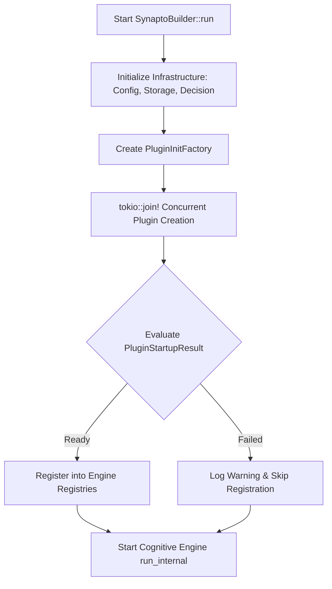
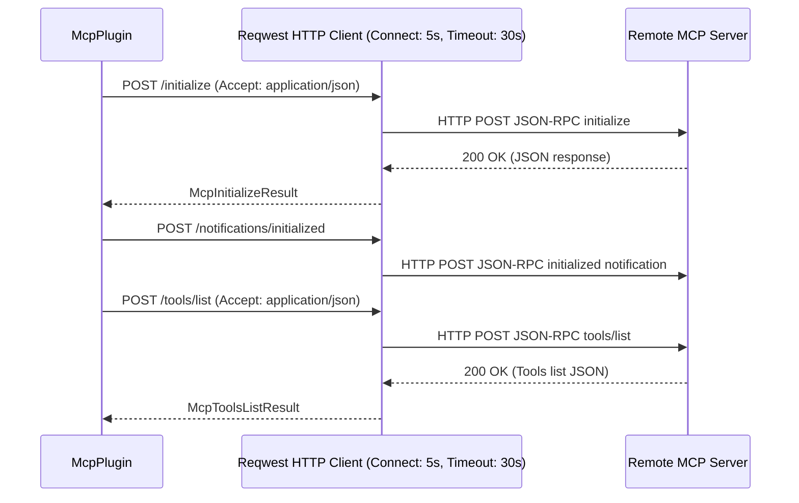

# [MVP] [DRAFT] Framework Stability and Runtime Reliability Hardening

> **Draft Status:** Reproduced (`rfcs/reproduced/`) — Failing scenario test `rfc_2026_09_20_runtime_stability_and_smells_remediation` verified in `synapto/crates/test/tests/scenario_tests.rs`; all 10 sections drafted, awaiting Lead Architect Phase 6 approval to move to `approved/2026-09-20-runtime-stability-and-smells-remediation.md`.
> **Next Step on Resume:** Perform Pre-Implementation Recheck and seek explicit Phase 6 approval from the Lead Architect.

## 1. User-Centric Motivation & Goal
When running an AI assistant, users expect it to boot reliably and stay operational even when network conditions degrade, remote APIs experience downtime, or plugins encounter unexpected states.

Currently, if an external service or remote tool server (such as an MCP provider or cloud speech endpoint) hangs or drops connection packets during startup or execution, the entire assistant freezes indefinitely without explanation. Furthermore, non-fatal issues (like a single offline tool provider) cause catastrophic process panics rather than graceful degradation.

Hardening framework runtime boundaries ensures the assistant boots in bounded time, isolates external network failures, reports intelligible error messages, and continues operating with remaining capabilities when external services fail.

---

## 2. Executive Summary
- **Context:** Synapto orchestrates background cognitive loops, tool execution, memory synchronization, and speech processing across modular plugins and cloud integrations (`synapto-core`, `synapto-interface`, and plugins in `integrations/`).
- **Motivation:** An audit of the core boot sequence and external integration layers revealed multiple critical code smells that impair stability: unbound network requests with infinite timeouts, blocking channel primitives inside asynchronous Tokio task contexts, panic-based failure modes, and protocol framing mismatches in external tool connectors.
- **Overarching Goals:** Establish robust, production-grade reliability across Synapto's runtime infrastructure by enforcing deterministic timeouts, non-blocking asynchronous communication boundaries, graceful error degradation, and protocol correctness.
- **Purpose:** Document and resolve four systemic runtime stability code smells across `synapto-core`, `synapto-plugin-mcp`, `synapto-decision-typesafe`, `synapto-credentials-google`, and `synapto-plugin-tts-google`.
- **Problem:**
  1. **Unbounded Network Clients:** Outbound `reqwest::Client` instances are instantiated without explicit timeouts, allowing remote hangs to block the assistant indefinitely.
  2. **Protocol Mismatch in Remote MCP:** `synapto-plugin-mcp` sends `Accept: text/event-stream` while awaiting single-shot JSON bodies, causing compliant MCP SSE servers to open hanging streams.
  3. **Blocking Synchronous Channel in Async Task:** Storing `std::sync::mpsc::Receiver` in `Synapto` and passing it to async `GuiPlugin::start` forces blocking synchronization in Tokio task loops.
  4. **Panic-as-Error-Handling on Boot:** Plugin setup relies on `panic!`, causing full process termination on transient external errors.
- **Solution:**
  1. Configure explicit client-wide connection (5s) and request (30s) timeouts on all outbound HTTP/transport clients directly at instantiation time.
  2. Correct remote MCP HTTP header contracts to specify `Accept: application/json` for standard HTTP JSON-RPC transports.
  3. Replace `std::sync::mpsc` channels with asynchronous `tokio::sync::mpsc` channels across core and telemetry error boundaries.
  4. Convert panic points in `PluginInitFactory::init_plugin` to structured error logging and fault-tolerant plugin omission.

---

## 3. Current State Analysis

### 3.1 Unbounded Network I/O (Missing HTTP Timeouts)
In `synapto-plugin-mcp`, `synapto-decision-typesafe`, `synapto-credentials-google`, and `synapto-plugin-tts-google`, HTTP clients are initialized via:
```rust
let client = reqwest::Client::new();
// or
let client = reqwest::Client::builder().default_headers(header_map).build()?;
```
`reqwest` defaults to no request timeout. If an endpoint hangs at the TCP handshake, TLS negotiation, or response streaming phase, the calling Tokio task waits forever. In the case of decision providers or plugins initializing at boot, this freezes the application lifecycle.

### 3.2 Protocol Asymmetry in Remote MCP Client
In `synapto/integrations/plugins/mcp/src/lib.rs` (`connect_remote_mcp_server`):
```rust
header_map.insert(
    reqwest::header::ACCEPT,
    reqwest::header::HeaderValue::from_static("application/json, text/event-stream, */*"),
);
```
The client advertises acceptance of `text/event-stream`. When connecting to MCP servers powered by standard frameworks (such as FastMCP or Python MCP SDK), the presence of `text/event-stream` triggers SSE streaming mode. The server keeps the HTTP connection open to stream server-sent events. However, `connect_remote_mcp_server` awaits `.json::<JsonRpcResponse>()`, which waits for EOF. Because the SSE stream remains open indefinitely, the request never completes.

### 3.3 Blocking Synchronous Channel in Async Context
In `crates/core/src/lib.rs`:
```rust
pub struct Synapto<...> {
    ...
    error_rx: Option<std::sync::mpsc::Receiver<String>>,
    ...
}
```
`std::sync::mpsc::Receiver` is a blocking synchronization primitive. When passed into `GuiPlugin::start` (an `async fn`), calling `.recv()` blocks the underlying Tokio worker thread, risking thread starvation across the async runtime.

### 3.4 Panic-Driven Error Handling on Boot Path
In `PluginInitFactory::init_plugin`:
```rust
let plugin_result = P::create(&init_context).await;
Arc::new(plugin_result.unwrap_or_else(|e| {
    panic!("Failed to initialize plugin '{}': {}", plugin_identity, e)
}))
```
If an optional tool plugin (e.g., `McpPlugin`) fails to reach a third-party server during boot, the application panics. The core provides no mechanism to log the failure, mark the plugin as degraded/omitted, and proceed with core speech and assistant capabilities.

---

## 4. Structural Hierarchy

- **Mission:** Systemic Framework Hardening.
- **Goal:** Resilient, Non-Blocking, Fault-Tolerant Runtime.
- **Atomic Responsibilities:**
  - **Direct Client Timeout Hardening:** Enforces explicit connection (5s) and request (30s) timeouts on all outbound `reqwest::Client` instances directly in each consumer crate using local constants.
  - **`McpHttpTransport`:** Enforces strict protocol alignment by requesting `Accept: application/json` for standard HTTP JSON-RPC calls.
  - **`AsyncTelemetryChannel`:** Employs `tokio::sync::mpsc` for GUI error layers, ensuring non-blocking async event consumption.
  - **`FaultTolerantBoot`:** Permits plugin initialization failure during `SynaptoBuilder::run` by logging warnings and continuing without the failed plugin.

---

## 5. Data Models

### 5.1 Hardcoded Timeout Constants
Per `ARCHITECTURE.md` Rule 28 (Explicit Configuration Mandate), operational timeouts for framework runtime clients are hardcoded framework engine constants rather than defaulted configuration fields. In each HTTP-consuming crate:
```rust
const CONNECT_TIMEOUT: std::time::Duration = std::time::Duration::from_secs(5);
const REQUEST_TIMEOUT: std::time::Duration = std::time::Duration::from_secs(30);
```

### 5.2 Fault-Tolerant Plugin Startup Result
In `synapto/crates/core/src/lib.rs`:
```rust
pub enum PluginStartupResult<P> {
    Ready(std::sync::Arc<P>),
    Failed { plugin_identity: String, error: String },
}
```

---

## 6. Component Architecture

### 6.1 Bounded HTTP Client Configuration
Every outbound `reqwest::Client` instance MUST explicitly specify timeouts via `Client::builder()`:
```rust
let client = reqwest::Client::builder()
    .connect_timeout(CONNECT_TIMEOUT)
    .timeout(REQUEST_TIMEOUT)
    .build()
    .expect("Failed to build HTTP client with static timeout configuration");
```
Constructors returning `Self` synchronously (such as `GoogleCredentials::new` and `TypeSafeDecisionExecutor::new`) use `.expect(...)` because client builder failure only occurs under catastrophic TLS backend initialization failure.

### 6.2 Asynchronous Telemetry Error Channel
Replace `std::sync::mpsc` with `tokio::sync::mpsc`:
- `GuiErrorLayer` in `synapto-telemetry` receives `tokio::sync::mpsc::UnboundedSender<String>`.
- `GuiPlugin::start` receives `tokio::sync::mpsc::UnboundedReceiver<String>`.
- `Synapto` stores `Option<tokio::sync::mpsc::UnboundedReceiver<String>>`.

### 6.3 Fault-Tolerant Plugin Attachment
In `PluginInitFactory`:
```rust
async fn init_plugin<P: Plugin>(&self) -> PluginStartupResult<P> {
    let full_path = core::any::type_name::<P>();
    let base_path = full_path.split('<').next().unwrap_or(full_path);
    let plugin_identity = base_path.to_string();
    ...
    match P::create(&init_context).await {
        Ok(plugin) => PluginStartupResult::Ready(Arc::new(plugin)),
        Err(e) => {
            tracing::warn!("Plugin '{}' failed to initialize and was skipped: {}", plugin_identity, e);
            PluginStartupResult::Failed { plugin_identity, error: e }
        }
    }
}
```
In `Synapto`:
```rust
fn attach_plugin<P: Plugin>(&mut self, startup_result: PluginStartupResult<P>) {
    if let PluginStartupResult::Ready(plugin) = startup_result {
        let full_path = core::any::type_name::<P>();
        let base_path = full_path.split('<').next().unwrap_or(full_path);
        let plugin_identity = base_path.to_string();
        self.plugins_names.push(plugin_identity.clone());

        let type_id = std::any::TypeId::of::<P>();
        self.plugins.insert(type_id, plugin.clone());
        tracing::info!("Plugin {} registered.", plugin_identity);

        plugin.register(self);
    }
}
```

---

## 7. Architectural Diagrams

### 7.1 Hardened Plugin Boot Flow



### 7.2 Remote MCP Handshake Flow



---

## 8. Robustness & Pragmatic Security Trade-offs

### 8.1 Accepted Risks (MVP)
- **Restricted Remote MCP Transport:** Remote MCP support in MVP is targeted at single-endpoint HTTP JSON-RPC servers. MCP servers strictly requiring bidirectional Server-Sent Events (SSE) with stream listeners will be supported via a dedicated SSE transport actor in a future RFC.
- **Atomic Plugin Failure Granularity:** For MVP, `McpPlugin::create` treats all configured servers as an atomic unit. If one configured MCP server fails to connect, `McpPlugin::create` returns an error, resulting in `PluginStartupResult::Failed` and omitting all MCP tools while allowing the assistant core to boot cleanly. Per-server partial fault tolerance is deferred to future work.
- **Plugin Channel Handoff Mutexes:** Memory plugins (`BehavioralMemoryPlugin`, `SemanticMemoryPlugin`, `EpisodicMemoryPlugin`) using `Mutex<Option<T>>` to transfer channels from `create` to `register` are preserved for MVP; channel lifecycle unification is deferred to a future plugin architecture RFC.

### 8.2 Security & Reliability Mitigations
- **Timeout Isolation:** Unresponsive external servers trigger connection or request timeouts (5s / 30s), preventing the process from deadlocking.
- **Fail-Safe Startup:** Plugin instantiation errors are caught and logged; non-functional plugins do not prevent the assistant from booting with healthy components.

---

## 9. Systemic Consequences

### Audit of Dependent Files
- `synapto/crates/core/src/lib.rs` (`error_rx`, `PluginInitFactory`, `SynaptoBuilder`, `GuiSpawner`)
- `synapto/crates/interface/src/gui.rs` (`GuiPlugin`, `PluginRegistry::register_gui`)
- `synapto/crates/telemetry/src/tracing.rs` (`GuiErrorLayer`)
- `synapto/integrations/plugins/mcp/src/lib.rs` (`connect_remote_mcp_server`)
- `synapto/integrations/decision-providers/typesafe/src/lib.rs` (`TypeSafeDecisionExecutor`)
- `synapto/integrations/plugins/tts-google/src/lib.rs` (`run_google_tts`)
- `synapto/integrations/credentials-providers/google/src/lib.rs` (`GoogleCredentials`)

### Breaking Changes
- `GuiPlugin::start` interface changes from accepting `std::sync::mpsc::Receiver<String>` to `tokio::sync::mpsc::UnboundedReceiver<String>`.
- `GuiSpawner` type alias changes from accepting `std::sync::mpsc::Receiver<String>` to `tokio::sync::mpsc::UnboundedReceiver<String>`.
- `GuiErrorLayer::new()` return type changes from `(Self, std::sync::mpsc::Receiver<String>)` to `(Self, tokio::sync::mpsc::UnboundedReceiver<String>)`.
- `Synapto` field `error_rx` changes from `Option<std::sync::mpsc::Receiver<String>>` to `Option<tokio::sync::mpsc::UnboundedReceiver<String>>`.

### Documentation Impact
- Update `synapto/docs/src/ARCHITECTURE.md` to document the Bounded HTTP Client Policy (mandatory connect/request timeouts on outbound clients).

---

## 10. Definition of Done (DoD)

- [ ] Add explicit timeouts (connect: 5s, request: 30s) to `reqwest::Client` in `synapto-plugin-mcp`, `synapto-decision-typesafe`, `synapto-plugin-tts-google`, and `synapto-credentials-google`.
- [ ] Change `Accept` header in `synapto-plugin-mcp` (`connect_remote_mcp_server`) to `application/json`.
- [ ] Migrate `GuiErrorLayer`, `GuiPlugin`, and `GuiSpawner` from `std::sync::mpsc` to `tokio::sync::mpsc`.
- [ ] Implement `PluginStartupResult` in `PluginInitFactory::init_plugin` and `attach_plugin` to allow graceful degradation when an optional plugin fails.
- [ ] Update `synapto/docs/src/ARCHITECTURE.md` with outbound client timeout requirements.
- [ ] Run `cargo test --workspace` across `synapto-ai`.
- [ ] Verify `allusio-ai/alfons` boots cleanly without hanging on `just run`.
